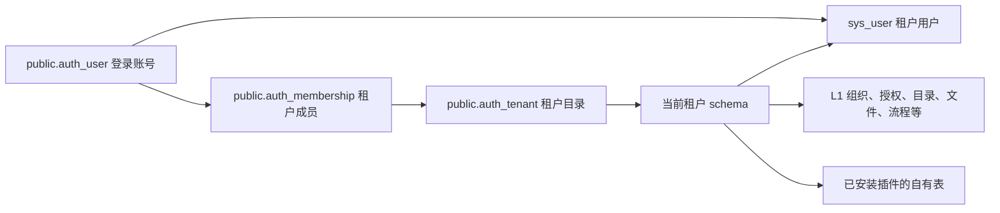

# 开源底座数据库设计

本页解释当前 L1 数据边界；强制字段规则见 [命名与建模规范](database-naming-convention.md)，已注册表见 [底座表目录](core-table-catalog.md)。

## 1. Schema 与身份

| 位置 | 拥有什么 | 不承担什么 |
| --- | --- | --- |
| public | auth_ 登录认证、租户目录、成员关系、租户插件安装/启停状态 | 不保存工单、学生、库存等业务事实，不引用租户业务表 |
| t_<租户编号> | 该租户的 L1 表及已安装插件表；按组织和权限进一步限制访问 | 不加 tenant_id，不跨租户外键，不写死 t_edu 等 schema |

public.auth_user 是登录账号；sys_user 是该账号在一个租户内的操作身份；md_party / md_person 是主体和自然人。它们通过关系协作，不能互相替代。认证审计引用 public.auth_user，租户业务审计引用 sys_user。

图表示身份与访问关系，不代表 public 向租户表建立外键。请求只使用认证会话确定的租户，事务级 search_path 由统一会话管理。

## 2. 表与字段约定

- 主键 UUIDv7；业务表不指定固定 schema。普通表复用标准审计字段和 flex_form，业务组织引用 sys_org。追加事实、日志等按规范例外处理。
- 命名、时间、金额、字典、唯一性、软删除及中文注释统一按规范执行；规划前缀不代表存在对应功能。
- 跨插件外键引用必须声明依赖。共享 md_ 前缀的表仍分别归属，不能因为在同一 schema 就直接写其他模块数据。
- ORM 定义用于表达当前结构；迁移保留实际演进历史；文档及生成快照不代替数据库升级。

## 3. 迁移所有权

| 范围 | 版本目录 | 版本记录 |
| --- | --- | --- |
| public 认证与租户目录 | plugins/core/backend/alembic/versions/public/ | public.auth_alembic_version |
| 租户 L1 独立基线 | plugins/core/backend/alembic/versions/core/ | 目标租户 schema 的 alembic_version |
| 各业务插件 | plugins/core/backend/alembic/versions/plugins/<key>/ | 同一租户的 alembic_version，独立分支及明确依赖 |

新库先显式初始化 public 和 L1；为租户启用业务插件时执行相应分支及依赖的必要迁移和开通步骤。只把插件加入 deployment、导入源码或阅读设计不会创建业务表。已有业务库继续原升级路径，不能直接换成新 core 基线。

pgvector 扩展的服务端准备与目标库启用见 [底座说明](../core-open-source.md#postgresql-扩展检查)。迁移和初始化的执行须确认目标及授权。

## 4. 业务设计与 AI 元数据

插件在自己的 docs 目录维护领域模型与实现差距，在模块内维护实际 ORM。AI 的表/字段白名单、范围条件和人工策略不能由全量数据字典自动放宽；文档中的自由 SQL 示例不是生产 AI 工具权限。

结构变化后按既有 CLI 独立同步表快照、接口快照及索引。该流程不会因为更新本页或启动服务自动运行。
