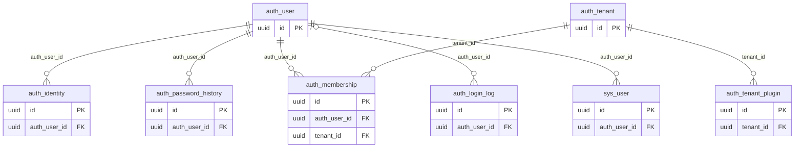
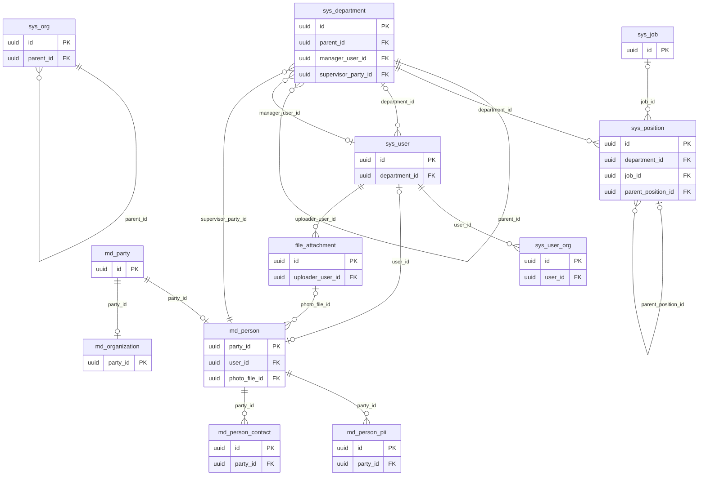
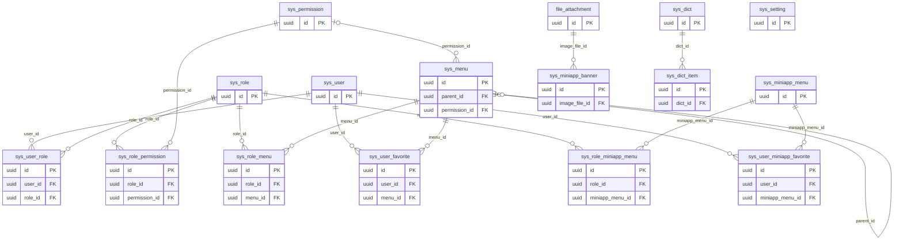
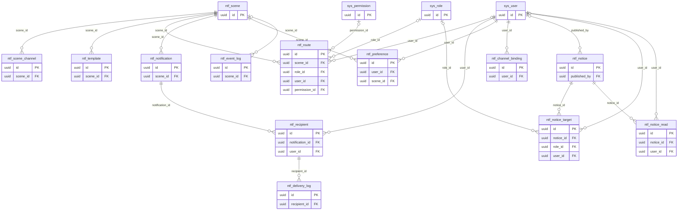
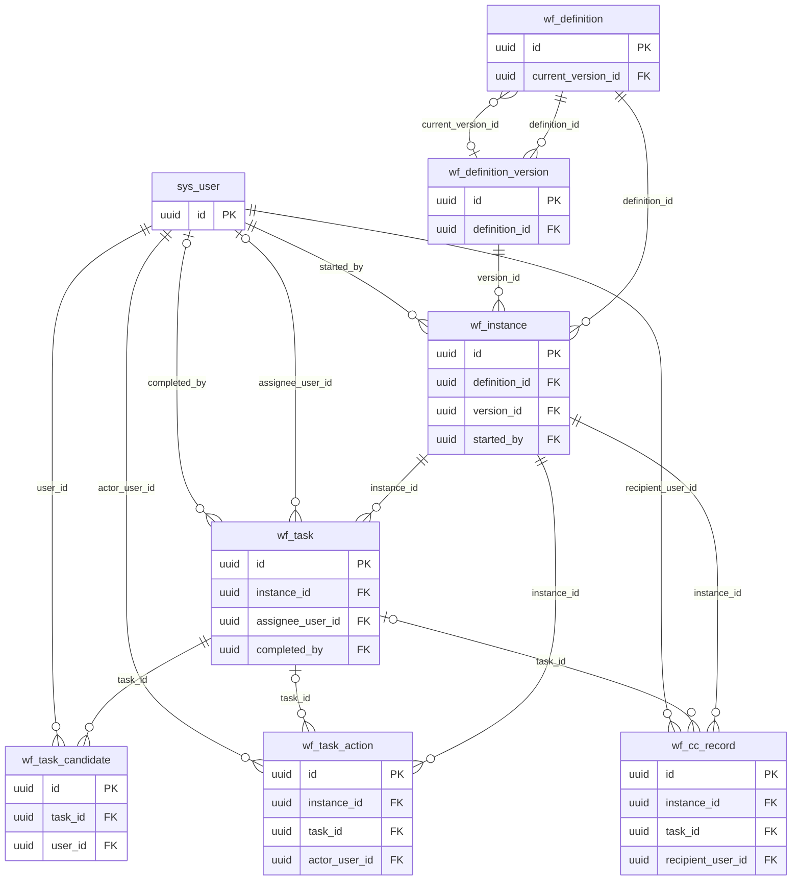
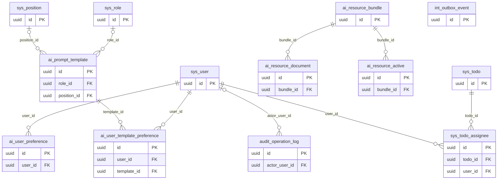

# 当前项目 ER 图

核对日期：2026-11-11。图以当前源码模型和根目录 `deployment.json` 为准：当前部署组合为 core，包含 `public` 认证/租户目录与租户 schema 的 L1 管理底座，共 63 张 ORM 表。未连接数据库核对实际已迁移结构；`plugins` 为空，因此未纳入未部署的 L2/L3 业务表。

图中展示表的主键及业务外键。为便于阅读，公共 `org_id`、`created_by`、`updated_by`、`deleted_by` 外键不在每张表重复展开；租户表的 `org_id` 由公共字段工厂声明并引用 `sys_org.id`，租户审计用户字段引用 `sys_user.id`，`public` 认证表的审计用户字段引用 `public.auth_user.id`。代码标识 `_code` 通常是逻辑字典引用，并非数据库外键。`sys_todo.source_id`、`int_outbox_event` 等多态/事件来源也不是统一外键。

## 登录、租户与用户身份

`auth_*` 表位于 `public` schema；`sys_user` 位于当前租户 schema。认证账号与租户内用户之间通过 `sys_user.auth_user_id` 关联。租户成员关系由开通/停用流程维护，不从 `public` 外键到租户表。

## 组织、人事主数据与文件

`md_person` 与 `md_organization` 是 `md_party` 的 1:1 子类型。`md_person.user_id` 在模型上唯一；有租户账号的人可关联一条人员记录。

## 角色、权限、菜单与字典

`sys_setting`、`sys_miniapp_menu` 本身没有数据库外键。页面、权限和小程序菜单目录的业务标识由目录声明与代码契约关联；所有 `_code` 到字典项的引用属于逻辑引用，不在本图中画成外键。

## 通知与公告

## 工作流与审批

## AI 上下文、资源索引、待办与系统事件

`sys_todo.source_id` 是由 `todo_type_key` 对应处理器解释的多态来源 ID；`int_outbox_event` 按事件契约保存来源信息，因此这两类来源关系没有统一数据库外键。
