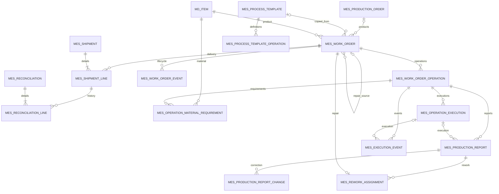

# MES 数据库实现说明

## 工单工艺变更

`mes_work_order_process_change` 保存变更前后工艺、剩余数量、已报合格数量、处置方式、审批实例及关联返修工单。原工单在审批和处置期间暂停，变更生效后按提交前状态恢复。工序继续沿用原任务 ID 和计划总量，并保留历史执行、报工、质检记录及累计产量。`mes_production_report.operation_name_snapshot` 在工艺切换时保存已有报工的当时名称。返修工单向原工单交回合格件，库存汇总中只计原工单的成品数量。

在仓库根目录执行以下命令，将 `t_actual` 换成目标租户 schema：

```powershell
python scripts/erp.py db revision --plugin mes --schema t_actual
# 审核新增变更单、工单标记和报工名称快照，保留原有记录。
python scripts/erp.py db upgrade --plugin mes --schema t_actual
python scripts/erp.py dev sync --plugin mes --schema t_actual
```

开发同步或应用管理升级会补齐缺失的「MES 工艺变更审批」，并发布默认版本，保留租户已有的默认定义。只执行数据库迁移时，需再补齐本租户配置。若提交提示缺少流程，在「流程定义」中核对业务类型「MES 工艺变更」、适用组织、当前已发布版本和「启用」「组织默认流程」两个开关。审批人需拥有 `mes:process_change:approve`。发起和安排处置使用工单查询、管理权限，其中生成返修还需要工单创建权限，登记复检结果需要质检处置权限。使用 Harness 的环境升级后执行 `python scripts/erp.py ai sync --schema t_actual` 更新目录。按需并经授权使用 `--index` 重建检索索引。

## 询价报价

销售询价状态字典 `mes_quotation_status` 增加 `final_review`（待复审）和 `voided`（已作废）。`review` 为待初审，`quoted` 为审核完成。初审后复审通过、退回初审和作废分别记录为 `mes_quotation_event.action_key` 的 `final_approve`、`final_reject`、`void`，沿用事件的操作人、时间、版本和备注字段。

已有环境需更新同编号仅允许一个进行中修订的部分唯一索引。将命令中的 `t_actual` 替换为实际租户 schema，在仓库根目录运行：

```powershell
python scripts/erp.py db revision --plugin mes --schema t_actual
# 审核生成的差异：以 uk_mes_quotation_open_revision 替换 uk_mes_quotation_pending_revision，排除审核通过、已作废和已删除的修订，并更新状态字段注释。
python scripts/erp.py db upgrade --plugin mes --schema t_actual
python scripts/erp.py dev sync --plugin mes --schema t_actual
```

迁移保留原业务单据；开发配置同步补齐新增的状态字典值。部署环境按现有套件升级流程更新配置。使用 Harness 的环境在升级后执行 `python scripts/erp.py ai sync --schema t_actual` 更新目录，需要重建检索索引时按授权加 `--index`。见[数据库维护](../../core/docs/database-workflow.md)。

AI 报价工艺对接新增 `mes_cnc_operation.process_id`（真实工艺外键）和 `process_no_snapshot`（选用时编号）。既有 `name` 保存选用时的工艺名称；计价规则另由 `quote_rule_no` 保存，不能用通用计价类别代替生产档案。采用时冻结、生成工单时重新鉴权；操作及升级见[询价转生产](README.md)。


0.8.0 新增 `mes_resource_calendar_exception` 及 `schedule_models.py` 的8张表：工序阶段参数、工单就绪、检验安排、方案、方案工序、方案阶段、实际生产批次、首件准入。方案时间不是执行/检验事实；执行与质量事实以外键关联真实批次。工艺增加执行类别/机器需求，工序及路线明细保留机器需求快照，生产执行/检验增加批次及资源字段。新增结构须在目标环境生成、审核并执行迁移，不改写已发布基线；操作见[生产排程](README.md#阅读顺序)。


外部迁入新增 `mes_external_import_row` 保存不可变来源行及真实外键，不代替业务事实；项目增加来源款数/完整性，工单增加制造要求字段，工序快照不伪造历史排程。库存由 inv 公开能力记账。

订单明细新增可空 `discount_rate numeric(5,4)`，明确记录成交折扣倍率（1 为不打折、0.7 为七折），空值保留历史或手动价语义；原始报价和成交单价分别保存。需按环境生成审核迁移，见[询价转订单与生产操作](README.md)。

2026-11-06：数量档、真实客户订单及订单转生产新增六张 MES 表，生产项目/执行工单增加来源订单外键。模型、关系、原价快照、权限及迁移说明统一见[询价转订单与生产操作](README.md)。升级以目标库生成的迁移差异为准。

配置产品与工序时支持选路线自动带入产品，以及把当前工序另存为专用/通用路线；复用原表及路线管理权限，无新增字段。操作见主设计 [MES 档案管理](README.md#当前架构的适用规则)。

产品执行工单另保存 `mes_work_order.processing_type_code`（字典 `mes_processing_type`）：自制/委外，默认自制，与生产/返修类型独立；执行后不能更改。不扩展 inv 共享物料，升级见仓库主设计 [MES 验证](../../core/docs/mes-plugin-integration.md#业务使用)。

工序列表最新增加时间悬浮卡及报工记录入口；工单工序和路线明细各新增可空 `standard_minutes_per_unit`（单件分钟数）。总时长按该工序计划数量计算，配置估算不占设备排程。字段与升级说明以仓库主设计 [工序时间与报工记录](../../core/docs/mes-plugin-integration.md#业务使用) 为准。

本文连接领域设计与当前源码，不表示目标数据库已创建这些表。强制规则见 [底座规范](../../core/docs/foundation-platform/database-naming-convention.md)，架构边界见 [插件架构](../../core/docs/foundation-platform/current-plugin-architecture.md)。

## 1. 拥有者和依赖

MES 业务表与 L1、inv 位于当前租户 schema，以 mes_ 前缀及模块清单区分；不增加 tenant_id，不固定 schema。产品与工序需求物料引用 inv 拥有的 md_item，组织和人员引用 L1。文件事实由 L1 file_attachment 管理；MES 只通过公开文件能力绑定业务 ID。

| 当前表 | 一行代表什么 | 主要关系 |
| --- | --- | --- |
| mes_production_order | 多产品生产项目，保存外部客户信息快照 | org_id → sys_org；所属产品由执行工单关联 |
| mes_work_order_event | 一次工单配置或状态变更 | work_order_id → 工单；created_by → sys_user |
| mes_work_order | 一张生产工单及释放时产品快照 | product_item_id → md_item；org_id → sys_org |
| mes_work_order_operation | 工单的一道可执行工序 | work_order_id → mes_work_order；assigned_production_person_id → mes_production_person；原派工账号 assigned_user_id → sys_user |
| mes_operation_material_requirement | 一道工序的一种物料需求 | operation_id → 工序；item_id → md_item |
| mes_operation_execution | 一次 Track-in 到 Track-out 的执行区间 | operation_id → 工序；production_person_id → 实际生产人员；worker_user_id → 录入账号 |
| mes_production_report | 一次产量、工时和异常报工事实 | operation_id → 工序；execution_id → 执行区间 |
| mes_execution_event | 一次工序状态变化或动作事件 | operation_id → 工序；execution_id 可选；actor_user_id → sys_user |
| mes_process_template | 一个组织下可复用的工序模板及当前修订 | product_item_id 可选 → md_item |
| mes_process_template_operation | 模板的一道有序工序定义 | template_id → mes_process_template |
| mes_rework_assignment | 一次返工报工与独立返修工单的处理关联 | report_id → mes_production_report；work_order_id → mes_work_order |
| mes_production_report_change | 一次更正或冲销申请及审批结果 | report_id / replacement_report_id → 报工；wf_instance_id → L1 审批实例 |
| mes_shipment | 一次同组织、同客户、同一计价口径的直发或仓储出货单 | fulfillment_mode_code 区分模式；warehouse_id → inv_warehouse；order_currency_snapshot 非空为订单币种及未税口径，空为历史或独立工单人民币含税口径 |
| mes_shipment_line | 某生产工单在本单的分批出货明细 | shipment_id → 出货单；work_order_id → 工单；product_item_id → md_item |
| mes_shipment_document_revision | 一次出货单据生成的不可变模板版本 | shipment_id → 出货单；render_snapshot 含版本化的货品、箱单和抬头渲染数据，不用于业务查询或 AI |
| mes_shipment_invoice | 一张正式发票与本批出货的登记 | shipment_id → 出货单；attachment_id → 文件中心；同一出货单内发票号码唯一 |
| mes_reconciliation | 某客户指定期间的出货对账单 | 不代替应收、收款或发票 |
| mes_reconciliation_line | 一条出货明细的对账快照及调整 | shipment_line_id → 出货明细；有效占用部分唯一，取消释放 |
| mes_inventory_posting | 工单的一次领料、退料、入库或出货关联 | stock_order_id → inv_stock_order 唯一；source_posting_id → 原领料；shipment_line_id → 出货明细唯一 |

| mes_exception_case | 一次工单/工序异常及当前责任处理状态 | work_order_id / operation_id；assigned_user_id → sys_user；期限、独立复核及修订号 |
| mes_exception_event | 一次异常登记、办理、复核或提醒的追加事实 | case_id → 异常单；责任人与期限按当时保留 |
| mes_quality_inspection | 一次整工序检验与放行/退回事实 | operation_id / execution_id；保存报工累计及工序修订快照，只追加 |
| mes_customer | 本组织业务客户代号及简称 | 项目可空 customer_id 引用；名称按选用时快照保存 |
| mes_project_stage | 工艺归类阶段 | 供工艺与工序阶段快照引用，不替代状态机 |
| mes_process_requirement | 可复用操作要求和定价说明 | 工艺和路线选用；定价不自动执行 |
| mes_process | 可复用的一道工艺 | 阶段、默认要求、加工/检验标记 |
| mes_process_dependency | 一项工艺前置关系 | 同组织 process_id / previous_process_id，禁止成环 |
| mes_equipment | 一台可选生产设备 | 所属工艺；选用时复制设备编号到工作站快照 |



0.5.0 在 delivery_models / delivery_schemas / delivery_repository / delivery_service / delivery_api 中实现生产直发和客户出货对账。出货按末道已结束执行的合格数量扣除有效出货控制；确认时先按 UUID 顺序锁工单再锁出货单，取消和对账共同锁出货单，避免超发/重复对账。对账草稿即占用整条出货明细，取消保留记录并释放占用。人民币含税金额按行四舍五入到分，调整需理由且最终金额非负。有效出货存在时阻止报工冲销；先取消对账、再取消出货。该段为 0.5 直发口径；0.6 的仓储联动见下文，应收、发票、收款、退货及客户签章尚未接入。

关联客户订单后的计价按成交未税价和订单币种冻结，确认后的历史出货不回填。对账按来源出货单的币种和计价口径核对，同一对账单不得混用。升级时须在目标租户生成和审核迁移，再应用；无需回填历史记录。

## 0.6 仓储联动

管理端保留 MES 工作台及五个顶层分组：生产管理、执行与报工、出货与对账、仓库管理、制造扩展，不再创建“MES 制造执行”总目录。仓库内部保留六个可见子菜单；重复的 MesInventory 仅保留隐藏兼容路由，正常入口统一为生产消耗。目录同步按历史父级移动既有菜单、保留 ID/授权/收藏，再通过 L1 公开契约停用旧空目录；租户自定义父级不覆盖。历史 `Mes` key 仅保留插件归属，不再发布为活动菜单。

`inventory_models/schemas/repository/service/api` 保存 MES 自有来源和数量规则；通过 inv `public.py` 的 create/confirm/cancel、最小状态及批次查询调用库存。普通 inv 单据默认逻辑不变；MES 来源防篡改钩子保护 `mes_work_order`；成品仓和历史总仓中的工单批次另有保护钩子，禁止普通库存单据绕过。四个专用类型由 tenant_setup 幂等补齐，需审批时保留待审批状态。

同库同租户使用调用方会话：MES 关联、inv 单据/余额/流水及 outbox 同一事务提交或回滚，MES 不直接写 inv 表。工单产出同时约束直发和入库；待审批入库/退料/仓储出货占业务额度，实际库存只在记账后变化。成品入库创建独立工单批次，仓储出货按本工单已记账批次分行扣减，禁止跨工单替代；退料按原领料流水批次回仓；冲销必须先解除下游占用。`consumed_quantity` 只汇总对应工序和物料的已记账领料减退料，不反写计划量。

锁顺序：生产创建先锁工单，再插入全新库存单；已有单据的独立记账/冲销先锁 inv 单，再由钩子锁工单。仓储出货先按 UUID 排序锁工单、再锁出货单和关联 inv 单；禁止绕过出货单直接确认/冲销其库存单。普通库存审批不锁 MES 工单。真实 PostgreSQL 并发仍需现场验证。

新增 `mes_inventory_posting`（共十七张），出货增加模式和仓库列；inv 0.1.7 无新增数据库列。尚未生成/执行迁移或扩大 AI 白名单；原混合 dd_spec.py 不定义这些表，不能据此覆盖模型。

## 2. 设计如何落到文件

交付驾驶舱沿用 `MesDashboard` 菜单及 `/mes/dashboard`。`cockpit_schemas/repository/service` 提供只读工单投影，工序与出货先独立聚合再按工单关联，指标覆盖完整授权筛选集；管理端使用 `mesCockpit.ts`。无新增表列，权限及数量口径见 [交付驾驶舱](README.md)。

| 内容 | 当前定义 |
| --- | --- |
| 字段、外键、索引和注释 | [models.py](../backend/app/modules/mes/models.py) |
| 请求、响应及乐观锁协议 | [schemas.py](../backend/app/modules/mes/schemas.py) |
| 权限范围、软删除、查询与行锁 | [repository.py](../backend/app/modules/mes/repository.py) |
| 工单/工序状态与事务 | [service.py](../backend/app/modules/mes/service.py) |
| 字典定义与扩展 | [dictionary_specs.py](../backend/app/modules/mes/dictionary_specs.py) |
| 权限及菜单 | [catalog.py](../backend/app/modules/mes/catalog.py) |
| 迁移目录及 inv 依赖 | [plugin.toml](../plugin.toml) |
| AI 受控资源及允许字段 | [ai_catalog.py](../backend/app/modules/mes/ai_catalog.py) |

旧设计中的 quality_required、predecessor_ready、lot_controlled、serial_controlled 已统一为 is_quality_required、is_predecessor_ready、is_lot_controlled、is_serial_controlled，后端及两端契约同步。version_no 继续作为现有乐观锁协议；历史文档里的旧字段不能用于生成重复列。

工单编号按组织唯一；报工编号按组织唯一；幂等键按提交人唯一。普通主对象软删除，报工与事件按追加事实处理。数量单位沿用工单/物料单位，不同单位不可直接汇总；报工明细、工序累计和工单产量不可重复相加。

## 3. 状态和未实现部分

0.4.0 新增 Web 手动报工、报工更正/冲销申请及底座工作流适配。原报工数值不覆盖，审批通过后标记 reversed，更正类型追加替代报工并关联；纯冲销不生成零数量报工。数量/工时按差额回算，必要时重新打开工序和工单，质量要求仍进入待检验。审批中冻结该工单的生产写操作；已有后序执行、关联返修安排或已取消工序时拒绝直接更正。驳回/撤回不改原事实，重新申请产生新记录。附件下载随报工范围校验。小程序提供扫码报工；出货/对账支持上述直发及 0.6 仓储口径，整工序检验放行见下文，完整质量体系尚未实现。

0.3.0 补充生产管理：返修独立列表、人工工序排程、返工报工明细与分配、工序模板及工单图纸。新增模板/模板工序/返工关联三张表；工序增加成对的 planned_start_at/planned_end_at，工单增加模板来源/修订快照及 drawing_revision_label。图纸仍由 L1 文件服务绑定，不在 JSON 中保存附件 ID。

- 排程支持任务时间轴、设备看板及设备时间轴，设备改派、单道/批量/整单计划；仅调整未开始工序，校验工序先后和设备/工作站冲突。按设备身份及工作站加事务锁，整批保存并追加事件。筛选范围内的设备汇总由 `scheduling_repository.py` 完成，跨日时长按北京时间拆分；此处为0.3人工计划口径。0.8另有独立日历和自动方案表；自动设备负荷按正式阶段计算；操作见 [生产排程](README.md#阅读顺序)。已排程工序的配置变更须先清空计划。
- 模板选用后复制成本单工序，可按本单调整。模板修订保留旧明细，工单记录选用修订；这不是完整 BOM/BOP/Routing 发布体系。
- 当前最多一份 PDF 和一份 STP/STEP，单个 20MB；新建通过一个入口一次多选/拖入两类文件，创建工单时一并提交。详情选文件即更新对应类型，另一类保留，旧文件归入图纸历史修订。按工单权限查看，执行后冻结，复制/返修不自动复制附件；见 [图纸操作](../../core/docs/mes-plugin-integration.md#业务使用)。
- 新增货品可选择二维 PDF 和三维 STP/STEP，随项目最终提交绑定到各自工单；先创建“未配置”货品，再由工艺人员配置为“待下单”，点击货品/项目行“下单”切换状态。复用现有字段及创建/管理权限，无需迁移；见 [操作验收](../../core/docs/mes-plugin-integration.md#业务使用)。
- 返工明细取未冲销且返工数量大于零的报工事实，可拆分为多个关联返修工单；锁来源工单防止超量安排。草稿占用安排量，取消/删除且无执行历史的返修释放安排量；独立返修不修改原报工数量。完成和合格以返修工单实际结果为准，不把已安排当作已返工完成。

0.2.0 已支持项目多产品、工单生命周期、变更/复制/关联返修、工单卡、筛选视图；新增项目和工单事件表，必须先按模型迁移，再升级套件。命令和验收见 [升级与测试](../../core/docs/mes-plugin-integration.md#业务使用)。物料 md_item 是租户共享目录，没有 org_id；工单组织和人员范围分别校验。客户信息为外部快照，不创建内部客户主体。主设计与完整约束以 [实现映射](database-design.md) 为准。

- Track-in 在执行时重新检查前置工序，不仅信任缓存标记。
- 全部工序完成才关闭工单，最终产量取末道工序，不能相加多道工序得到成品量。
- is_quality_required=true 会进入 waiting_quality；整工序放行/退回返工已实现，完整质量体系仍为规划。
- 物料需求详情可读取，0.6 已联动手工领退料、成品入库及仓储出货；批次谱系、QA 自动记账尚未实现。
- 不按角色名旁路范围，Repository 复用统一 scoped_conditions。AI 的人员、现场说明和凭证字段继续排除，文档不扩大白名单。

历史总体设计中的目标表分期实施。只有新增了相应模型、正式迁移、服务/接口及验收后，才能将对应规划标记为已落地。

## 4. 演进方式

修改领域设计时同步实际模型、接口、两端类型与必要测试；生成/执行迁移分别遵守授权规则。已安装分支使用增量升级，不改写发布基线。AI 表快照与索引按独立 CLI 更新。

制造仓库配置复用现有 `inv_warehouse` 和仓库类型字典，新增原料/在制品/成品用途，不增加表字段。制造视图按制造相关用途筛选仓库。原单仓历史保留；成品按工单独立批次隔离，不做自动搬仓。配置及验收见仓库主设计 `mes-web-validation.md`。

档案管理新增六张 MES 表和由 inv 拥有的 `inv_supplier_price`；路线明细、工单工序保存选用档案外键及阶段快照。`archive_binding.py` 校验组织、启停、设备所属工艺和前置顺序；修改档案不反写已创建工单。九项入口、迁移和验收见 [档案管理](README.md#当前架构的适用规则)。不新增基础数据菜单，不实现计件工资、自动取价或设备采集。

## 工序检验放行

当前新增 `mes_quality_inspection` 追加事实表，整工序合格放行、退回原工序返工及复检已落地。详细范围与升级见 [主设计说明](database-design.md#工序检验放行)。完整质量体系仍按需开发。

## 制造异常闭环

`exception_models/schemas/repository/service/api` 新增两张表和独立权限；复用底座通知场景及租户任务，驾驶舱按授权父工单汇总未关闭/超时数量，不读取异常正文。处理人提交后由另一名复核人关闭，可退回或重开；不反写生产、检验或库存状态。需用户生成、审核并执行迁移，再同步配置，见 [异常处理](database-design.md#制造异常闭环)。
