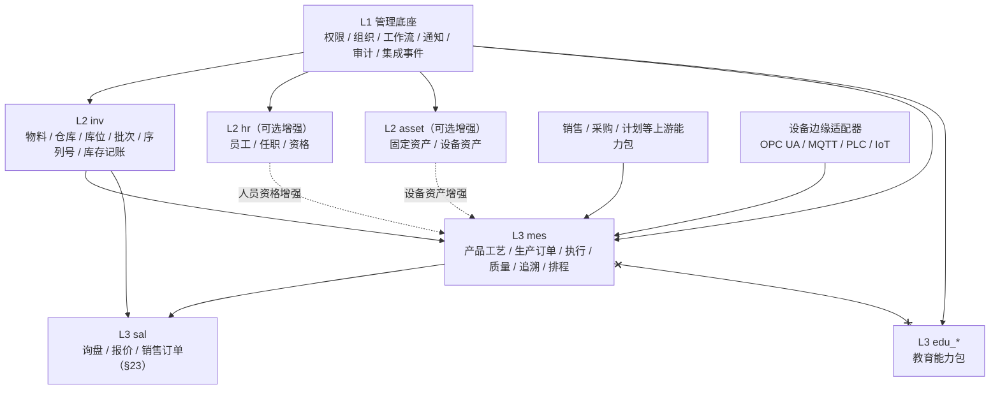
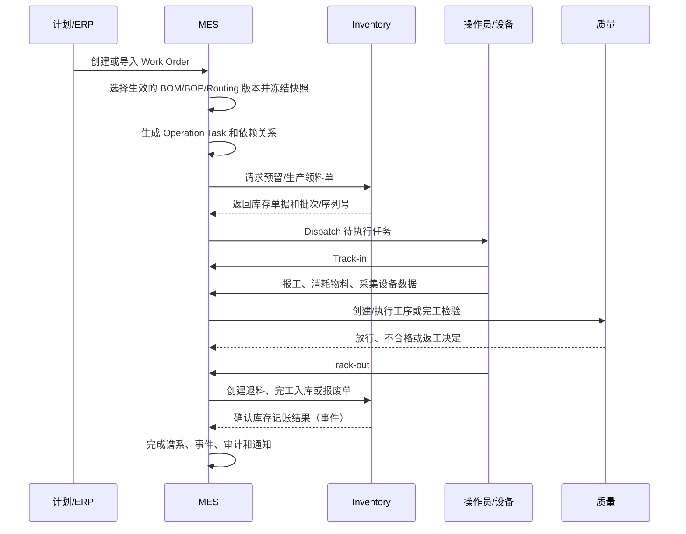
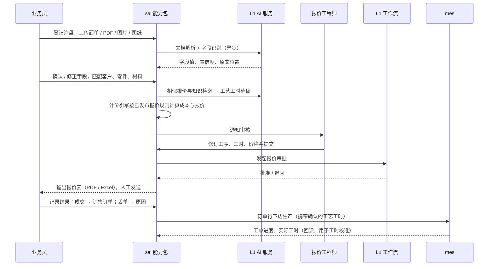

> 本文描述领域模型与架构演进。当前功能及操作入口见 [MES 说明](README.md)。
> 本文含历史部署组合、旧迁移路径及规划内容，不是当前开通步骤。当前使用 deployment.json 显式选择插件、core 独立分支和租户启用；当前字段/状态以 [实现映射](database-design.md) 和 [文档入口](README.md) 为准。原混合表目录、数据字典的引用现指向 MES 实现映射，不沿用旧章节编号。

# 离散制造 MES 设计

| 项目 | 内容 |
|---|---|
| 文档版本 | v0.3 |
| 状态 | 设计稿；§22 决策 #1～#13 已于 2026-10-12 评审，决策 #1 已实施；P0 执行内核已部分落地（6 张表，见 §18）；§23～§25（AI 订单录入、AI 辅助排产）与决策 #14～#21 待评审 |
| 日期 | 2026-10-12 |
| 适用范围 | 离散制造 MES：机加、装配、电子、设备制造、钣金、订单型制造等 |
| 能力包 | L3 `mes` |
| 直接依赖 | L1 管理底座、L2 `inv` 物资与库存；人员和设备先通过 MES 资源模型接入，后续可接入 `hr` / `asset`；上游销售报价能力包 `sal` 依赖 `mes`（§23），`mes` 不依赖 `sal` |
| 部署组合 | `edu`（学校）、`mes`（工厂）、`edu_mes`（同一部署同时提供教育与制造），见 §3 |
| 相关文档 | [ERP 整体分层设计](../../core/docs/foundation-platform/current-layered-architecture.md)、[能力包（插件）架构设计](../../core/docs/foundation-platform/current-plugin-architecture.md)、[MES 领域数据模型](mes-domain-data-model.md)、[数据库命名与建模规范](../../core/docs/foundation-platform/database-naming-convention.md)、[数据库表目录](database-design.md) |

> 本文是生产执行能力的总体设计。已有的统一库存模型仍以 [MES 领域数据模型](mes-domain-data-model.md) §2～§8 为准；本文只定义 MES 如何调用库存公开 Service，以及如何保存生产业务与库存事实之间的关联。
>
> 本文同时是 `mes` 能力包落地[能力包（插件）架构设计](../../core/docs/foundation-platform/current-plugin-architecture.md)的试点说明。两份文档冲突时，以插件架构文档的原则为准，本文 §3、§16 说明 MES 的过渡做法和收敛路径。

### v0.3 修订要点

1. 新增 §23「AI 订单录入」：询盘、报价、销售订单归入新的 L3 能力包 `sal`（依赖 `mes`），定义识别、草稿、计价、审批、下达生产的数据模型、状态机、接口和指标；客户真实信息与代号隔离。
2. 新增 §24「AI 辅助排产」：把 §11 的有限产能排程按规则排程的最小子集提前到试点；数值化的资源能力模型、日历、排程方案 / 问题 / 调整 / 负荷表，确定性排程引擎，人工调整与插单，发布与派工，外部系统工单导入。
3. 新增 §25：两项 AI 功能共用的 L1 前置能力、技能、保密和降级规则。
4. 同步修订 §2.1、§5.4、§11、§13～§15、§17、§19～§22；新增决策 #14～#21。

### v0.2 修订要点

1. 新增 §0「MES 市场参考与选型基线」：商业套件、开源软件和 Work Order 定义对比，作为后续各章取舍的参考依据。
2. 新增 §3「部署组合与 EDU / MES 共存」：明确同一代码库部署 `edu`、`mes`、`edu_mes` 三种组合时，后端、迁移、菜单、权限、小程序、管理端和 AI 各自的行为，以及“同一租户共存”和“不同租户共存”两种模式。
3. 新增 §18「当前实现基线与差距」，取代 v0.1 的“本次代码落地”流水记录：逐表列出已落地的 6 张表、接口和已知缺陷，并给出修正方式。
4. 补齐工序任务和工单的状态机（§6.4、§6.5）、数量汇总与工单完工规则（§6.6）、暂停与挂起的区分（§7.3）、报工冲销（§7.4）。
5. 新增 `mes_inventory_posting`（MES 事实与库存单据的关联与记账状态，§12.4），替代 v0.1 中只有约束、没有落表的“库存单据绑定”。
6. 字典取值、权限编码、报工来源等以已落地代码为准对齐（§14、§15.3）；设计中的旧取值标为作废。
7. 实施分期把 P0 拆成 P0.1～P0.4，每步有可验证的验收条件（§19）。
8. §22 决策评审：#1（迁移共用版本表）已实施，其余结论写入设计。

## 0. MES 市场参考与选型基线

### 0.1 口径

本节用于确定本项目的参考对象，不把“最好”理解为对所有工厂都成立的绝对排名。商业产品的完整数据模型、实施方法和授权边界通常不公开，下面比较的是公开资料中可以确认的产品业务对象和能力边界；商业软件的最终选型仍需结合行业验证、实施商能力、接口清单、部署方式、总拥有成本和本厂的质量/追溯要求。

本设计的离散制造基线是：产品与工艺版本、BOM/BOP/Routing、Work Order、Operation Task、Dispatch、Track-in/out、质量、不合格/返工、批次/序列号谱系、设备事件和有限产能排程。表格中的“覆盖判断”是面向本项目设计的工程判断，不是厂商的功能承诺。

开源软件需要进一步区分：

- **完整或接近完整的开源 MES**：有订单/工序/现场执行，且至少具备质量、追溯或设备接入中的一部分；
- **开源 ERP + 制造执行**：Work Order、BOM、Job Card、库存和生产管理较完整，但不一定覆盖企业级 MES 的设备集成、SPC、复杂谱系和多工厂治理；
- **相邻工具**：库存、BOM、装配或 OEE 能力较好，但不能直接替代本设计的 L3 MES。

资料链接按 2026-10-12 检查；版本、授权和文档入口可能随厂商发布而变化。

### 0.2 商业 MES 套件

以下六个系统是本项目当前最有价值的商业参考基线，覆盖离散制造、高科技、多工厂、SAP/自动化生态和云化 MES 等主要路线。

| 产品 | 更适合的场景 | 对本设计的参考价值 | 覆盖判断 | 主要产品资料 | 主要技术/实施文档 |
|---|---|---|---|---|---|
| [Siemens Opcenter Execution Discrete](https://www.siemens.com/en-gb/products/opcenter/execution/discrete/) | 汽车、机械、装备、航空航天、复杂装配、多品种制造 | Work Order、Operation/Step、BOM/BOP、效期、资源、序列号/批次、变更和谱系 | 离散制造综合标杆；与本设计的 L3 目标最接近 | [产品页](https://www.siemens.com/en-gb/products/opcenter/execution/discrete/) | [功能说明 PDF](https://static.sw.cdn.siemens.com/siemens-disw-assets/public/RfzqxJDwGeF98G2Nc2th7/en-US/Siemens-SW-Opcenter-Execution-Discrete-2307-FS-85507-D3.pdf)、[Opcenter Architecture Hub](https://www.siemens.com/en-us/content/architecture-hub/op-center/) |
| [Critical Manufacturing MES](https://www.criticalmanufacturing.com/mes-for-industry-4-0/) | 半导体、电子、医疗器械、高科技装备、强追溯 | Production Order、Production Order Step、依赖、Flow、BOM 展开、物料和工序确认 | 高科技离散制造和可配置执行能力强 | [产品页](https://www.criticalmanufacturing.com/mes-for-industry-4-0/) | [官方文档门户](https://help.criticalmanufacturing.com/)、[Production Order 页面](https://help.criticalmanufacturing.com/userguide/business-data/production-order/production_order_page/)、[企业集成 PDF](https://www.criticalmanufacturing.com/wp-content/uploads/2025/03/CMF221796-Data-sheet-enterprise-integration_11.1.pdf) |
| [DELMIA Apriso](https://www.3ds.com/products/delmia/apriso/production) | 全球多工厂、复杂流程、PLM/ERP/APS 协同、复杂装配 | ERP Production Order → WIP Order，按 Process Plan 展开 Operation/Step，并协调设备、技能、批次和序列号 | 多工厂治理、复杂装配和跨系统工单协调强 | [Production 产品页](https://www.3ds.com/products/delmia/apriso/production) | [Apriso 2025 文档索引](https://www.3ds.com/support/documentation/delmia-apriso-2025-documentation)、[3DEXPERIENCE 集成指南 PDF](https://vdemopro186plp.extranet.3ds.com/Apriso/Downloads/Documents/2025_Guide_IntegrationWith3DEXPERIENCEPlatform.pdf) |
| [SAP Digital Manufacturing](https://www.sap.com/products/scm/digital-manufacturing.html) | 已使用 SAP S/4HANA 或 SAP ERP 的大型企业 | Production Order 与 SFC 分离；订单引用 BOM/Routing，释放后生成现场执行单元 | SAP 生态内优先；适合作为“订单—SFC—确认”模型参考 | [产品页](https://www.sap.com/products/scm/digital-manufacturing.html) | [官方文档总入口](https://help.sap.com/crawler/PRODUCTION/SAP_DIGITAL_MANUFACTURING/latest/en-US)、[Order API](https://help.sap.com/docs/sap-digital-manufacturing/apis/order)、[ERP 集成指南](https://help.sap.com/docs/sap-digital-manufacturing/integration-guide/business-integration-with-sap-s-4hana-or-sap-erp?locale=en-US&q=field+mapping&state=PRODUCTION&version=latest) |
| [Rockwell FactoryTalk ProductionCentre](https://www.rockwellautomation.com/en-dk/products/software/factorytalk/operationsuite/mes/productioncentre.html) | Rockwell PLC、自动化和控制系统占主导的工厂；汽车、制药、电子、包装 | Work Order/Production Order 作为生产编排对象，下发到现场并关联配方、物料、设备、质量和实际投入 | 自动化、配方/批记录和工厂编排优势明显；公开资料不完整披露内部实体模型 | [产品页](https://www.rockwellautomation.com/en-dk/products/software/factorytalk/operationsuite/mes/productioncentre.html) | [Rockwell Literature 文档入口](https://literature.rockwellautomation.com/)、[Production Order Management 案例](https://www.rockwellautomation.com/en-us/capabilities/digital-transformation/digital-transformation-at-norbord.html) |
| [Plex MES/MOM](https://www.plex.com/products/manufacturing-execution-system) | 云部署、汽车零部件、工业制造、标准化生产、多工厂 | Job/Production Job、Routing Operation、Work Center、排程、现场控制台、质量和追溯 | 云化、生产事务闭环和有限产能排程较强；更偏 Job-centric | [MES/MOM 产品页](https://www.plex.com/products/manufacturing-execution-system) | [生产计划/排程/管理](https://www.plex.com/products/manufacturing-execution-system/production-planning-scheduling-and-management-software)、[Plex 技术文档入口](https://docs.plex.com/welcome) |

商业套件的选择建议：

1. **复杂离散装配、航空航天、汽车装备**：优先把 Opcenter、Apriso、Critical Manufacturing 作为详细需求和演示脚本的比较对象。
2. **SAP S/4HANA 已经是企业主系统**：优先评估 SAP Digital Manufacturing，重点验证 S/4HANA 订单、BOM/Routing、SFC、批次/序列号和质量确认的闭环。
3. **Rockwell 自动化体系占主导**：优先评估 FactoryTalk ProductionCentre，重点验证 PLC/设备模型、配方、生产订单下发和电子批记录。
4. **希望云化、快速标准化和多工厂推广**：把 Plex MES/MOM 作为云化和生产事务模型的参考。

### 0.3 开源或开源核心 MES 软件

开源 MES 的现状不是“存在一个能够全面替代商业套件的唯一最佳产品”。较成熟的开源选择主要分成专用 MES 和带制造执行能力的开源 ERP；复杂离散制造仍需要自行补齐设备协议、SPC、复杂工艺效期、多工厂治理、权限范围和实施运维。

| 产品 | 类型与许可证/授权 | 更适合的场景 | 对本项目的参考价值 | 覆盖判断 | 主要产品/源码 | 主要业务/开发文档 |
|---|---|---|---|---|---|---|
| [Carbon Community Edition](https://github.com/crbnos/carbon) | 开源核心；Community Edition 为 AGPLv3，商业版/云版另行授权 | 高混合、复杂装配、合同制造，希望 ERP、MRP、MES、QMS 共用数据模型 | Job、Operation、Work Center、生产事件、质量问题、批次/序列号追溯、API/MCP；与本项目“订单—工序—现场事实”最接近的现代参考之一 | **接近完整 MES + ERP/QMS**；项目较新，必须自行评估发布稳定性和生态规模 | [GitHub 仓库](https://github.com/crbnos/carbon) | [技术文档总览](https://docs.carbon.ms/)、[MES 应用](https://docs.carbon.ms/docs/reference/mes)、[许可证说明](https://docs.carbon.ms/docs/platform/licensing)、[架构](https://docs.carbon.ms/docs/building/architecture) |
| [qcadoo MES Community](https://github.com/qcadoo/mes) | 社区版 AGPLv3；同时存在商业版 | 中小型工厂、生产计划、工艺、工单和现场生产管理 | 专用 MES 的经典 Work Order/Operation/Workstation/Job Card 结构；适合参考计划、工序和生产状态 | **专用 MES**；高级排程、仓储物料流、维护、REST 集成等部分在商业版或扩展中 | [GitHub 仓库](https://github.com/qcadoo/mes) | [安装与开发文档入口](https://github.com/qcadoo/mes/blob/master/mes-application/root/README)、[项目官网](https://qcadoo.com/en/) |
| [OpenMES](https://github.com/Mes-Open/OpenMes) | AGPL-3.0，自托管 | 中小工厂、木工、钣金、塑料、装配、平板/移动现场执行 | Work Order、批次、质量检查、停机、排程、PWA、MQTT、REST、操作员终端；适合参考手机报工和现场终端 | **轻量专用 MES**；不宜直接视为 Opcenter/Apriso 级企业 MES | [GitHub 仓库](https://github.com/Mes-Open/OpenMes) | [用户与安装文档](https://getopenmes.com/documentation/)、[README 与 API/技术文档入口](https://github.com/Mes-Open/OpenMes/blob/main/README.md) |
| [ERPNext Manufacturing](https://github.com/frappe/erpnext) | GPLv3 开源 ERP，制造模块随 ERPNext 提供 | 中小企业、ERP 与制造一体化、BOM、库存、Work Order、Job Card | Work Order → Job Card → Workstation；数量、工时、员工、物料转移、质量检验的链路清晰，适合作为订单/报工基础模型参考 | **开源 ERP + 制造执行**；不是覆盖全部 L3 MES 能力的专用 MES | [GitHub 仓库](https://github.com/frappe/erpnext) | [制造模块总览](https://docs.frappe.io/erpnext/manufacturing)、[Work Order](https://docs.frappe.io/erpnext/work-order)、[Job Card](https://docs.frappe.io/erpnext/job-card)、[质量检验](https://docs.frappe.io/erpnext/user/manual/en/quality-inspection) |
| [Odoo Community Manufacturing](https://github.com/odoo/odoo) | Odoo 社区代码开放；具体制造/Shop Floor 功能、版本和授权需逐项核验 | 中小企业、标准 MRP、工作中心、工单依赖和现场平板 | Manufacturing Order → Work Order → Work Center/Shop Floor；适合参考工序依赖、工作中心、工时和现场操作 | **开源 ERP/MRP + 部分 MES 能力**；不能假定所有高级 MES 能力都在社区版可用 | [GitHub 仓库](https://github.com/odoo/odoo) | [Manufacturing Orders/Work Orders](https://www.odoo.com/documentation/master/applications/inventory_and_mrp/manufacturing/basic_setup/manufacturing_work_orders.html)、[Shop Floor](https://www.odoo.com/documentation/18.0/applications/inventory_and_mrp/manufacturing/shop_floor/shop_floor_overview.html)、[Work Order Dependencies](https://www.odoo.com/documentation/18.0/applications/inventory_and_mrp/manufacturing/advanced_configuration/work_order_dependencies.html) |
| [InvenTree](https://github.com/inventree/InvenTree) | 开源库存与制造管理工具 | 元器件、BOM、装配、库存分配、批次/序列号和构建输出 | Build Order、BOM、Stock Allocation、Build Output 和子装配关系，适合作为 L2 库存/装配和追溯参考 | **相邻工具，不是完整 MES**；缺少本设计要求的完整工序执行、质量闭环、设备集成和有限产能排程 | [GitHub 仓库](https://github.com/inventree/InvenTree) | [Manufacturing 总览](https://docs.inventree.org/en/stable/manufacturing/)、[Build Orders](https://docs.inventree.org/en/latest/manufacturing/build/)、[Build Outputs](https://docs.inventree.org/en/latest/manufacturing/output/) |

开源项目的工程判断：

- **如果只选一个作为领域模型参考**：优先阅读 Carbon 的 Job/Operation/MES 文档，再结合 ERPNext 的 Work Order/Job Card 和 OpenMES 的现场终端设计；不要直接复制其中任何一个项目的数据库结构。
- **如果需要专用 MES 原型**：qcadoo 和 OpenMES 比普通 ERP 更接近 MES，但要核验项目活跃度、版本发布、许可证、API、升级策略和商业支持。
- **如果需要 ERP + 制造一体化**：ERPNext 的 Work Order、Job Card、BOM、库存和质量链路较适合做业务流程参考；Odoo 适合参考工作中心、Shop Floor 和工序依赖。
- **如果需要 L2 库存/装配参考**：InvenTree 的 Build Order、Stock Allocation、Build Output、批次/序列号关系有参考价值，但不能代替 `mes_work_order_operation`、`mes_operation_execution` 和质量/设备模型。
- **不建议把 OEE、SCADA、IIoT 数据平台或 APS 单独当成完整 MES**：它们可以作为设备采集、时序数据或排程组件，但不能替代本设计的工单执行、质量和谱系闭环。

### 0.4 本项目采用的参考组合

本项目不把商业产品或开源项目作为唯一模板，而采用“商业语义基线 + 开源实现参考”的组合：

```text
Opcenter / Apriso / Critical Manufacturing
    └─ 复杂离散制造的工艺、工单、资源、质量、追溯语义

SAP Digital Manufacturing
    └─ Production Order 与 SFC 分离、订单释放和现场执行单元

Plex / Rockwell
    └─ 现场控制台、设备集成、排程和工厂级生产编排

Carbon / ERPNext / qcadoo / OpenMES
    └─ 开源可读的数据模型、Work Order、Job Card、移动现场和 API 实现参考
```

因此，本项目的设计取舍是：

1. `mes_work_order` 是生产指令聚合根，不等于一个批次、序列号或一次报工；
2. 工单至少要有产品/产出行、工序任务、任务依赖、物料需求和执行单元的扩展关系；
3. 释放时冻结 BOM/BOP/Routing/Effectivity 的版本与关键快照；
4. `mes_operation_execution` 和 `mes_production_report` 保存不可覆盖的生产事实；
5. 批次/序列号、库存余额和库存流水仍由 L2 `inv` 所有，MES 保存生产关联和谱系事实；
6. 手机报工是现场事实的一个录入渠道，不建立独立的移动端工单模型；
7. 设备事件先标准化、鉴权、幂等和单位转换，再进入 MES 执行 Service。

## 0.5 商业系统 Work Order 定义对比

下面的比较是业务语义对比，不是商业产品的内部数据库表结构。厂商公开资料通常能确认对象关系和操作流程，但不会完整公开产品内部表、扩展点和实施配置。

| 系统 | 官方/主要称谓 | Work Order 的定义 | 典型层级 | 对本项目的启发 |
|---|---|---|---|---|
| Siemens Opcenter Execution Discrete | Work Order | 面向离散制造现场的可执行生产指令，描述产品、数量、工序/步骤、物料、设备、人员、工具、效期和执行约束 | Work Order → Operation → Step → Material/Resource/Serial/Lot/Quality | `mes_work_order` 不应只是数量表，必须关联已解析的工艺、资源和依赖 |
| Critical Manufacturing MES | Production Order | 对生产需求的正式执行指令，明确生产什么、如何生产、生产多少；订单可包含步骤、依赖、物料和产品特征 | Production Order → Production Order Step/Dependency → Material/SFC/Confirmation | `mes_work_order_operation`、`mes_work_order_dependency` 和 `mes_production_report` 的拆分方向合理 |
| DELMIA Apriso | Work Order / WIP Order | ERP Production Order 按 Process Plan 展开后形成的现场执行订单，并协调 ERP、PLM、APS 和 MES 的字段来源 | ERP Order → WIP Order → Operation/Step/Workplan → Resource/Material/Trace | 需要记录上游来源、工艺解析结果和释放时快照，不能只保存一个来源订单号 |
| SAP Digital Manufacturing | Production Order + SFC | Production Order 是授权车间生产某物料、某数量的订单；订单引用 BOM/Routing，释放后生成 SFC 等现场执行单元 | Production Order → Release → SFC → Operation/Data Collection/Confirmation | 明确区分生产指令、执行单元和生产事实，避免把工单直接当批次或序列号 |
| Rockwell FactoryTalk ProductionCentre | Work Order / Production Order | 将企业生产需求、产品变体、配方、物料和现场自动化执行统一下发的生产编排对象 | Order → Recipe/BOM/BOP/Line/Equipment/Serial/Quality/Actual | 设备和变体上下文是工单的一部分，但不应把原始 PLC 数据直接塞进工单表 |
| Plex MES/MOM | Job / Production Job | 面向现场的 Job，关联 Routing Operation、Work Center、材料、排程、质量和实际事务 | Job → Operation → Work Center/Material/Production Event/Quality | Work Order 可以采用“订单头 + Job/Operation”的语义，现场控制台面向工序而不是只面向订单 |

### 0.5.1 共同结论

六个系统虽然名称不同，但共同关系是：

```text
计划/ERP 需求
    ↓
Work Order / Production Order / Job
    ↓
产品与工艺版本快照
    ↓
Operation / Step / Job Operation
    ↓
SFC / Lot / Serial / Trace Unit
    ↓
Track-in / Track-out / Report / Quality / Material Consumption
    ↓
Inventory Confirmation / Genealogy / ERP Confirmation
```

因此本设计不把以下对象混为一谈：

| 对象 | 本设计含义 |
|---|---|
| `mes_work_order` | 生产指令及计划执行范围 |
| Work Order Line / Output | 生产什么、生产多少、是否有副产品/联产品 |
| `mes_work_order_operation` | 一张工单的一道工序任务 |
| `mes_trace_unit` | 实际被加工和追踪的批次、序列号或容器 |
| `mes_operation_execution` | 一次 Track-in 到 Track-out 的执行区间 |
| `mes_production_report` | 不可覆盖的数量、工时、人员、设备和异常事实 |

## 1. 设计结论

### 1.1 MES 的定位

MES 是“生产过程的事实与控制层”，负责把已经发布的产品、工艺、生产订单转换为现场可执行的任务，并记录真实发生的人员、设备、物料、数量、质量和时间。

MES 不拥有以下对象的主生命周期：

- 物料、仓库、库位、批次库存余额和库存流水：由 L2 `inv` 维护；
- 用户、角色、组织、审批、通知、文件、审计和集成事件：由 L1 维护；
- 员工、劳动关系和固定资产：分别由 `hr`、`asset` 等公共能力包维护；
- 采购、销售、财务和成本核算：由相应 ERP 能力包维护。

MES 可以保存生产时的快照和事实关联，但不能绕过所属模块直接写入这些模块的表。

### 1.2 第一版采用的边界

```text
L3 MES（本设计）
├── 产品与工艺版本：制造物料扩展、BOM、BOP、Routing、Effectivity
├── 生产订单：Work Order、Operation Task、Task Dependency
├── 执行控制：Dispatch、Track-in、Track-out、Pause、Hold、Release、Abort、Rework
├── 现场报工：数量、工时、人员、设备、异常、冲销
├── 质量：检验计划、检验执行、SPC、不合格、处置、返工
├── 追溯：批次、序列号、物料消耗、成品产出、正向/反向谱系
├── 设备集成：OPC UA、MQTT、PLC、IoT 的标准化事件接入
└── 排程：工作中心、资源、日历、技能、有限产能、派工

L2 Inventory（已有统一模型）
└── 生产领料、退料、完工入库、报废、库存余额、库存流水

L1 Foundation（复用）
└── 权限、组织、工作流、通知、审计、文件、集成事件、任务调度
```

### 1.3 四个重要决策

1. **定义与事实分离**：BOM、BOP、Routing 是可版本化的定义；工单、任务、报工、检验和谱系是生产事实，定义变更不能覆盖已发生的事实。
2. **库存单一记账入口**：MES 只通过 `inv` 的公开 Service 创建和确认生产领料、退料、完工入库、报废等库存单据；不直接写 `inv_stock_balance` 或 `inv_stock_transaction`。
3. **先建离散执行内核，再接设备和高级排程**：P0 先保证工艺约束、现场执行、报工、质量和追溯闭环；OPC UA/MQTT 适配器、SPC 高级规则和有限产能优化作为同一领域模型上的增量能力。
4. **一套代码，按部署组合装配**：教育与制造共用同一个 L1 底座和 L2 公共能力。MES 不 import 教育代码，教育不 import MES 代码，L1 不出现两者的业务名词；是否加载 MES 由部署组合决定，是否对某租户可见由租户启用决定（§3）。

## 2. 领域边界与依赖

### 2.1 能力包关系



`MES x--x EDU` 表示两者之间禁止任何依赖：不 import、不建外键、不订阅对方事件、不引用对方字典。两者都需要的能力只能放到 L1 或 L2。

`mes` 的插件清单：

```toml
key = "mes"
name = "制造执行"
layer = "L3"
version = "0.1.0"
requires = ["inv>=0.1"]
module_codes = ["mes"]
table_prefixes = ["mes_"]
```

当前由 `plugins/mes/plugin.toml` 声明，`backend/app/framework/plugin.py` 读取清单并按部署组合加载；MES 后端业务代码仍在 `backend/app/modules/mes/`。

人员资格和资产台账未形成稳定的能力包公开 Service 之前，不让 MES 直接依赖 `hr` 或 `asset` 的表。MES 的 `mes_worker_skill` 和 `mes_equipment` 先承担执行所需的最小资源模型，未来通过公开接口或 1:1 映射扩展。人员一律用 `sys_user.id`（`<角色>_user_id`）引用，不引用 `hr_employee`。

### 2.2 模块边界

| 问题 | MES 负责 | 其他模块负责 |
|---|---|---|
| 生产什么 | 工单产品、数量、工艺版本、交期和优先级 | 销售订单、主生产计划、MRP 需求来源 |
| 如何生产 | BOM、BOP、Routing、工序依赖、资源要求 | 工艺文件原件放 `file_`，工程变更审批复用 `wf_` |
| 现场做了什么 | 派工、Track-in/out、暂停、挂起、报工、异常、返工 | 通用通知、审批、审计 |
| 用了什么物料 | 实际消耗、退料、成品产出与工单/任务的关联 | 库存余额、库存流水和库存单据记账 |
| 产品是否合格 | 检验计划、测量、SPC、不合格、处置和返工 | 通用文件、审批、通知 |
| 设备发生了什么 | 生产相关设备状态、采集点映射、关键执行事件 | 协议适配、凭据、原始高频遥测存储 |
| 谁可以做 | 任务所需技能、现场操作人、授权校验 | 用户、角色、员工主数据、数据范围 |

## 3. 部署组合与 EDU / MES 共存

### 3.1 三种部署组合

同一个代码库、同一个后端镜像，按 `ERP_DEPLOYMENT_PROFILE` 选择装配内容：

| 组合 | 用途 | 加载的能力 |
|---|---|---|
| `edu`（默认） | 学校 | L1 + 现有全部 L2 + 教育能力包；不加载 `mes` |
| `mes` | 工厂 | L1 + `inv`（物料、仓库、库存、领用、供应商）+ `mes`；不加载教育能力包，也不加载 `hr`、`ar`、`tkt`、`fac` |
| `edu_mes` | 同一部署同时提供教育和制造，例如有校办工厂、实训车间的职业院校，或一套平台同时服务学校与工厂客户 | `edu` 的全部内容 + `mes` |

规则：

- 部署组合只决定**进程加载什么**。组合外的代码可以在镜像里，但不导入、不注册路由、不收集目录、不建模型、不升级迁移（插件架构 §7.4）。
- 部署组合是能力包列表的**预设名称**。当前由 `deployment.json` 列出能力包，后端仍只支持 `edu` / `mes` / `edu_mes` 三种预设；能力包元数据从 `plugin.toml` 读取，部分历史模块与菜单仍用过渡映射，见 §3.7。
- 工厂最小组合为 `inv` + `mes`，`hr`、`tkt` 等作为客户可选能力包加入，不默认装配；插件架构 §7.4 已采用相同口径（决策 #7）。

### 3.2 各对象在三种组合中的行为

| 对象 | `edu` | `mes` | `edu_mes` | 实现位置 |
|---|---|---|---|---|
| 后端路由 | 无 `/api/mes` | 只有 L1、`inv`、`mes` 路由；教育路由不导入 | 两者都有 | `framework/router.py` 的 `_optional_router` |
| ORM 模型 | 不导入 `mes_*` 模型 | 不导入教育模型 | 两者都导入 | `framework/db/registry.py` |
| 目录（权限、菜单、小程序菜单、字典取值） | 不收集 MES 目录 | 不收集教育目录 | 两者都收集 | `framework/catalog.py` 的 `iter_module_attr` |
| 租户迁移 | 版本树只有主干 | 主干 + `mes` 分支，共用 `alembic_version` | 同 `mes` | 当前按组合升级版本树；按租户启用后只升级该租户准备启用的分支（§3.6）。主干基线已有教育表，不能据此推断工厂 schema 无 `edu_*` 表 |
| `tenant_setup` / `demo_seed` | 不运行 MES | 只运行 L1、`inv`、`mes` | 都运行 | 同上，经 `iter_module_attr` |
| 定时任务 | 无 MES 任务 | 无教育任务 | 都有 | `framework/jobs.py`（MES 当前无任务） |
| Harness 资源 | 不发布 `mes_` 资源 | 不发布 `edu_` / `hr_` 资源 | 都发布 | `harness_query_repository.py` 按表前缀过滤 |
| 管理端菜单 | 无 MES 菜单 | MES 页面直接是顶层菜单，另有 L1、库存菜单 | “MES 制造执行”目录与教育菜单并列 | `/api/auth/menus`，再经 `is_menu_enabled` 过滤历史菜单 |
| 小程序入口 | 无“手机报工” | 有 | 有 | `MINIAPP_MENUS` + 当前 `roleServices.ts` 过渡实现 |

### 3.3 共存的两种模式

`edu_mes` 下有两种完全不同的共存方式，设计和验收要分开：

| 模式 | 场景 | 数据位置 | 需要的能力 |
|---|---|---|---|
| A. 同一租户共存 | 一所学校同时管理教学和校办工厂 / 实训车间 | 同一个 `t_<租户编号>` schema；学校和车间用不同的 `org_id` 区分 | 已具备：两套菜单并列，按角色授权和组织数据范围分开 |
| B. 不同租户共存 | 一套平台同时服务学校客户和工厂客户 | 学校租户和工厂租户各自的 schema | **依赖插件架构 §7 的按租户启用**（`public.auth_tenant_plugin`），当前未实现 |

模式 A 的规则：

1. **菜单并列**：共存时 MES 是独立的顶级目录 `/mes`（菜单键 `Mes*`，组件路径 `mes/...`）。教育菜单不挂 MES 子菜单，MES 菜单也不挂教育子菜单。只部署 MES 的工厂组合不建这个目录，MES 页面直接是顶层菜单（§15.4）。
2. **权限隔离**：MES 权限全部以 `mes:` 开头，`module_code = "mes"`。租户开通时由 MES 的 `tenant_setup` 提供角色模板（生产管理员、班组长、操作员、质量员），模板只是一组权限的初始授权，代码从不按角色名判断（AGENTS.md §6）。
3. **组织隔离**：MES 业务数据带 `org_id`，Repository 用 `accessible_org_ids` / `scope_filters` 过滤。教师只授权学校组织时，即使误授予 MES 权限也查不到车间数据。
4. **共享 L1 / L2**：用户、组织、审批、通知、文件共用；物料主数据 `md_item` 共用，学校物资和生产物料按物料分类区分；可生产物料由 `mes_manufacturing_item` 1:1 扩展标记（§5.2），不在 `md_item` 加制造字段。
5. **共享仓库但不共享语义**：库存单据类型 `inv_stock_order_type` 中的生产领料、完工入库等类型由 MES 的 `tenant_setup` 幂等补齐，学校物资流程看不到这些类型以外的变化。

模式 B 在按租户启用落地前的现状与限制：

- `edu_mes` 会为**所有**租户升级 `mes` 分支，学校租户也会建出 `mes_*` 空表；
- 内置管理员拥有全部权限，学校租户的管理员也会看到 MES 菜单；
- 因此**模式 B 不得用于生产**，直到插件架构 §11 第 3 步完成。完成后：从未安装 `mes` 的租户不升级 `mes` 分支；曾安装后停用的租户保留 MES 表和修订；两者的 `/api/mes` 都返回 404，菜单和 AI 工具不下发。仅 `ready` 且 `is_active` 的租户可调用接口。

### 3.4 登录与租户选择

- 一个登录身份可以属于多个租户（例如平台运维同时管理学校租户和工厂租户）。目标做法是管理端和小程序提供租户切换，登录时由客户端显式选择租户，服务端校验成员关系。
- 当前 `auth/service.py` 在未指定租户时优先选择 `DEFAULT_TENANT_NO` 对应的租户，这是为本地联调做的过渡处理。它只影响“未指定租户”时的默认值，不放宽成员校验；租户切换上线后应回退为“最近进入的租户”或由客户端选择。
- 管理端 `web/src/api/routes.ts` 中“`VITE_DEPLOYMENT_PROFILE=mes` 且菜单中没有 `/mes` 就清除会话”的逻辑同样是过渡处理，只用于本地切换组合后清理旧会话。它不能作为权限判断，`edu_mes` 下不生效，租户切换上线后删除。

### 3.5 管理端与小程序的构建

| 端 | 现状 | 目标（插件架构 §8） |
|---|---|---|
| 管理端 | `web/src/views/mes/` 与教育页面一起打包；`VITE_DEPLOYMENT_PROFILE` 只用于 §3.4 的会话检查；可见性完全由后端菜单决定 | MES 页面成为 `@erp/plugin-mes` workspace 包；从统一装配摘要生成 `virtual:enabled-plugins` 和显式组件导入表，`edu` 产物不含 MES 代码，`mes` 产物不含教育代码；构建时验证服务端菜单组件可解析 |
| 小程序 | `pages.json` 固定注册 `production-report`、`production-report-detail`；首页入口由 `roleServices.ts` 在教育角色分支中按 `mes:production_report:create` 权限追加 | MES 提供小程序分包，构建时按同一装配摘要写入 `pages.json` 并检查产物；首页服务入口由服务端 `MINIAPP_MENUS` 下发，不依赖教育角色 |

小程序的关键问题：当前首页按 `student` / `parent` / `teacher` / `staff` / `principal` 等教育角色分支组装服务。工厂组合中的操作员没有教育角色，只能落到默认分支。规则：

- MES 入口只由权限和服务端菜单决定，不在教育角色分支里判断“是不是工人”；
- 工厂组合使用通用的 `staff` 门户（字典 `sys_miniapp_portal`），首页“常用服务”完全来自服务端下发的小程序菜单；
- `roleServices.ts` 中为 MES 追加的入口是过渡代码，小程序门户改为服务端下发（底座设计 12.3）时一并移除。

本地开发配置注意：`web/.env.development` 当前写入了 `VITE_DEPLOYMENT_PROFILE = mes`，会影响所有开发者。个人的组合选择应写在不提交的 `web/.env.local`，提交的默认值保持 `edu`。

### 3.6 迁移分支

决策 #1 已实施（2026-10-12）：MES 分支与主干共用一棵版本树和一张 `alembic_version`（插件架构 §6）。

| 方面 | 实现 |
|---|---|
| 版本树 | 当前使用 `alembic/versions/core` + 本地保留的 `alembic/versions/plugins/*` 历史。`tenant_version_locations()` 不按 deployment 裁剪历史；移出 MES 后仍解析已执行版本。升级目标按当前部署或明确指定分支选择，不使用全局 `heads`；见仓库 `docs/foundation-platform/current-plugin-architecture.md` |
| 版本表 | 租户 schema 中的 `alembic_version`，主干和 MES 共用；旧的 `mes_alembic_version` 停用 |
| 依赖 | `0001_mes_core`：`down_revision = None`、`branch_labels = ("mes",)`、`depends_on = "0001_tenant_baseline"`（引用 `sys_org`、`sys_user`、`md_item`）。只补了依赖声明，建表内容不变 |
| bootstrap | `system/tenant_template.py` 的 `upgrade_tenant_schema` 用按组合生成的版本树执行 `upgrade heads`，主干与组合内各分支一起升级，Alembic 按依赖排序（主干先于 MES）。原 `upgrade_mes_schema` 删除 |
| 命令行 | `alembic.ini` 的 `[tenant]` 只有主干，学校的既有命令不变；`[tenant_mes]` 是同一迁移范围加 MES 分支，供工厂和双组合环境手工升级、生成 MES 迁移。原 `[mes]` 节删除 |
| 旧版本表保护 | 租户 schema 中仍有 `mes_alembic_version` 时，`env.py` 拒绝执行租户迁移，避免重复建表；先运行合并脚本 |
| 合并脚本 | `scripts/merge_plugin_version_tables.py`：读取旧版本表的修订号，用 Alembic stamp 记入 `alembic_version`（不执行建表），再删除旧版本表。默认只打印计划，加 `--apply` 才执行，可重复执行。这些修订当初是真实升级执行过的，stamp 只是迁移版本记录，不能替代真实升级 |

当前与目标的界限：按租户启用（插件架构 §7）落地前，没有可信的租户能力包状态，所以当前对组合内全部分支执行 `upgrade heads`。落地后，先升级主干，再按依赖顺序升级该租户**准备启用或已经安装**的能力包分支；迁移和 `tenant_setup` 成功后才标记 `ready`、`is_active = true`。不能先开放接口再升级表，也不能仅凭部署组合对所有租户升级所有能力包。已安装分支的修订必须继续留在该租户可解析的版本树中。

注意事项：

- Alembic 把依赖并入版本记录：同时有主干和 MES 的租户，`alembic_version` 可能只有一行 `0001_mes_core`（它通过 `depends_on` 覆盖主干基线）；主干将来有新修订时会再增加一行。检查已安装版本应使用完整版本图，不能用表的行数判断。
- 已装过 MES 的租户，版本记录中有 MES 修订，之后**必须**用包含 MES 分支的版本树升级（`mes` / `edu_mes` 组合，或命令行 `[tenant_mes]`）。用 `edu` 组合或 `[tenant]` 升级会报“找不到修订”而失败，不会误操作；这与“停用能力包不删表”（插件架构 §10）一致。
- `[tenant_mes]` 命令行在当前组合不含 MES 时（如 `backend/.env` 默认 `edu`），`env.py` 只在该命令行进程内切换到 `mes` 组合以导入 MES 模型。bootstrap 使用 `[tenant]` 节和调用方的组合，不再被改写；修正了旧实现在 `edu_mes` bootstrap 中把进程组合改成 `mes`，导致后续教育开通步骤被跳过的问题。
- 生成 MES 迁移时建议设置 `ERP_DEPLOYMENT_PROFILE=mes`，避免 `edu_mes` 下把教育模型差异混进 MES 修订。
- 已发布的 `0001_tenant_baseline` 包含 `edu_*` 表；新工厂租户执行它后仍可能有空教育表。若商业交付要求物理上不含教育表，需要另行设计仅适用于新安装的基线和既有租户升级兼容方案，不改写已发布基线，也不把停用解释为删表。

### 3.7 L1 中的行业名词：需要整改的过渡代码

为了让三种组合先跑起来，当前有几处把教育或 MES 的名字写进了 L1 / framework，违反插件架构 §4.2 第 2 条。这些代码可以保留到对应整改步骤，但**不能被新代码模仿**：

| 位置 | 内容 | 整改方式 |
|---|---|---|
| `framework/deployment.py` | `inv`、`mes` 的模块归属已从 `plugin.toml` 读取；仍有 `CORE_MODULES`、`EDU_MENU_PATH_PREFIXES`、`EDU_MENU_PERMISSION_PREFIXES` 等过渡映射 | 逐步消除剩余硬编码；历史菜单过滤改为按 `sys_permission.module_code` 判断其所属能力包是否加载 |
| `framework/catalog.py` | `if get_deployment_profile() == "mes"` 时裁剪悬空菜单 | 改为通用规则：任何组合下，引用了未加载权限的菜单都不收集，并递归移除悬空子菜单；不判断组合名 |
| `modules/navigation/catalog.py` | 按教育路径前缀裁剪集中式导航目录 | 教育菜单随教育分批拆包（插件架构 §11 第 5 步）移入教育模块的 `catalog.py`；在此之前保留 |
| `modules/dictionary/builtin_dicts.py` | 新增 8 个 `mes_*` 字典定义；`sys_module` 增加 `mes`；`inv_source_doc_type` 含 `mes_work_order` | `framework/catalog.py` 增加 `DICTS` 声明（字典定义，与现有 `DICT_ITEMS` 取值登记并列），MES 在自己的 `catalog.py` 中声明字典并登记 `sys_module`、`inv_source_doc_type` 取值，L1 文件不出现 `mes_` |
| `harness_query_repository.py` | 按 `edu_` / `hr_` / `mes_` 表前缀判断资源所属模块 | 资源由能力包经 `ctx.ai` 登记（插件架构 §9），未加载的能力包自然不登记 |
| `framework/plugin.py` | `edu` 清单的 `table_prefixes` 含已停用的 `adm_` | 改为 `edu_`；教育拆包后按 `edu_core`、`edu_adm` 等分别声明 |

## 4. 核心业务对象

### 4.1 术语

| 中文 | 英文 | 本设计定义 |
|---|---|---|
| 产品/物料 | Item / Product | 由 L2 `md_item` 统一维护；MES 用 1:1 扩展表达制造属性 |
| 物料清单 | BOM | 产品由哪些组件构成，以及用量、损耗和投料工序 |
| 工艺路线 | Routing | 产品经过哪些工序、顺序如何、在哪类工作中心完成 |
| 工艺过程 | BOP / Manufacturing Process | BOM、Routing、作业说明、参数和质量要求组成的可执行过程 |
| 工序 | Operation | Routing 中一个可执行的制造步骤 |
| 工作中心 | Work Center | 可分配产能的资源组，例如装配线、CNC 车间 |
| 工作站 | Workstation | 工作中心下可实际执行任务的工位、机器或设备 |
| 生产工单 | Work Order | 对某产品生产一定数量的执行指令 |
| 工序任务 | Operation Task | 工单中一个具体工序的可执行实例；表 `mes_work_order_operation` |
| 计数工序 | Count Point | 其合格数量计入工单完成数量的工序，默认是最后一道工序 |
| 派工 | Dispatch | 把待执行任务放入工作站/人员的执行队列 |
| Track-in | Track-in | 操作人正式开始在某工作站执行任务 |
| Track-out | Track-out | 操作人结束本次执行并提交数量、时间、质量和异常 |
| 暂停 | Pause | 操作人自己中断执行，可自行恢复（§7.3） |
| 挂起 | Hold | 管理或质量人员锁定任务，必须由有权限的人放行（§7.3） |
| 生产单元 | Trace Unit | 一个可追踪的批次、序列号或工单产出单元 |
| 谱系 | Genealogy | 成品、半成品、原料、工序、人员和设备之间的事实关系 |

### 4.2 订单到成品的主流程



## 5. 产品与工艺版本

### 5.1 版本选择规则

每个工单在释放前必须确定：

- 生产组织 `org_id`；
- 产品物料 `md_item.id`；
- 生效的 BOM 版本；
- 生效的 Routing/BOP 版本；
- 版本选择时点和选择原因；
- 工艺定义的快照版本。

工单释放后，不能因为主数据版本更新而改变正在生产的工单。若发生工程变更，创建新的版本并重新生成尚未释放工单的任务；已释放工单只能通过受控变更流程处理。

第一版的 Effectivity 支持：

- `valid_from` / `valid_to` 日期时间区间（左闭右开，空结束表示持续有效）；
- 组织范围；
- 产品物料范围；
- 版本状态：草稿、评审中、已发布、已过期、已停用（字典 `mes_definition_status`）；
- 可选的批次号区间和序列号区间（P1）。

同一组织、同一产品、同一类型的已发布版本在适用区间内不得重叠。数据库使用排斥约束（如 `ex_mes_bom_version_no_overlap`）实现，版本发布 Service 同时做并发校验；不能只靠页面校验。

在 BOM / Routing 落地之前（P0.1），工单允许以“手工工序”方式创建：请求中直接给出工序清单，工序信息作为快照保存，`bom_version_id` / `routing_version_id` 为空。P0.2 起，有已发布 Routing 的产品必须从 Routing 生成工序，手工工序只保留给“临时工单”类型并需要单独权限。

### 5.2 产品制造扩展

`md_item` 仍是物料主数据的所有者。MES 使用 `mes_manufacturing_item` 做 1:1 扩展（主键 `id`，`item_id` 唯一外键引用 `md_item.id`），保存：

- 是否允许生产、是否允许返工；
- 默认 BOM/Routing 选择策略；
- 批次和序列号生成策略；
- 默认完工检验计划；
- 默认生产组织和工作中心；
- 制造属性和工艺参数定义。

不在 `md_item` 中增加离散制造字段，不把制造规则塞进 `flex_form`。

### 5.3 BOM / BOP / Routing

| 对象 | 建议表 | 一行代表什么 | 关键内容 |
|---|---|---|---|
| 制造物料扩展 | `mes_manufacturing_item` | 一个物料的制造属性 | 是否可生产、追溯策略、默认规则 |
| BOM 定义 | `mes_bom` | 一个产品的一类 BOM | 产品、BOM 编号、用途、状态 |
| BOM 版本 | `mes_bom_version` | 一个 BOM 的一个版本 | 版本号、生效区间、发布状态、版本说明 |
| BOM 明细 | `mes_bom_line` | 一个 BOM 版本中的一个组件 | 组件物料、用量、损耗、替代关系、投料工序 |
| Routing 定义 | `mes_routing` | 一个产品的一条工艺路线 | 产品、路线编号、用途 |
| Routing 版本 | `mes_routing_version` | 一条路线的一个版本 | 版本号、生效区间、发布状态 |
| Routing 工序 | `mes_routing_operation` | 一个路线版本中的一个工序 | 顺序、工序编号、工作中心、标准工时、技能、质量要求、是否计数工序 |
| 工序依赖 | `mes_operation_dependency` | 两个工序之间的一条定义依赖 | 前置工序、后置工序、依赖类型、最小间隔 |
| 工艺文件关联 | `file_attachment` | 一份绑定到工艺对象的附件 | SOP、图纸、检验规范、程序文件 |

BOM 明细与 Routing 工序的关联使用明确的 `issue_routing_operation_id`，表示该物料在哪道工序投入。若物料可以在多个工序投入，建立明细关联表，不在 JSON 数组中保存。

### 5.4 资源与技能定义

| 对象 | 建议表 | 说明 |
|---|---|---|
| 工作中心 | `mes_work_center` | 产能、成本和排程的资源组；例如车间、装配线 |
| 工作站 | `mes_workstation` | 实际执行任务的工位、机器或生产单元 |
| 技能 | `mes_skill` | 操作工序需要的技能定义 |
| 资源能力 | `mes_capability` / `mes_workstation_capability` | 能力定义与工作站的能力值（精度、轴数、行程等数值比较）；取代原规划的 `mes_workstation_skill`（§24.2，决策 #17） |
| 工作站操作员 | `mes_workstation_operator` | 某人员在有效期内可操作某工作站（§24.2） |
| 人员技能 | `mes_worker_skill` | 某人员（`worker_user_id` → `sys_user`）具有的技能、等级和有效期 |
| 日历 | `mes_calendar` | 工作中心或工作站使用的生产日历 |
| 班次 | `mes_calendar_shift` | 日历中的工作班次、休息和有效产能 |
| 日历例外 | `mes_calendar_exception` | 节假日、停机、临时加班和特殊产能 |

技能校验是服务端规则：工单任务释放或 Track-in 时，根据工序要求、人员技能有效期和工作站能力判断是否允许执行。前端展示的技能标签不能替代服务端校验。

技能以 `mes_skill` 表为准，不另建字典。当前 `required_skills_snapshot` 保存的是技能编号数组快照（§18.2），P0.2 起校验改用 `mes_work_order_operation_skill` 关系表，快照列保留用于展示。

## 6. 生产订单与工序任务

### 6.1 Work Order

`mes_work_order` 一行代表一张生产工单。已落地字段与目标字段：

| 字段 | 含义 | 状态 |
|---|---|---|
| `work_order_no` | 工单号；组织内唯一（`uk_mes_work_order_org_id_work_order_no`，部分唯一，排除软删除） | 已落地 |
| `org_id` | 生产组织 | 已落地 |
| `product_item_id` | 生产物料，引用 `md_item` | 已落地 |
| `product_item_no_snapshot` / `product_item_name_snapshot` | 释放时的产品编号、名称快照 | 已落地 |
| `unit_code` | 计量单位；字典 `md_unit` | 已落地 |
| `planned_quantity` | 计划数量 | 已落地 |
| `good_quantity` | 合格完成数量：计数工序合格数量之和（§6.6） | 已落地（汇总规则待修正） |
| `scrap_quantity` / `rework_quantity` | 各工序报废、返工数量之和 | 已落地（汇总规则待修正） |
| `priority_code` | 优先级；字典 `mes_priority` | 已落地 |
| `status_code` | 工单状态；字典 `mes_work_order_status` | 已落地 |
| `due_at` | 交期 | 已落地 |
| `version_no` | 乐观锁版本 | 已落地 |
| `released_at` / `released_by`、`closed_at` / `closed_by` | 释放、关闭的时间和人 | 已落地 |
| `planned_start_at` / `planned_end_at` | 计划开始/结束 | P0.1 新增 |
| `work_order_type_code` | 工单类型：标准、临时（手工工序）、返工；字典 `mes_work_order_type` | P0.1 新增 |
| `bom_version_id` / `routing_version_id` | 释放时选定的版本 | P0.2 新增 |
| `bom_version_no_snapshot` / `routing_version_no_snapshot` | 释放时的版本号快照 | P0.2 新增 |
| `source_doc_type_code` / `source_doc_id` | 上游计划或销售来源；字典 `mes_source_doc_type`，多态引用登记到语义模型 | P1 新增 |

v0.1 中的 `completed_quantity` 与已落地的 `good_quantity` 含义相同，统一使用 `good_quantity`；`released_quantity`（分批释放）推迟到 P1 的工单拆分一起设计。

§0.4、§0.5.1 提到的“产品/产出行”：P0 一张工单只有一个产出物料（`product_item_id`）。联产品、副产品在 P1 用子表 `mes_work_order_output`（一行代表工单的一种产出物料及计划数量）表达，届时 `product_item_id` 保留为主产出，不拆改已有字段（决策 #13）。

数量字段统一为 `numeric(18, 3)`，注释写明单位见 `unit_code`；不使用浮点数保存业务数量。

### 6.1.1 Work Order Allocation

`mes_work_order_allocation` 一行代表一个 Work Order 对一个生产需求/销售订单行的数量分配关系。它解决多个销售订单购买同一产品时合并生产的问题：一个 Work Order 可以对应多条订单需求，一条订单需求也可以拆分到多个 Work Order。

```text
销售订单行 / 生产需求行
        1 ───── n
mes_work_order_allocation
        n ───── 1
mes_work_order
```

字段设计：

| 字段 | 含义 | 约束/说明 |
|---|---|---|
| `work_order_id` | 被分配的生产工单 | 外键 `mes_work_order.id`；必须与分配关系处于同一租户和组织范围 |
| `order_id` | 订单需求行 ID | 必须指向销售订单行或统一生产需求行，不能只指向销售订单头；在销售能力包尚未落地时，由集成适配层提供稳定的需求行 UUID，并登记语义模型 |
| `allocated_quantity` | 分配给该订单需求的计划数量 | `numeric(18, 3)`；非负；单位继承工单 `unit_code`，订单单位不同需先完成单位换算 |
| `fulfilled_quantity` | 已确认用于履行该订单需求的数量 | `numeric(18, 3)`；非负；不是 Work Order 的总合格数量，必须由产出、库存分配或发运确认推进 |
| `scrapped_quantity` | 原计划分配给该订单、但已经报废而不能履行的数量 | `numeric(18, 3)`；非负；不等于工单总报废数量，只有可归属到该订单需求的报废才计入 |
| `allocation_type_code` | 分配类型 | 字典 `mes_allocation_type`；至少支持 `soft`（库存/计划分配）和 `hard`（批次/序列号硬绑定） |
| `status_code` | 分配状态 | 字典 `mes_work_order_allocation_status`；至少支持 `planned`、`allocated`、`partially_fulfilled`、`fulfilled`、`cancelled` |

表还包含统一的 `id`、`org_id`、审计字段、软删除字段和 `flex_form`。`work_order_id` 与 `order_id` 建联合唯一约束（排除软删除记录），同一订单需求可以通过多行分配到不同工单，但同一工单与同一订单需求不能重复建关系。

业务规则：

1. `allocated_quantity` 的总和不得超过工单允许分配的数量；是否允许超额分配必须由工单类型或订单策略明确允许，不能由前端直接提交。
2. 默认情况下，`fulfilled_quantity + scrapped_quantity` 不得超过 `allocated_quantity`；返工、冲销和订单变更通过新的事实或受控调整推进，不直接覆盖历史数量。
3. `soft` 分配只表示计划或库存预留关系，产品可在完工入库后再按库存分配给订单；`hard` 分配必须进一步关联 `mes_trace_unit`、批次或序列号。
4. `fulfilled_quantity` 只有在成品产出、库存分配或发运确认成功后才增加；仅完成 Work Order 或提交生产报工不能自动视为某个销售订单已履行。
5. `scrapped_quantity` 需要关联报工、质量处置或报废事实，不能由用户手工随意修改。
6. `order_id` 代表订单行/需求行，不代表销售订单头；同一个销售订单的不同明细行必须分别分配。

示例：

```text
SO1001 / Line 1 / 产品 P / 数量 10 ─┐
SO1002 / Line 1 / 产品 P / 数量 15 ─┼─> WO20261001 / 产品 P / 数量 30
SO1003 / Line 2 / 产品 P / 数量 5  ─┘
```

库存生产时可以只记录 `soft` 分配，最终在库存预留/发运时确认订单履行；按订单生产或强追溯场景使用 `hard` 分配，把批次、序列号或 `mes_trace_unit` 绑定到订单需求。

### 6.2 Operation Task

`mes_work_order_operation` 一行代表一张工单的一道具体工序，是现场执行和报工的主要对象。

关键字段（已落地，除非另注）：

- `work_order_id`；`routing_operation_id`（P0.2）；
- `operation_no`、`operation_name_snapshot`、`operation_description`、`sequence_no`；
- `work_center_name_snapshot`、`workstation_name_snapshot`；P0.2 增加 `work_center_id`、`workstation_id` 外键，名称快照保留；
- `assigned_user_id`：当前派工人员（P0 简化派工，§7.2）；
- `status_code`：字典 `mes_operation_task_status`（§6.4）；
- `planned_quantity`、`good_quantity`、`scrap_quantity`、`rework_quantity`：后三者是报工事实的汇总缓存，只能由报工和冲销 Service 维护；
- `is_count_point`：是否计数工序（P0.1 新增，§6.6）；
- `quality_required`：是否需要质量检验或放行；P0.1 改名为 `is_quality_required`（布尔命名规范）；
- `predecessor_ready`：仅为展示缓存，**Service 不得据此放行**（§6.3）；P0.2 依赖表落地后删除；
- `required_skills_snapshot`；`standard_setup_minutes`、`standard_run_minutes`（P0.2，从 Routing 复制）；
- `version_no`：乐观锁版本。

任务创建时复制工艺定义的关键值，避免工艺版本后续修改影响历史任务。只有明确的变更单才允许调整已发布任务，并记录差异和原因。

### 6.3 工序依赖

定义层使用 `mes_operation_dependency`，执行层使用 `mes_work_order_dependency`（P0.2）。

支持的依赖类型由字典 `mes_dependency_type` 定义，第一版包括：

- `finish_to_start`：前置完成后后置才能开始；
- `start_to_start`：前置开始后后置才能开始；
- `finish_to_finish`：前置完成后后置才能完成。

v0.1 中的 `parallel_with` 不是依赖，而是“没有依赖”，删除；并行工序就是彼此之间没有依赖记录的工序。

P0.1（依赖表落地前）的规则：工单内工序按 `sequence_no` 视为线性 `finish_to_start` 链，但允许“流转”——后序工序的可执行数量等于前序工序的累计合格数量（§6.6），不要求前序整道完成。Service 在 Track-in 和报工时现场计算，不读取 `predecessor_ready` 缓存。

执行 Service 在 Dispatch 和 Track-in 时检查：

1. 前置任务状态和可流转数量；
2. 最小等待时间或批次等待条件（P0.2）；
3. 质量放行条件；
4. 物料是否已按要求领用或允许现场补料（P0.3）；
5. 工作站、人员和设备是否满足能力要求（P0.2）。

### 6.4 工序任务状态机

字典 `mes_operation_task_status`：

| 状态 | 含义 | 终态 |
|---|---|---|
| `pending` | 待派工，或部分完成后等待继续 | 否 |
| `dispatched` | 已派工，等待 Track-in | 否 |
| `in_progress` | 有一个进行中的执行区间 | 否 |
| `paused` | 执行区间被操作人暂停 | 否 |
| `on_hold` | 被管理或质量人员挂起；P0.1 新增 | 否 |
| `waiting_quality` | 数量已报完，等待检验放行 | 否 |
| `completed` | 完成 | 是 |
| `skipped` | 经授权跳过；P0.2 新增 | 是 |
| `cancelled` | 取消 | 是 |

允许的动作（Service 统一执行，每次写 `mes_execution_event`，`version_no` 加一）：

| 动作 | 从 | 到 | 权限 | 事件类型 |
|---|---|---|---|---|
| 派工 `dispatch` | `pending`、`dispatched` | `dispatched` | `mes:operation_task:manage` | `dispatched` |
| Track-in | `pending`、`dispatched` | `in_progress` | `mes:production_report:create`，且为派工人或任务开放给工作站 | `tracked_in` |
| 暂停 `pause` | `in_progress` | `paused` | 同 Track-in，且为执行区间本人 | `paused` |
| 恢复 `resume` | `paused` | `in_progress` | 同上 | `resumed` |
| 报工 `report` | `in_progress` | 不变 | `mes:production_report:create`，且为执行区间本人 | `production_reported` |
| Track-out | `in_progress`、`paused` | 有剩余数量 → `pending`；报满且需检验 → `waiting_quality`；报满 → `completed` | 同报工 | `tracked_out` |
| 挂起 `hold` | 任一非终态 | `on_hold`；进行中的执行区间同时暂停 | `mes:operation_task:hold` | `held` |
| 放行 `release` | `on_hold` | 挂起前状态（取自 `held` 事件的 `from_status_code`） | `mes:operation_task:hold` | `released` |
| 质量放行 | `waiting_quality` | `completed` | `mes:quality:inspect`（P0.4 前用 `mes:operation_task:manage`） | `quality_released` |
| 跳过 `skip` | `pending`、`dispatched` | `skipped` | `mes:operation_task:manage` | `skipped` |
| 取消 `cancel` | `pending`、`dispatched`，且无报工 | `cancelled` | `mes:operation_task:manage` | `cancelled` |

### 6.5 工单状态机

字典 `mes_work_order_status`：`draft`、`released`、`in_progress`、`on_hold`、`completed`、`closed`、`cancelled`。

| 动作 | 从 | 到 | 规则 |
|---|---|---|---|
| 创建 | — | `draft` | 可编辑数量、交期、工序 |
| 释放 `release` | `draft` | `released` | 冻结快照、生成任务；P0.1 允许“创建即释放”作为一个动作 |
| 首次 Track-in | `released` | `in_progress` | 由任务 Track-in 自动推进 |
| 挂起 / 放行 | `released`、`in_progress` ↔ `on_hold` | — | 工单挂起时其下全部非终态任务不可 Track-in 和报工 |
| 完工 | `in_progress` | `completed` | 全部任务处于终态（`completed`、`skipped`、`cancelled`），由最后一个任务进入终态时自动推进 |
| 关闭 `close` | `completed` | `closed` | 库存过账全部确认（§12.4）后才允许；关闭后不再接受冲销 |
| 取消 `cancel` | `draft`、`released` 且无报工 | `cancelled` | 同时取消全部任务 |

### 6.6 数量汇总与完工规则

1. **报工是数量的唯一来源**。任务和工单上的数量字段都是 `mes_production_report` 的汇总缓存，在同一事务中随报工、冲销更新；对账以报工事实为准。
2. **任务可执行数量** = `min(任务计划数量, 前序工序累计合格数量)` − 本工序已报数量（合格 + 报废 + 返工）。第一道工序的前序数量视为工单计划数量。
3. **单次报工校验**：合格、报废、返工均非负，至少一项大于 0，合计不超过任务可执行数量。超产比例作为租户参数 `mes.overrun_ratio`（`sys_setting`，默认 0）在 P1 引入。
4. **返工数量**表示“送返工”的数量：计入本工序已报数量但不计入合格；P0.4 起由质量处置生成返工任务，返工任务合格后按处置决定回到原流程或直接计入计数工序。
5. **工单数量**：`good_quantity` = 计数工序（`is_count_point = true`，P0.1 默认最后一道未取消工序）的合格数量之和；`scrap_quantity`、`rework_quantity` = 全部工序之和。
6. **工单完工**只看任务终态（§6.5），不看“某一道工序数量报满”。

## 7. 执行控制与现场报工

### 7.1 执行状态总览

```text
工单  draft → released → in_progress → completed → closed
                 │            │
                 └──── on_hold ┘            （cancelled：无报工时）

任务  pending ⇄ dispatched → in_progress ⇄ paused
                                │
                                ├─ Track-out → pending（有剩余）/ waiting_quality / completed
                                └─ hold → on_hold → release → 挂起前状态
```

状态变化必须通过 Service 完成；每次状态变化写入 `mes_execution_event`，并在 L1 出站事件可用后按需发布 `mes.operation_task.dispatched`、`mes.operation_task.tracked_in`、`mes.operation_task.tracked_out`、`mes.operation_task.held`、`mes.operation_task.released`、`mes.work_order.completed` 等事件。

### 7.2 Dispatch

P0 的简化派工：任务上的 `assigned_user_id` 表示当前派工人员，派工历史只记录在 `mes_execution_event`。`assigned_user_id` 为空表示任务对有权限的现场人员开放（P0.2 起限定为对应工作站的人员）。

P1 引入 `mes_dispatch`，一行代表一次把工序任务放入执行队列的派工记录：

- 工序任务、工作中心、工作站、人员和设备；
- 排队顺序、计划开始时间、优先级；
- 派工来源：人工、规则、有限产能排程、设备请求；
- 状态：字典 `mes_dispatch_status`（`queued`、`accepted`、`started`、`completed`、`cancelled`、`expired`）；
- 派工时的任务和资源快照。

引入后 `assigned_user_id` 作为“当前有效派工”的冗余缓存保留，由派工 Service 维护。

派工不等于 Track-in。操作员接受派工后仍需通过服务端规则正式 Track-in；设备自动执行也必须生成同样的执行记录。

### 7.3 Track-in / Pause / Hold / Track-out

`mes_operation_execution` 一行代表一次工序任务在某工作站上的执行区间，允许同一任务多次暂停、换站或返工。一个任务同时最多一个未结束的执行区间（P0.1 加部分唯一索引，条件为状态 `in_progress` 或 `paused`）。

Track-in 校验：

- 工单不在 `on_hold`、任务处于允许状态；
- 前置可流转数量大于 0（§6.6）、质量放行和物料条件满足；
- 人员具有所需技能且未超过并发限制（P0.2）；
- 工作站启用、能力匹配且未被锁定（P0.2）；
- 同一序列号/生产单元不存在未结束的冲突执行（P0.4）。

Track-out 校验：

- 存在本人的未结束执行区间，且 `execution_id` 与当前区间一致；
- 必填检验已完成或明确走待检状态；
- 物料消耗和设备采集数据达到工艺要求（P0.3 起）；
- 异常必须选择异常类型并填写处理结果或创建不合格单。

**暂停与挂起的区别**（v0.1 混用，P0.1 拆开）：

| | 暂停 Pause | 挂起 Hold |
|---|---|---|
| 发起人 | 执行区间的操作人本人 | 班组长、生产管理、质量人员 |
| 原因 | 吃饭、换班、临时离开、等料 | 质量疑点、工艺问题、安全、管理决定 |
| 状态 | 任务 `paused`，执行区间 `paused` | 任务 `on_hold`；执行区间同时暂停 |
| 解除 | 本人 `resume` | 有 `mes:operation_task:hold` 权限的人 `release`，并重新校验质量和资源条件 |
| 记录 | `paused` / `resumed` 事件 | `held` / `released` 事件，必须填原因 |

当前代码中的手机端 `/hold`、`/release` 实现的是“暂停 / 恢复”语义（操作人可自行恢复）。P0.1 增加 `/pause`、`/resume` 并让小程序改用它们，受控挂起与放行只在管理路径提供；接口和小程序在同一次改动中切换（§15.2）。

执行区间的工时：`labor_minutes`、`machine_minutes` 是本区间内报工工时的汇总缓存；暂停时长由 `paused` / `resumed` 事件计算，不另建字段。

### 7.4 现场报工与冲销

`mes_production_report` 一行代表一次现场提交的生产事实，提交后不可覆盖；更正通过冲销完成。

报工至少支持：

- 合格数量、报废数量、返工数量；
- 实际人工工时、机器工时（准备工时、等待工时在 P1 引入）；
- 操作人；工作站、设备（P0.2）；
- 报工时间 `reported_at`（业务发生时间）和提交时间 `created_at`；
- 相关批次/序列号/生产单元（P0.4）；
- 异常类型、异常说明、附件；
- 来源 `source_code`：字典 `mes_report_source`（`web`、`mini_program`、`device`、`integration`），**由接口入口决定**，不由客户端传入；
- 幂等键 `idempotency_key`：唯一键为（提交人 `created_by`，`idempotency_key`）。重复请求返回第一次的处理结果。

冲销（P0.1）：

- 新增一行报工，`reversal_of_report_id` 引用被冲销的报工，数量与原报工相同，`report_type_code = reversal`（字典 `mes_report_type`：`normal`、`reversal`）；
- 原报工 `status_code` 改为 `reversed`；这是唯一允许修改原报工的字段；
- 任务、执行区间、工单的汇总缓存减去原报工数量；
- 已有确认的库存过账时，冲销同时创建反向库存单据（§12.4）；工单 `closed` 后不允许冲销；
- 权限 `mes:production_report:reverse`，必须填写原因。

报工状态 `status_code`（字典 `mes_report_status`）：

| 值 | 含义 |
|---|---|
| `posted` | 生产事实已记录；不需要库存过账，或库存过账已全部确认 |
| `pending_inventory` | 生产事实已记录，库存过账尚未全部确认（§12.4） |
| `reversed` | 已被冲销 |

手机小程序只作为现场终端，不拥有独立业务模型：扫码、选择任务、Track-in、填报数量、拍照、提交异常都调用 `/api/mes` 服务；权限、菜单和组织范围由服务端下发。

报工附件通过 L1 文件模块上传和绑定（场景 `production_report`，业务类型 `mes_production_report`）。MES 必须同时用 `register_file_access` 注册读取鉴权：能查看该报工的人才能读取附件（当前缺失，§18.3）。

### 7.4.1 手机报工小程序模块

#### 终端定位

手机报工面向操作员、班组长和现场质量人员，解决“在工位旁快速确认任务、开始执行、提交数量与工时、记录异常、结束执行”的问题。它不是独立的轻量 MES，也不在本地维护一份生产任务数据库。

手机端只保存：

- 当前页面加载的服务端任务快照；
- 尚未提交的表单草稿；
- 写操作使用的稳定幂等键；
- 临时图片上传状态和附件 ID。

手机端不保存或自行计算：

- 工单的最终状态、库存余额、可用量、质量放行结果；
- 人员、工作站和组织授权；
- 报工成功与否的最终判断；
- 可替代后端事实的本地演示任务。

#### 与现有小程序架构的映射

```text
miniprogram/src/
├── pages.json
│   ├── pages/production-report/index        # 我的生产任务
│   └── pages/production-report-detail/index # 任务详情与现场报工
├── config/roleServices.ts                   # 首页“手机报工”入口（过渡实现，见 §3.5）
├── api/mesProduction.ts                     # MES 手机端 API 类型与请求
├── api/client.ts                            # 认证、令牌刷新、统一响应和错误处理
├── components/StatusBadge.vue               # 任务状态展示
├── utils/permissions.ts                     # 权限检查、确认弹窗和错误提示
└── pages/                                   # 复用现有 Uni-app 页面生命周期
```

设计规则：

1. 页面通过 `pages.json` 注册，不修改固定底部 TabBar；手机报工作为首页“常用服务”进入。
2. 首页入口按 `mes:production_report:create` 显示；前端权限只控制导航，后端仍是最终鉴权边界。入口最终由服务端 `MINIAPP_MENUS` 下发，不挂在教育角色分支里（§3.5）。
3. 所有请求使用现有 `requestApi`，复用 Bearer Token、刷新令牌、统一 `{ code, message, data }` 响应和登录失效处理，不另建 MES 请求客户端。
4. MES 任务事实不进入教育场景的 `appStore`、`store/workbench` 或本地演示数据；页面状态使用 Vue `ref` / `reactive`，服务端数据由接口刷新。
5. 小程序页面可以复用 `StatusBadge`、文件上传和确认弹窗等通用组件，但不能把教育角色、教师身份或学校部门写入 MES 规则。

#### 页面与操作流

```text
首页常用服务
    ↓ 权限 mes:production_report:create
我的生产任务
    ├─ 状态筛选：全部 / 待执行 / 执行中 / 已完成
    ├─ 关键词查询：工单号 / 产品编号 / 任务编号
    ├─ 扫码查询：工单码、工序任务码、生产单元码
    └─ 下拉刷新
          ↓
任务详情
    ├─ 工单、产品、工序、工作中心、工作站、交期
    ├─ 计划数量、可执行数量、合格、报废、返工进度
    ├─ 物料要求与追溯要求
    ├─ 当前执行和历史执行事件
    └─ 按服务端返回的 allowed_actions 显示动作
          ├─ Track-in
          ├─ 报工：合格 / 报废 / 返工 / 工时 / 异常 / 附件
          ├─ 暂停 / 恢复
          └─ Track-out
```

挂起与放行属于管理动作，P0.1 起不在操作员的手机页面上提供；班组长使用同一页面时，服务端按权限在 `allowed_actions` 中返回 `hold` / `release`，页面调用管理路径接口。

#### 任务列表契约

任务列表只返回当前用户在当前租户、当前组织数据范围内可执行的任务。服务端完成派工关系、人员技能、组织范围和任务状态过滤；客户端不能通过传入其他用户 ID 查询他人的任务。

最小返回字段：

| 字段 | 用途 |
|---|---|
| `id` | 工序任务 UUID |
| `work_order_no` | 工单号 |
| `operation_no` / `operation_name` | 工序编号和名称 |
| `product_item_no` / `product_item_name` | 产品物料 |
| `work_center_name` / `workstation_name` | 执行资源 |
| `planned_quantity` | 计划数量 |
| `good_quantity` / `scrap_quantity` / `rework_quantity` | 当前累计数量 |
| `unit_name` | 展示单位 |
| `status_code` / `status_label` | 状态值和展示名称 |
| `priority_code` / `priority_label` | 优先级 |
| `due_at` | 交期 |

列表接口支持 `page`、`page_size`、`status_code`、`keyword`，返回 `items`、`total`、`page`、`page_size`。服务端默认限制单页数量，客户端不得通过超大 `page_size` 绕过限制。

#### 任务详情契约

详情接口在列表字段基础上返回：

- `version_no`：并发控制版本；每次写操作必须带回服务端返回的最新版本；
- `operation_description`：当前工艺说明；
- `required_skills`：执行技能要求；
- `available_quantity`：当前可执行数量（§6.6），P0.1 新增；
- `allowed_actions`：当前用户此刻可执行的动作列表，由 Service 按状态机和权限计算，P0.1 新增；
- `predecessor_ready`：前置任务是否满足；仅用于展示，P0.1 起由 `available_quantity > 0` 推导；
- `quality_required`：是否需要质量检验或放行；
- `material_requirements`：物料需求、已消耗数量、单位和批次/序列号要求；
- `current_execution`：当前执行区间，包含 Track-in 时间、人员和工作站；
- `events`：执行状态时间线。

详情页面只根据 `allowed_actions` 显示按钮，不根据状态或 `predecessor_ready` 自己判断；Service 在每个写操作时再次校验。

#### 手机报工字段

`POST /api/mes/mobile/operation-tasks/{id}/production-report` 请求：

| 字段 | 规则 |
|---|---|
| `version_no` | 必填；乐观锁版本 |
| `execution_id` | 有当前执行区间时必填 |
| `good_quantity` | 非负数量 |
| `scrap_quantity` | 非负数量 |
| `rework_quantity` | 非负数量 |
| `labor_minutes` | 非负分钟数，可空 |
| `machine_minutes` | 非负分钟数，可空 |
| `exception_type_code` | 字典 `mes_exception_type`，可空；报废数量大于 0 时必填 |
| `note` | 异常或现场说明；按权限和敏感策略处理 |
| `attachment_ids` | 已上传的 `file_attachment.id` 列表，可空 |
| `idempotency_key` | 本次提交稳定且唯一，弱网重试必须复用 |

约束见 §6.6 第 3 条；数量与工单剩余量、工艺损耗、库存可用量和质量要求由服务端校验。

#### 扫码与附件

- 扫码结果只作为任务号、工单号、批次号、序列号或生产单元号查询条件，服务端必须验证其归属和当前用户权限；
- 扫描到序列号/批次后，页面展示服务端解析结果，不能只根据二维码文本直接拼接任务详情；
- 异常照片先通过现有文件模块上传，得到 `file_attachment.id`，报工提交只提交附件 ID；
- 上传状态为进行中或失败时，不允许提交报工；
- 附件必须绑定到生产事实后才算有效，未绑定的临时附件按现有文件生命周期清理。

#### 弱网、重复提交与并发

1. 打开任务时保存 `version_no`，写操作失败后刷新详情，不能盲目重复发送旧请求。
2. 用户点击提交后按钮进入 loading，直到接口返回或明确超时；不能通过连续点击创建多条报工。
3. `idempotency_key` 在表单草稿创建时生成并持久化到该草稿；超时后重试使用同一个 key。
4. 服务端以（提交人，幂等键）建立唯一处理语义；重复请求返回第一次处理结果，**且幂等判断先于版本校验**，保证第一次已成功、响应丢失的重试不会因版本已变化而报冲突（当前实现已如此）。
5. 网络断开时可以保留未提交草稿，但不能把草稿显示成“已报工”；重新提交前必须重新获取任务版本和权限。
6. 报工处于 `pending_inventory` 时，页面显示“已报工，待库存处理”，不能显示“完工入库成功”。

#### 端侧不做的事情

- 不在小程序计算或修改库存余额；
- 不在小程序决定工序依赖、质量放行和技能授权；
- 不按 `role`、角色名称或部门名称判断能否 Track-in；
- 不在本地生成工单、任务、批次或序列号；
- 不用 mock 数据掩盖 MES API 尚未开通；
- 不把原始 PLC/OPC UA/MQTT 遥测直接写入小程序本地存储。

### 7.5 异常

`mes_exception`（P0.2）一行代表生产现场的一次异常或停机事实，支持：

- 设备故障、缺料、换型、质量异常、人员不足、工艺问题、等待审批（字典 `mes_exception_type`）；
- 关联工单、工序任务、执行记录、设备、人员和工作站；
- 开始/结束时间、影响数量、影响工时、原因、处置结果；
- 是否需要升级工单或工作流；
- 可由设备事件自动创建，也可由人员手工创建。

在此之前，异常只记录在报工的 `exception_type_code` 和 `note` 上。停机时间和异常事实不放在 `flex_form`；扩展的设备原始信息可以放在有结构说明的 JSONB 字段中。

## 8. 质量管理

### 8.1 表前缀决策

本期质量是 `mes` 能力包中的生产质量子域，表名使用 `mes_quality_`，满足插件清单的 `table_prefixes = ["mes_"]`。数据库命名规范中预留的 `qa_` 前缀保留给将来独立的、跨行业质量能力包；本期不建立 `qa_` 表，也不让 L1 依赖质量领域。

### 8.2 质量对象

| 对象 | 建议表 | 一行代表什么 |
|---|---|---|
| 检验计划 | `mes_quality_plan` | 一套适用于物料/工序/组织的检验计划 |
| 检验计划版本 | `mes_quality_plan_version` | 检验计划的一个版本和生效区间 |
| 检验项目 | `mes_quality_item` | 一个检验项目：尺寸、外观、功能、材料特性等 |
| 检验任务 | `mes_quality_inspection` | 对一次来料、工序或完工对象的检验任务 |
| 测量结果 | `mes_quality_measurement` | 一次检验项目的实际测量值 |
| 不合格 | `mes_quality_nonconformance` | 一条已确认的不合格事实及影响对象 |
| 质量处置 | `mes_quality_disposition` | 对不合格的返工、返修、让步接收、报废或退回决定 |
| 返工记录 | `mes_quality_rework` | 一次从原工序分流到返工路线的记录 |
| SPC 规则 | `mes_quality_spc_rule` | 一条控制图、规格限或抽样规则 |
| SPC 测量 | `mes_quality_spc_measurement` | 一次用于统计过程控制的测量事实 |

### 8.3 质量流程

```text
检验计划发布
    ↓
创建检验任务（来料 / 首件 / 巡检 / 工序 / 完工）
    ↓
记录检验项目与测量值
    ├─ 合格 → 放行 → 任务 waiting_quality → completed，或允许完工入库
    ├─ 待判定 → Hold → 质量人员处置
    └─ 不合格 → NCR → 返工 / 返修 / 让步 / 报废 / 退回
```

质量结果与库存状态的关系：

- 完工入库可先进入 `quarantine`，检验放行后由 `inv` 创建库存状态转换单；
- 不合格品进入 `defective` 或隔离库位，库存状态由 `inv` 统一记账；
- MES 保存检验和不合格事实，不直接更新库存余额；
- 返工生成 MES 返工记录和任务（工单类型 `rework` 或原工单内的返工任务），必要时通过 `inv` 退料、补料或状态转换。

### 8.4 SPC

第一版 SPC（P1）支持：

- 规格上限、规格下限、目标值；
- 均值、极差、标准差、Cp/Cpk 等服务端计算结果；
- 控制图规则触发的异常事件；
- 按物料、工序、设备、工作站、班次和人员查询。

高频测量原始数据不无限堆积在 OLTP 表。`mes_quality_spc_measurement` 保存质量分析所需的事实和聚合引用；若设备产生高频时序数据，由边缘或时序存储保存原始值，MES 只保存可追溯的样本标识和关键结果。

## 9. 批次、序列号与谱系

### 9.1 所有权

- 批次和序列号实体由 L2 `inv` 统一维护。当前 `inv` 只有 `inv_lot`，**没有序列号表**；序列号追溯的前置条件是 `inv` 新增 `inv_serial` 及其公开 Service（L2 任务，不在 MES 内实现）；
- MES 不另建一套库存批次和序列号表；
- MES 可以建立 `mes_trace_unit` 作为生产过程中的可追踪单元，引用库存批次/序列号，并记录生产上下文；
- 批次/序列号生成由库存公开 Service 或统一编号服务完成，MES 不能本地生成后绕过库存登记。

### 9.2 谱系对象

| 对象 | 建议表 | 说明 |
|---|---|---|
| 生产单元 | `mes_trace_unit` | 一个工单产出的批次、序列号、托盘、箱或内部追踪单元 |
| 物料消耗 | `mes_material_consumption` | 工序实际消耗的物料、批次、序列号和数量；`mes_operation_material_requirement.consumed_quantity` 是它的汇总缓存 |
| 产出记录 | `mes_output_record` | 工序或工单产生的合格、不良、返工产出 |
| 谱系关系 | `mes_genealogy_link` | 父单元、子单元、消耗物料、工序之间的明确关系 |

`mes_genealogy_link` 不用 `source_type + source_id` 作为任意多态关系。针对不同事实建立明确的外键列，例如 `parent_trace_unit_id`、`child_trace_unit_id`、`material_consumption_id`、`operation_execution_id`；无法声明的外部关系登记到语义模型。

### 9.3 追溯查询

必须提供两种查询：

1. **反向追溯**：一个成品序列号 → 生产工单 → 工序 → 设备/人员 → 消耗的原料批次和序列号 → 来料检验。
2. **正向追溯**：一个原料批次 → 被哪些工单/工序消耗 → 形成哪些半成品和成品 → 哪些库存单据和客户交付对象。

查询使用 MES 公开 Service，统一应用数据范围、组织范围、删除过滤和字段敏感级别；不能给 AI 或前端开放任意 SQL 图遍历。

## 10. 设备集成

### 10.1 分层

```text
PLC / 机床 / 产线设备
        ↓ OPC UA / MQTT / 厂商协议
边缘适配器 / Gateway
        ↓ 标准化设备事件
L1 int_connector / int_outbox_event
        ↓
MES 设备绑定与执行 Service
        ↓
Work Order / Operation Task / Report / Quality / OEE
```

MES 核心不实现每一种 PLC 驱动。OPC UA、MQTT、Modbus、厂商 SDK 等协议放在集成适配器；MES 只接收经过鉴权、校验、幂等化和单位转换的标准事件。

### 10.2 设备模型

| 对象 | 建议表 | 说明 |
|---|---|---|
| MES 设备 | `mes_equipment` | 生产执行所需的机器、工装、检测器具或产线设备 |
| 设备端点 | `mes_equipment_endpoint` | 一个设备的 OPC UA/MQTT/HTTP 接入端点；凭据不明文入库 |
| 设备采集点 | `mes_equipment_tag` | 一个可读写或订阅的数据点、单位和数据类型 |
| 设备绑定 | `mes_equipment_binding` | 设备、采集点与工序参数/质量项目/执行动作的映射 |
| 设备事件 | `mes_equipment_event` | 已标准化的状态、计数、报警、测量或执行回执 |

关键规则：

- 设备身份和端点编号唯一，密钥由外部凭据管理，数据库只存引用或非敏感配置；
- 所有设备事件带设备时间、接收时间、事件编号、来源端点和幂等键；
- 设备事件不能直接把工序标记为完成，必须经 MES 执行规则验证；设备报工以 `source_code = device` 进入同一个报工 Service；
- 高吞吐遥测只保留摘要、异常和生产关联数据，原始流进入边缘/时序存储；
- 设备离线、时钟漂移、重复消息和乱序消息必须可观测并可重放。

### 10.3 标准事件

MES 接收的标准事件至少包括：

- `equipment.status_changed`：运行、空闲、故障、维护、离线；
- `equipment.counter_reported`：产量、循环次数、能耗等计数；
- `equipment.measurement_reported`：尺寸、温度、压力、电流等测量；
- `equipment.alarm_raised` / `equipment.alarm_cleared`；
- `equipment.execution_acknowledged`：设备确认开始、暂停、完成或失败。

进入 MES 后，按数据库规范转换为 `mes.equipment.status_changed` 等业务域事件，并通过 `int_outbox_event` 对外发布。

## 11. 排程与有限产能

> 试点按 §24 提前落地规则排程的最小子集（方案、问题、调整、负荷、发布）；本章其余内容（产能预留、换型、人员技能约束、多方案并行）仍为 P1。

### 11.1 排程范围

排程不是 ERP 的 MRP，也不是现场 Dispatch 的同义词：

- MRP 决定需要生产什么和需要多少；
- MES 排程决定工序在什么资源、什么时间窗口执行；
- Dispatch 把当前可执行任务放到现场队列；
- 操作员和设备的实际执行事实最终覆盖计划结果。

### 11.2 排程对象

| 对象 | 建议表 | 说明 |
|---|---|---|
| 排程方案 | `mes_schedule_plan` | 一次排程运行的输入、算法、范围和状态 |
| 排程工序 | `mes_schedule_operation` | 一个工序任务在排程结果中的开始/结束、工作中心和工作站 |
| 产能预留 | `mes_capacity_reservation` | 某资源在某时间段被某任务占用的产能事实 |
| 工作中心/工作站 | `mes_work_center` / `mes_workstation` | 排程资源和约束 |
| 日历/班次/例外 | `mes_calendar` / `mes_calendar_shift` / `mes_calendar_exception` | 可用时间和有效产能 |

### 11.3 第一版约束

有限产能排程至少考虑：

- 工序依赖和最小间隔；
- 工作中心和工作站能力；
- 班次、停机、节假日和临时加班；
- 工装/设备占用；
- 人员技能和班组可用性；
- 换型时间；
- 交期、优先级、批量和在制品；
- 已开始任务不可被排程结果静默覆盖。

排程结果是建议或计划，不直接替代现场事实。重新排程必须生成新版本，保留旧结果和差异。

## 12. MES 与 Inventory 的接口契约

> 2026-10-24 当前实现为 MES 0.6 + inv 0.1.7。以下 §12 更新为手工仓储的现行契约；其他章节的自动报工过账、补偿任务、质量和完整追溯仍为规划。迁移及页面验收以当前实现映射为准。

### 12.1 MES 调用 Inventory 的公开 Service

`mes` 只能通过 `app.modules.inventory.public`（搬迁后为 `inv` 能力包的 `public.py`）使用库存能力：

| Service | 用途 | 状态 |
|---|---|---|
| `get_active_item` | 读取可用于单据快照的启用物料 | 已有 |
| `first_active_item` | 演示数据取第一个启用物料 | 已有，仅限 `demo_seed` 使用 |
| `get_stock_availability` | 查询物料、库位、批次的可用量 | 待 `inv` 提供 |
| `reserve_stock` | 为生产工单/任务预留库存 | 待 `inv` 提供（P1） |
| `create_stock_order` | 调用方会话中创建库存单，传来源工单、单据类型与明细；请求幂等由 MES 保存 | 已有，支持手工领退料、成品入库和出货出库 |
| `confirm_stock_order` | 在原事务中校验库存权限、审批和来源规则后记账 | 已有 |
| `cancel_stock_order` | 未记账作废，已记账生成反向单据；不删除流水 | 已有 |
| `get_stock_order_states` / `get_stock_order_lots` | 按来源已授权 ID 读取最小状态、冲销及实际批次 | 已有；不直接暴露通用 HTTP 接口 |
| `get_stock_order_status` | 查询单据状态，供补偿任务对账 | 待 `inv` 提供（P0.3 前置） |
| `get_lot_trace` | 查询库存批次的库存侧事实 | 待 `inv` 提供（P0.4） |

v0.1 中按业务拆开的 `create_production_issue_order` 等方法合并为一个按单据类型区分的 `create_stock_order`：单据类型由 `inv_stock_order_type` 配置，MES 的 `tenant_setup` 幂等补齐“生产领料、生产退料、成品入库、出货出库”四种类型（生产报废单另属规划），避免为每种类型增加库存公开方法。具体签名以 `inv` 的 `public.py` 实现为准。

### 12.2 库存单据来源

MES 创建库存单据时使用：

```text
source_doc_type_code = mes_work_order          （字典 inv_source_doc_type，已有该取值）
source_doc_id         = mes_work_order.id
```

库存单据的来源统一指向工单；更细的来源（哪次报工、哪次处置）保存在 MES 自己的 `mes_inventory_posting` 中（§12.4），不要求 `inv` 理解 MES 的子对象。

`inv_source_doc_type` 的 `mes_work_order` 取值目前写在 L1 文件 `builtin_dicts.py` 中；按 §3.7 的整改，改由 MES 的 `catalog.py` 通过 `DICT_ITEMS` 登记。

### 12.3 事务边界（0.6 当前实现）

- 同一 PostgreSQL、同一租户内，通过 inv 公开 Service 传入调用方会话；MES 来源关联、inv 单据/余额/流水及 outbox 在同一事务提交或回滚。MES 不直接写 inv 表，不调用会自行提交的 HTTP 接口。
- 这是对原“所有跨模块调用均独立事务”规划的调整，复用 inv 已有同会话来源回调；只适用于当前同库插件架构。将来跨库/远程库存须另行设计幂等消息、补偿及最终一致流程。
- 报工事实与仓储申请分开。报工不会自动入库；不设置尚未实现的 `pending_inventory` 报工状态。用户显式申请，库存类型要求审批时保留 submitted，只有确认记账才改变库存。
- 数量校验以锁定的工单及真实 inv 状态为准。生产创建先锁工单再插入新 inv 单；已有独立 inv 单动作先锁 inv 单、回调锁工单。仓储出货按排序锁工单、再锁出货及库存单，禁止绕过来源单单独确认/冲销。

### 12.4 库存关联 `mes_inventory_posting`（0.6 当前实现）

一行对应一次领料、退料、入库或出货的一张单物料库存单。库存状态、冲销与记账日期读取 inv，不复制另一个状态机。

| 字段 | 说明 |
| --- | --- |
| id / org_id / work_order_id | UUIDv7、业务组织及工单外键 |
| operation_id | 可选工序；必须属于工单，匹配工序需求时回算实际净消耗 |
| posting_type_code | 字典 mes_inventory_posting_type：issue、return、receipt、shipment |
| stock_order_id | 必填库存单外键，唯一；同事务创建后绑定 |
| source_posting_id | 退料对应原领料；按 inv 实际流水批次限制可退数量 |
| shipment_line_id | 仓储出货明细外键，唯一；普通领退料/入库为空 |
| item_id / item_no_snapshot / item_name_snapshot | 物料与申请时快照 |
| warehouse_id / lot_id | 仓库、指定或生成批次；FIFO 实际分批取 inv 流水 |
| quantity / unit_code / unit_price | 正数 numeric(18,3)、基本单位及可选人民币成本价 numeric(18,2)；不是出货销售价 |
| idempotency_key / request_hash | 按 created_by + key 唯一及内容 SHA256；相同重试不重复建单 |
| note、审计字段、flex_form | 说明、创建/修改审计；不软删除 |

入库额度为末道已结束且符合质量要求的合格量，扣除有效直发及已申请入库；仓储出货只使用该工单在所选仓库的已记账入库，待审批出货也占业务额度。退料不得超原实际批次领料量。已被出货占用的入库先解除出货，原领料有退料时先解除退料；有效产出库存存在时禁止报工更正/冲销。

自动 QA 过账、生产报废库存处置、跨库补偿、批次谱系仍是后续规划，不用本表伪造这些能力。模型、公开契约、权限和升级以当前实现映射及 mes-web-validation.md 为准。

## 13. 数据模型总表

所有表位于当前租户 schema，不写死 `t_edu`；通用标准字段按数据库命名规范补齐，日志和只追加事实按规范 §8.3 的例外处理。“分期”列：已落地 / P0.1～P0.4 / P1。

### 13.1 产品、工艺与资源

| 表名 | 粒度 | 分类 | 分期 |
|---|---|---|---|
| `mes_manufacturing_item` | 一个物料的制造扩展 | 实体 | P0.2 |
| `mes_bom` | 一类 BOM 定义 | 实体 | P0.2 |
| `mes_bom_version` | 一个 BOM 版本 | 实体 | P0.2 |
| `mes_bom_line` | BOM 版本的一个组件行 | 明细 | P0.2 |
| `mes_routing` | 一条工艺路线 | 实体 | P0.2 |
| `mes_routing_version` | 工艺路线的一个版本 | 实体 | P0.2 |
| `mes_routing_operation` | 路线中的一个工序 | 实体 | P0.2 |
| `mes_operation_dependency` | 两个定义工序之间的依赖 | 关系 | P0.2 |
| `mes_work_center` | 一个生产资源组 | 维度 | P0.2 |
| `mes_workstation` | 一个可执行工作站 | 维度 | P0.2 |
| `mes_skill` | 一项可校验技能 | 维度 | P0.2 |
| `mes_capability` | 一项资源能力定义 | 维度 | 试点（§24.2） |
| `mes_workstation_capability` | 工作站的一项能力值 | 关系 | 试点（§24.2） |
| `mes_workstation_operator` | 人员可操作某工作站 | 关系 | 试点（§24.2） |
| `mes_routing_operation_capability` | Routing 工序要求的一项能力 | 关系 | P0.2 |
| `mes_worker_skill` | 人员的一项技能及有效期 | 关系 | P0.2 |
| `mes_calendar` | 一套生产日历 | 维度 | P1 |
| `mes_calendar_shift` | 日历中的一个班次 | 维度 | P1 |
| `mes_calendar_exception` | 日历中的一个例外 | 事实 | P1 |

### 13.2 订单、执行与报工

| 表名 | 粒度 | 分类 | 分期 |
|---|---|---|---|
| `mes_work_order` | 一张生产工单 | 事实/实体 | **已落地** |
| `mes_work_order_operation` | 工单的一道工序任务 | 事实 | **已落地** |
| `mes_operation_material_requirement` | 一道工序所需的一种物料 | 明细 | **已落地** |
| `mes_operation_execution` | 一次工序执行区间 | 事实 | **已落地** |
| `mes_production_report` | 一次不可覆盖的报工提交 | 事实（只追加） | **已落地** |
| `mes_execution_event` | 一次执行状态或动作事件 | 日志（只追加） | **已落地** |
| `mes_work_order_operation_skill` | 一道工序任务要求的一项技能 | 关系 | P0.2 |
| `mes_work_order_dependency` | 工单任务之间的一条依赖 | 关系 | P0.2 |
| `mes_work_order_allocation` | 工单与订单需求行之间的数量分配 | 关系/事实 | P1 |
| `mes_exception` | 一次生产异常或停机事实 | 事实 | P0.2 |
| `mes_dispatch` | 一次派工 | 事实 | P1 |
| `mes_work_order_output` | 工单的一种产出物料（联产品、副产品） | 明细 | P1 |

### 13.3 库存协同、质量与返工

| 表名 | 粒度 | 分类 | 分期 |
|---|---|---|---|
| `mes_inventory_posting` | 一次生产事实对应的一张库存单据 | 事实 | P0.3 |
| `mes_quality_plan` | 一套质量计划 | 实体 | P0.4 |
| `mes_quality_plan_version` | 质量计划的一个版本 | 实体 | P0.4 |
| `mes_quality_item` | 一个检验项目 | 实体 | P0.4 |
| `mes_quality_inspection` | 一次检验任务 | 事实 | P0.4 |
| `mes_quality_measurement` | 一次检验项目测量 | 事实 | P0.4 |
| `mes_quality_nonconformance` | 一条不合格事实 | 事实 | P0.4 |
| `mes_quality_disposition` | 一次不合格处置 | 事实 | P0.4 |
| `mes_quality_rework` | 一次返工分流 | 事实 | P0.4 |
| `mes_quality_spc_rule` | 一条 SPC 规则 | 维度 | P1 |
| `mes_quality_spc_measurement` | 一次 SPC 测量 | 事实 | P1 |

### 13.4 追溯与设备

| 表名 | 粒度 | 分类 | 分期 |
|---|---|---|---|
| `mes_trace_unit` | 一个可追踪的生产单元 | 实体/事实 | P0.4 |
| `mes_material_consumption` | 一次实际物料消耗 | 事实 | P0.3 |
| `mes_output_record` | 一次生产产出 | 事实 | P0.4 |
| `mes_genealogy_link` | 一条谱系关系 | 关系/事实 | P0.4 |
| `mes_equipment` | 一个 MES 执行设备 | 维度 | P0.2（仅台账） |
| `mes_equipment_endpoint` | 一个设备接入端点 | 配置 | P1 |
| `mes_equipment_tag` | 一个设备采集点 | 配置 | P1 |
| `mes_equipment_binding` | 一个设备点到业务对象的映射 | 关系 | P1 |
| `mes_equipment_event` | 一条标准化设备事件 | 日志/事实 | P1 |

### 13.5 排程

| 表名 | 粒度 | 分类 | 分期 |
|---|---|---|---|
| `mes_schedule_plan` | 一次排程运行或发布版本 | 事实/实体 | 试点（§24.3） |
| `mes_schedule_issue` | 方案中的一条冲突或风险 | 事实 | 试点（§24.3） |
| `mes_schedule_adjustment` | 一次人工调整 | 日志（只追加） | 试点（§24.3） |
| `mes_schedule_resource_load` | 一个方案中一台工作站一天的负荷 | 事实（计算结果） | 试点（§24.3） |
| `mes_external_progress` | 一次外部系统同步的一道工序进度快照 | 日志（只追加） | 试点（§24.8） |
| `mes_work_order_operation_capability` | 一道工序任务要求的一项能力 | 关系 | 试点（§24.2） |
| `mes_schedule_operation` | 排程结果中的一个工序任务 | 事实 | 试点（§24.3） |
| `mes_capacity_reservation` | 一段资源产能占用 | 事实 | P1 |

试点提前的表还包括：`mes_work_center`、`mes_workstation`（§13.1 中的 P0.2）、`mes_calendar`、`mes_calendar_shift`、`mes_calendar_exception`（§13.1 中的 P1）、`mes_work_order_allocation`（§13.2 中的 P1），以及 §24.2 列出的工单、工序补充字段。`sal_` 表见 §23.4。

## 14. 状态、字典与约束

### 14.1 字典

所有 `_code` 字段必须引用 `sys_dict` / `sys_dict_item`，并在字段注释中写明字典编码。字典定义和取值由 MES 的 `catalog.py` 声明（§3.7 整改后），租户可扩展的字典（`scope = tenant`）由租户在管理端增加取值，代码只依赖内置取值。

已落地（取值以 `backend/app/modules/mes/catalog.py` 为准）：

| 字典编码 | 范围 | 当前取值 | 本设计调整 |
|---|---|---|---|
| `mes_priority` | 租户 | `urgent`、`high`、`normal`、`low` | 无 |
| `mes_work_order_status` | 全局 | `draft`、`released`、`in_progress`、`completed`、`cancelled` | P0.1 增加 `on_hold`、`closed` |
| `mes_operation_task_status` | 全局 | `pending`、`dispatched`、`in_progress`、`paused`、`waiting_quality`、`completed`、`cancelled` | P0.1 增加 `on_hold`；P0.2 增加 `skipped` |
| `mes_execution_status` | 全局 | `in_progress`、`paused`、`completed`、`cancelled` | 无 |
| `mes_execution_event_type` | 全局 | `created`、`dispatched`、`tracked_in`、`held`、`released`、`production_reported`、`tracked_out` | P0.1 增加 `paused`、`resumed`、`report_reversed`、`quality_released`、`skipped`、`cancelled`；`held` / `released` 改为只表示挂起 / 放行 |
| `mes_exception_type` | 租户 | `material_shortage`、`equipment_failure`、`quality_abnormal`、`changeover`、`other` | 无 |
| `mes_report_source` | 全局 | `web`、`mini_program`、`device`、`integration` | 无；v0.1 的 `miniapp`、`pwa_terminal`、`api` 作废 |
| `mes_report_status` | 全局 | `posted`、`pending_inventory`、`reversed` | 无；含义见 §7.4 |

规划：

| 字典编码 | 典型值 | 分期 |
|---|---|---|
| `mes_work_order_type` | `standard`、`ad_hoc`、`rework` | P0.1 |
| `mes_allocation_type` | `soft`、`hard` | P1 |
| `mes_work_order_allocation_status` | `planned`、`allocated`、`partially_fulfilled`、`fulfilled`、`cancelled` | P1 |
| `mes_report_type` | `normal`、`reversal` | P0.1 |
| `mes_definition_status` | `draft`、`in_review`、`published`、`expired`、`disabled` | P0.2 |
| `mes_dependency_type` | `finish_to_start`、`start_to_start`、`finish_to_finish` | P0.2 |
| `mes_inventory_posting_type` | `issue`、`return`、`receipt`、`scrap`、`reversal` | P0.3 |
| `mes_inventory_posting_status` | `pending`、`created`、`confirmed`、`failed`、`cancelled` | P0.3 |
| `mes_quality_inspection_type` | `incoming`、`first_piece`、`in_process`、`final`、`patrol` | P0.4 |
| `mes_quality_result` | `pass`、`fail`、`pending`、`waived` | P0.4 |
| `mes_disposition_type` | `rework`、`repair`、`use_as_is`、`scrap`、`return_to_supplier` | P0.4 |
| `mes_dispatch_status` | `queued`、`accepted`、`started`、`completed`、`cancelled`、`expired` | P1 |
| `mes_equipment_status` | `running`、`idle`、`fault`、`maintenance`、`offline` | P1 |
| `mes_source_doc_type` | 上游单据类型；`sal_order_line` 由 `sal` 目录登记 | 试点（原 P1） |
| `mes_process_type` | 工序类型（租户范围）：车、铣、磨、钻、线切割、热处理、表面处理、检验等 | 试点 |
| `mes_external_system` | 外部跟单系统（租户范围，取值由租户配置） | 试点 |
| `mes_material_status` | `ready`、`partial`、`awaiting`、`unknown` | 试点 |
| `mes_duration_source` | `quote`、`routing`、`history`、`manual`、`external` | 试点 |
| `mes_capability_value_type` | `flag`、`number` | 试点 |
| `mes_capability_comparator` | `gte`、`lte`、`eq`、`has` | 试点 |
| `mes_calendar_exception_type` | `holiday`、`maintenance`、`breakdown`、`overtime` | 试点 |
| `mes_schedule_plan_status` | `draft`、`computed`、`published`、`superseded`、`discarded`、`failed` | 试点 |
| `mes_schedule_placement` | `engine`、`manual`、`locked`、`actual`、`unplaced` | 试点 |
| `mes_schedule_issue_type` | `no_capable_resource`、`missing_duration`、`late_against_due`、`material_not_ready`、`overload`、`no_operator`、`outsourcing_overdue`、`manual_conflict` | 试点 |
| `mes_schedule_issue_severity` | `info`、`warning`、`error` | 试点 |
| `mes_schedule_adjustment_type` | `move`、`reassign`、`lock`、`unlock`、`priority_change` | 试点 |
| `mes_schedule_adjust_reason` | 客户加急、机台偏好、人员、物料、质量、设备、其他（租户范围） | 试点 |

`sal` 的字典（`sal_inquiry_status`、`sal_quote_status`、`sal_lost_reason` 等）见 §23.4、§23.5，由 `sal` 的 `catalog.py` 声明。

状态流转和允许动作登记在 MES Service 的状态机定义中（§6.4、§6.5），同时写入语义模型；不在 PostgreSQL `CHECK` 中写死可扩展的状态集合。

### 14.2 关键约束

- 工单编号在组织内唯一（已落地，部分唯一索引排除软删除）；
- 报工单号 `report_no` 唯一（P0.1 补 `uk_mes_production_report_report_no`）；
- 同一工单的工序编号唯一（已落地）；同一 Routing 版本的工序编号唯一；
- 一个任务同时最多一个未结束执行区间（P0.1 补部分唯一索引）；
- 工序依赖不能引用自身，不能形成环；发布 Routing 前必须做拓扑校验；
- `mes_work_order_allocation` 的 `work_order_id` 和 `order_id` 必须声明外键或登记到语义模型；在订单能力包未落地前，不得把 `order_id` 伪装成不存在的销售订单表外键；
- 同一未删除工单与订单需求行只有一条分配关系；一条订单需求可以分配给多个工单；
- 分配数量、履行数量和报废数量必须非负，默认满足 `fulfilled_quantity + scrapped_quantity <= allocated_quantity`；
- 同一工作站不能存在重叠的已确认产能预留（排斥约束）；
- 生产报工的幂等键在提交人范围内唯一（已落地）；
- 同一库存单据不能被 MES 重复绑定（`mes_inventory_posting`，§12.4）；
- 事实表确认后不可更新核心数量、时间、人员和设备，冲销通过新事实完成；
- 数量 `numeric(18, 3)` 非负（`ck_<table>_quantity_non_negative`，属于稳定的数值范围约束，允许用 CHECK）；
- `valid_to` 为空表示持续有效；有值时必须晚于 `valid_from`；
- 所有内部 UUID 外键显式声明，无法声明的关系登记在语义模型；
- 每张表、每个字段、每个状态和字典值都有准确中文注释。

## 15. 服务与 API 设计

### 15.1 API 分组

所有接口前缀为 `/api/mes`，统一返回 `{ code, message, data }`，API 层只负责参数、权限和 Service 调用，不写 SQL。

| 分组 | 接口 | 作用 | 状态 |
|---|---|---|---|
| 工单 | `GET /api/mes/work-orders`、`GET /api/mes/work-orders/{id}`、`POST /api/mes/work-orders` | 查询、创建（创建即释放） | 已落地 |
| 工单 | `POST /api/mes/work-orders/{id}/release`、`/hold`、`/release-hold`、`/cancel`、`/close` | 释放、挂起、放行、取消、关闭 | P0.1 |
| 工序任务 | `GET /api/mes/operation-tasks`、`POST /api/mes/operation-tasks/{id}/dispatch` | 管理端任务列表、派工 | 已落地 |
| 工序任务 | `POST /api/mes/operation-tasks/{id}/hold`、`/release`、`/skip`、`/cancel`、`/quality-release` | 受控动作 | P0.1 |
| 报工 | `GET /api/mes/production-reports` | 报工台账 | 已落地 |
| 报工 | `POST /api/mes/production-reports/{id}/reverse` | 冲销 | P0.1 |
| 手机端 | 见下表 | 现场执行 | 已落地（部分） |
| 产品与工艺 | `GET /api/mes/boms`、`POST /api/mes/routings/{id}/publish` 等 | 维护定义和发布版本 | P0.2 |
| 资源 | `GET /api/mes/work-centers`、`GET /api/mes/workstations`、`GET /api/mes/skills` | 工作中心、工作站、技能 | P0.2 |
| 库存协同 | `GET /api/mes/inventory-postings`、`POST /api/mes/inventory-postings/{id}/retry` | 过账状态与人工重试 | P0.3 |
| 质量 | `POST /api/mes/inspections`、`POST /api/mes/nonconformances/{id}/disposition` | 检验、不合格、返工和处置 | P0.4 |
| 追溯 | `GET /api/mes/genealogy/backward`、`GET /api/mes/genealogy/forward` | 正向/反向谱系查询 | P0.4 |
| 设备 | `POST /api/mes/equipment-events` | 接收标准化设备事件 | P1 |
| 排程 | `POST /api/mes/schedules`、`POST /api/mes/schedules/{id}/publish` 等，完整列表见 §24.9 | 运行、调整、比较、发布排程结果，派工清单 | 试点 |
| 资源与日历 | `/api/mes/work-centers`、`/workstations`、`/capabilities`、`/calendars`、`/workstation-operators` | 机床能力表、生产日历、操作员对应 | 试点 |
| 外部工单导入 | `POST /api/mes/work-order-imports` | 外部跟单系统 / Excel 工单工序导入（§24.8） | 试点 |

手机端现场报工接口：

| 场景 | 接口 | 状态 |
|---|---|---|
| 我的工序任务 | `GET /api/mes/mobile/operation-tasks/mine` | 已落地 |
| 任务详情 | `GET /api/mes/mobile/operation-tasks/{id}` | 已落地 |
| Track-in | `POST /api/mes/mobile/operation-tasks/{id}/track-in` | 已落地 |
| 暂停 / 恢复 | `POST /api/mes/mobile/operation-tasks/{id}/pause`、`/resume` | P0.1（替代当前 `/hold`、`/release` 的暂停语义） |
| 提交生产报工 | `POST /api/mes/mobile/operation-tasks/{id}/production-report` | 已落地 |
| Track-out | `POST /api/mes/mobile/operation-tasks/{id}/track-out` | 已落地 |

### 15.2 移动端与管理端接口的关系

执行动作只有一套 Service，接口路径按“谁在用”区分：

- `/api/mes/mobile/...` 只放现场执行人自己的动作和“我的任务”视图（Track-in、暂停、恢复、报工、Track-out），校验“本人”关系；
- 管理动作（派工、挂起、放行、跳过、取消、冲销、质量放行）放在 `/api/mes/operation-tasks/{id}/...`，校验管理权限；
- Web 端工位终端（PWA）也使用 `/api/mes/mobile/...`，`source_code` 由服务端按入口和客户端类型头确定为 `web` 或 `mini_program`。

v0.1 中规划的 `POST /api/mes/executions/track-in` 等独立执行接口取消，不再与手机端接口重复。

当前 `/api/mes/mobile/operation-tasks/{id}/hold`、`/release` 由操作员调用、语义为暂停 / 恢复。P0.1 迁移步骤：新增 `/pause`、`/resume` → 小程序切换 → 删除 `/mobile/.../hold`、`/release`，受控挂起只在管理路径提供。同一 HTTP 方法与路径不重复注册。

### 15.3 权限

权限编码采用 `mes:<资源>:<动作>`，与已落地代码一致；v0.1 中的 `mes:execution:track_in` 等编码不再使用。

| 权限 | 说明 | 状态 |
|---|---|---|
| `mes:dashboard:view` | 查看 MES 工作台 | 已落地 |
| `mes:work_order:list` | 查询生产工单 | 已落地 |
| `mes:work_order:create` | 创建生产工单 | 已落地 |
| `mes:work_order:release` | 释放、挂起、放行、取消、关闭工单 | P0.1 |
| `mes:operation_task:list` | 查询生产任务 | 已落地 |
| `mes:operation_task:detail` | 查看生产任务详情 | 已声明；当前详情接口用 `mes:production_report:create` 或 `mes:operation_task:manage`，P0.1 改为由它控制 |
| `mes:operation_task:manage` | 派工、跳过、取消、管理全部任务 | 已落地 |
| `mes:operation_task:hold` | 挂起与放行工序任务 | P0.1 |
| `mes:production_report:create` | 现场执行与报工（Track-in、暂停、报工、Track-out） | 已落地 |
| `mes:production_report:list` | 查询现场报工 | 已落地 |
| `mes:production_report:reverse` | 冲销报工 | P0.1 |
| `mes:definition:list` / `mes:definition:manage` / `mes:definition:publish` | 产品、BOM、Routing、资源的查询、维护、发布 | P0.2 |
| `mes:inventory_posting:list` / `mes:inventory_posting:retry` | 库存过账查询与重试 | P0.3 |
| `mes:quality:inspect` / `mes:quality:disposition` | 检验与处置 | P0.4 |
| `mes:trace:list` | 追溯查询 | P0.4 |
| `mes:equipment:manage` | 设备集成配置 | P1 |
| `mes:schedule:list` / `mes:schedule:run` / `mes:schedule:publish` | 查看排程；计算与调整；发布（取代原规划的 `mes:schedule:manage`，§24.9） | 试点 |
| `mes:resource:list` / `mes:resource:manage` | 工作中心、工作站、能力、日历、操作员对应 | 试点 |
| `mes:work_order:import` | 外部工单导入 | 试点 |

权限必须通过 `require_permissions` / `require_any_permissions` 校验，不能用“操作员”“班组长”等角色名称绕过；数据范围通过 `org_id` 和当前用户授权计算。

### 15.4 菜单与通知

管理端菜单（`catalog.py` 的 `MENUS`）。层级随部署组合变化：

| 组合 | 层级 |
|---|---|
| `mes`（工厂，只有 MES 一个行业能力包） | 下表各页面直接作为**顶层菜单**，不建“MES 制造执行”目录 |
| `edu_mes`（与教育共存） | 收进顶层目录 `Mes`（“MES 制造执行”，路径 `/mes`），与教育菜单分开（§3.3 模式 A 规则 1） |

已开通租户切换组合后，开通同步（bootstrap）按 `MenuDef.previous_parent_keys` 移动菜单：菜单仍在目录以前声明的位置（`mes` 组合下是 `Mes` 目录，`edu_mes` 组合下是顶层）时，移到当前位置并采用目录中的排序；被手工移到其他位置的菜单不动。`mes` 组合下旧的 `Mes` 目录行保留，子菜单移走后成为空目录，`/api/auth/menus` 不下发空目录。

| 菜单 | 页面 | 当前状态 |
|---|---|---|
| MES 工作台 | `mes/dashboard/index` | 已落地，读取真实接口 |
| 生产工单 | `mes/work-orders/index` | 已落地 |
| 执行控制与派工 | `mes/execution/index` | 已落地 |
| 现场报工台账 | `mes/production-reports/index` | 已落地 |
| 产品与工艺版本、质量管理、追溯与谱系、设备集成、有限产能排程、MES 库存协同 | `mes/capability/index`（按 `mes_domain` 显示“规划中”说明） | 占位页，未落地 |
| 排程工作台、设备负荷、机床能力、生产日历、派工单、外部工单导入 | `mes/schedule/*`、`mes/resources/*`、`mes/imports/*`（§24.9），替换“有限产能排程”占位页 | 试点 |
| 销售与报价（`sal` 目录：询盘、报价、销售订单、客户、报价规则、术语与知识、报价分析） | `sal/*`（§23.7）；`edu_mes` 下为独立顶级目录，`mes` 组合下与 MES 菜单同级 | 试点 |

规则：

- 占位菜单当前挂在 `mes:operation_task:manage` 下，仅作为能力导航；对应能力落地时改用各自的权限（§15.3），并替换为真实页面。占位页不得显示静态业务数据（AGENTS.md §8）。
- 顶层菜单表示用户导航层级，不等于独立能力包。P0 的质量管理与追溯仍由 `mes` 能力包拥有；质量能力跨行业复用后再评审拆包（决策 #5）。
- 小程序菜单：`staff` 门户“生产执行”分组下的“手机报工”（已落地）；扫码报工、异常上报、质量检验、谱系查询随对应能力加入。
- 通知场景（P0.2 起，经 L1 通知中心注册）：任务派工、任务逾期、任务挂起、质量不合格、设备故障、缺料、库存过账失败、工单完成。

### 15.5 公开 Service

MES 的 `public.py`（当前尚未创建，P0.1 新建）只暴露稳定的领域能力：

- `get_work_order_summary(work_order_id)`：给其他能力包（如将来的销售、计划）读工单进度；
- `get_released_process(item_id, org_id, at)`（P0.2）；
- `create_work_order(command)`：供上游计划能力包导入工单；
- `record_production_report(command)`：供设备集成适配器以 `source_code = device` 报工（P1）；
- `get_backward_genealogy(trace_unit_id, scope)`、`get_forward_genealogy(lot_id, scope)`（P0.4）；
- `check_operation_executable(task_id, actor, resource)`；
- `create_work_order(command)` 在试点扩展为支持 `operations[]`（含工时、能力要求、委外）、`source_doc_*`、`customer_no_snapshot`、`allocations[]` 和幂等键，供 `sal` 下达（§23.8）；
- `upsert_external_work_order(command)`：供集成适配层导入外部跟单系统工单（§24.8）；
- `get_operation_time_stats(filter)`：按工序类型、工作中心、物料汇总计划与实际工时，供 `sal` 报价分析（§23.8）；
- `list_process_types()`、`list_work_centers(org_id)`、`list_capabilities()`：供 `sal` 草稿和计价引用。

其他能力包只能调用 `public.py`，不能导入 MES Repository 或直接读写 MES 表。教育能力包永远不调用 MES 的公开 Service（§2.1）。

## 16. 后端目录与职责

### 16.1 当前位置与目标位置

| 阶段 | 位置 | 说明 |
|---|---|---|
| 当前 | `backend/app/modules/mes/`，清单在 `framework/plugin.py` | 插件架构 §12 待决事项 #1 的 A 方案；加载器（插件架构 §11 第 1 步）未落地前，`plugins/` 目录没有发现机制 |
| 目标 | `plugins/mes/`，清单 `plugins/mes/plugin.toml` | P0.1 业务验收、加载器和启用守卫稳定后搬迁，作为插件架构 §11 第 4 步的验收对象 |

搬迁前，MES 代码按目标结构的职责拆分文件，保证搬迁只改路径和注册方式：

```text
backend/app/modules/mes/                 → plugins/mes/backend/mes/
├── __init__.py                          # 搬迁后：plugin = Plugin(key="mes", apply=apply)
├── models.py                            # 只声明 mes_ 表
├── schemas.py                           # 请求/响应与命令协议
├── repository.py                        # MES 查询、范围、软删除和持久化
├── service.py                           # 工单、执行、报工编排；按领域拆分为多个 *_service.py
├── state_machine.py                     # 工单、任务状态与允许动作定义（P0.1）
├── inventory_gateway.py                 # 调用 inventory.public，不直接访问 inv 表（P0.3）
├── equipment_gateway.py                 # 标准化设备事件入口（P1）
├── api.py                               # /api/mes 路由
├── catalog.py                           # 权限、菜单、小程序、字典定义与取值
├── public.py                            # 对其他能力包公开的 MES Service（P0.1）
├── file_access.py                       # 文件场景与读取鉴权注册（P0.1）
├── tenant_setup.py                      # 角色模板、库存单据类型、通知场景；必须幂等
├── demo_seed.py                         # 显式 --with-demo 才加载的演示数据
├── jobs.py                              # 库存过账补偿、逾期任务提醒、排程偏离检查等
├── scheduling/                          # 排程（试点，§24）：engine.py 纯函数引擎；service.py 方案、调整、发布
├── ai/                                  # 技能提示词、输出 Schema、评测样例（§25.2）
└── events.py                            # 领域事件订阅与发布（P0.3）
backend/alembic/versions/mes/            → plugins/mes/backend/mes/migrations/
web/src/views/mes/、web/src/api/mes.ts    → plugins/mes/web/
miniprogram/src/pages/production-report*、api/mesProduction.ts → plugins/mes/miniprogram/
```

Repository 负责查询和写入，Service 负责状态机、事务编排和跨模块调用，API 不拼 SQL；库存、工作流、通知、文件和审计都使用公开能力。

### 16.2 注册方式

- 文件场景、文件读取鉴权、事件订阅等扩展点当前在模块导入时直接调用 `register_*`（如 `service.py` 顶部的 `register_file_scene`）。新写的注册集中到 `file_access.py` 等专门文件；加载器落地后统一在进程启动时经 `ctx.extend` 注册，调用时校验租户启用状态。单租户停用不撤销其他租户仍需使用的进程级实现（插件架构 §5.3、§10）。
- 定时任务写在 `jobs.py` 的 `JOBS`，键名以 `mes.` 开头，例如 `mes.inventory_posting.retry`，由框架按租户调度（插件架构 §5.5）。

## 17. AI、报表与数据保护

### 17.1 可开放给 AI 的资源

MES 当前**未向 Harness 登记任何资源**（`AI_READ_FIELDS` 与语义模型中没有 `mes_` 表）。按能力包通过 `ctx.ai` 登记的原则，P0.1 起分批登记最小字段集合：

- 工单进度、任务逾期、工作中心负荷；
- 报工汇总（数量、工时），不含 `note` 自由文本；
- 质量合格率、不合格原因、返工趋势；
- 批次/序列号正向和反向谱系；
- 设备异常和停机汇总；
- 物料缺料和库存过账失败；
- 排程版本差异和产能利用率；排程方案摘要、问题、负荷（§24.7，只含客户代号）。

AI 默认不能读取：人员联系方式、证件、设备凭据、完整原始遥测、未脱敏的自由文本（`note`、`operation_description`）和任意 SQL 结果。人员只以 `sys_user` 引用和按保护策略处理后的展示名出现。写操作只暴露明确的业务命令，并要求用户确认。

登记后需按 AGENTS.md §9 用现有独立 CLI 重新生成表快照、接口快照和检索索引，不耦合到迁移或服务启动。

### 17.2 报表口径

- 计划数量：工单计划数量；
- 完成数量：计数工序的合格报工数量之和（扣除已冲销）；
- 一次合格率：未经返工即合格的数量 / 首道工序产出数量；
- OEE：可用率 × 性能 × 质量，设备和时间口径必须随报表显示（P1）；
- 在制品：已释放但尚未完成或关闭的任务数量；
- 追溯覆盖率：有完整物料、工序、人员和设备关联的产出比例。

统计优先从 MES 事实表（报工、执行区间、事件）和库存流水聚合，不把当前余额当成历史消耗，不用工单状态推测实际产量，不直接使用任务、工单上的汇总缓存做历史报表。

## 18. 当前实现基线与差距（2026-10-12）

### 18.1 已落地范围

| 层 | 内容 |
|---|---|
| 表（6 张，`mes` 迁移分支 `0001_mes_core`） | `mes_work_order`、`mes_work_order_operation`、`mes_operation_material_requirement`、`mes_operation_execution`、`mes_production_report`、`mes_execution_event` |
| 后端 | `app/modules/mes`：models、schemas、repository、service、api、catalog、tenant_setup（空实现）、demo_seed；库存只经 `app.modules.inventory.public` 读物料 |
| 接口 | §15.1 中标为“已落地”的接口 |
| 部署组合 | `ERP_DEPLOYMENT_PROFILE=edu|mes|edu_mes` 作用于路由、目录、模型注册、租户迁移、`tenant_setup`、bootstrap 和 Harness 资源目录（§3.2） |
| 管理端 | MES 工作台、生产工单、执行控制与派工、现场报工台账读取真实接口；6 个能力入口为占位页 |
| 小程序 | 我的生产任务、任务详情与报工两页；入口权限 `mes:production_report:create` |
| 数据库 | 本地是否已执行 `mes` 分支以各环境实际状态为准；本文不假设任何环境已升级 |
| 迁移 | MES 分支与主干共用 `alembic_version`，版本树按部署组合生成（§3.6，2026-10-12 实施） |
| 测试 | **无 MES 业务测试**；部署组合只有迁移版本树测试 `tests/test_tenant_migration_tree.py` |

### 18.2 已落地表的结构差距

已执行过的 `0001_mes_core` 不改写建表内容（§3.6 只为它补了 `depends_on`），以下修正都放在 `mes` 分支的新迁移 `0002`（`down_revision = "0001_mes_core"`）：

| 表 | 差距 | 修正 | 分期 |
|---|---|---|---|
| `mes_operation_material_requirement` | `lot_controlled`、`serial_controlled` 不符合布尔命名规范 | 改名 `is_lot_controlled`、`is_serial_controlled` | P0.1 |
| `mes_work_order_operation` | `quality_required`、`predecessor_ready` 不符合布尔命名规范 | `quality_required` 改名 `is_quality_required`；`predecessor_ready` P0.2 删除 | P0.1 / P0.2 |
| 4 张子表 | 用 `operation_id` 指向工序任务；P0.2 出现 `mes_routing_operation` 后会产生歧义 | 改名 `work_order_operation_id`（决策 #3） | P0.1 |
| `mes_work_order_operation` | 工作中心、工作站只有名称快照，没有外键 | 增加 `work_center_id`、`workstation_id`，名称快照保留 | P0.2 |
| `mes_work_order_operation` | 缺少计数工序标记 | 增加 `is_count_point` | P0.1 |
| `mes_work_order_operation` | `required_skills_snapshot` 为 JSONB 编号数组 | 保留为展示快照；校验改用 `mes_work_order_operation_skill` | P0.2 |
| `mes_production_report` | `report_no` 没有唯一约束 | 增加 `uk_mes_production_report_report_no` | P0.1 |
| `mes_production_report` | 无冲销关联 | 增加 `report_type_code`、`reversal_of_report_id`（自引用外键） | P0.1 |
| `mes_operation_execution` | 未限制一个任务只有一个未结束区间（只靠 Service 检查） | 部分唯一索引 | P0.1 |
| `mes_work_order` | 无计划起止时间、工单类型 | 增加 `planned_start_at`、`planned_end_at`、`work_order_type_code` | P0.1 |
| 全部 | 数量没有非负 CHECK | 增加 `ck_<table>_quantity_non_negative` | P0.1 |

### 18.3 已落地行为的缺陷

| # | 缺陷 | 影响 | 修正 | 分期 |
|---|---|---|---|---|
| 1 | Track-out 时**任意一道**工序报满就把工单置为 `completed`，工单数量取各任务数量的最大值 | 多工序工单在第一道工序完成时就显示完工，数量错误 | 按 §6.5、§6.6 实现：工单完工看全部任务终态；工单合格数量取计数工序 | P0.1 |
| 2 | 手机端 `hold` 置为 `paused`，操作员可自行 `release` | 质量 / 管理挂起不受控 | 按 §7.3 拆分暂停与挂起 | P0.1 |
| 3 | Track-in 依据 `predecessor_ready` 缓存放行，创建时恒为 `true` | 后序工序可以在前序未产出时开工 | 按 §6.3 现场计算可流转数量 | P0.1 |
| 4 | 报工数量校验用任务计划数量，不考虑前序合格数量 | 后序报工可以超过前序产出 | 按 §6.6 第 2、3 条 | P0.1 |
| 5 | `source_code` 写死为 `mini_program` | 管理端或终端报工来源错误 | 由接口入口决定（§15.2） | P0.1 |
| 6 | 报工附件只注册了上传场景，没有 `register_file_access` | 附件读取鉴权缺失 | 注册读取鉴权：能查看该报工的人才能读取 | P0.1 |
| 7 | 工单“创建即释放”，没有 `in_progress` 推进 | 工单状态与现场不一致 | 首次 Track-in 推进为 `in_progress` | P0.1 |
| 8 | 没有 `public.py`；`tenant_setup` 为空，未创建角色模板和库存单据类型 | 其他能力包无法正确集成；新租户需手工授权 | 按 §15.5、§16.1 补齐 | P0.1 / P0.3 |
| 9 | 管理端占位菜单都挂在 `mes:operation_task:manage` | 授权粒度过粗 | 能力落地时改用各自权限 | 随能力 |

### 18.4 部署组合与框架的差距

见 §3.4～§3.7：L1 中的行业名词、按租户启用缺失（模式 B 不可用于生产）、前端构建未裁剪、小程序入口依赖教育角色分支、`web/.env.development` 提交了 `mes` 组合。

## 19. 实施分期

当前开发顺序见 [MES 插件化开发顺序](mes-plugin-development-order.md)：先用现有 `app/modules/mes` 验证最小插件加载器、租户守卫与构建裁剪，再修正 P0.1 执行内核。P0.1 验收通过后才对生产租户开放或搬迁 MES 目录；P0.2～P0.4 随后扩展业务。

### P0.1：修正执行内核（不新增业务域）

1. ~~迁移收敛到单版本表多分支~~：已完成（§3.6）；已用旧方式升级过的环境需先运行合并脚本；
2. `0002` 迁移完成 §18.2 中标为 P0.1 的结构修正；
3. 修正 §18.3 中 P0.1 缺陷：状态机（`state_machine.py`）、数量汇总、暂停与挂起、可流转数量、报工冲销、来源、附件鉴权；
4. 新建 `public.py`、`file_access.py`；`tenant_setup` 提供角色模板；
5. MES 字典定义从 L1 `builtin_dicts.py` 移入 MES `catalog.py`（需要 framework 增加 `DICTS` 声明）；
6. 后端测试：状态机全部合法 / 非法转移、数量规则、幂等重试（含版本已变化的重试）、组织范围、三种部署组合下的导入与目录收集。

验收：§20.1 中标为 P0.1 的条目全部通过；`edu` 组合下 `import app.main` 不导入任何 `app.modules.mes`，`mes` 组合下不导入任何教育模块（测试断言 `sys.modules`）。此门槛在 MES 搬入 `plugins/mes/` 前完成。

### P0.2：产品工艺与资源

1. `mes_manufacturing_item`、BOM、Routing、工序、依赖、工作中心、工作站、技能、MES 设备台账；
2. 从已发布 Routing 生成工单任务，冻结版本快照；
3. 依赖表、技能和工作站校验；`mes_exception`；通知场景。

### P0.3：库存联动

前置：`inv` 提供 §12.1 中标为 P0.3 前置的公开 Service。

1. `mes_inventory_posting`、`mes_material_consumption`；
2. 生产领料、退料、完工入库、报废通过 `inv` 公开 Service 闭环；
3. 补偿任务、库存确认事件订阅、过账失败通知；工单关闭条件。

### P0.4：质量与追溯

前置：序列号追溯需要 `inv_serial`。

1. 首件 / 工序 / 完工检验、不合格、处置、返工任务；
2. `mes_trace_unit`、`mes_output_record`、`mes_genealogy_link`，正向 / 反向追溯；
3. 小程序扫码解析生产单元。

### P1：现场可视化和设备接入

1. OPC UA/MQTT 标准化事件；
2. 设备点、工序参数和质量项目绑定；
3. 停机、OEE、设备状态；
4. SPC 控制图和过程能力；
5. 有限产能排程、派工队列 `mes_dispatch` 和排程版本比较；
6. 复杂拆分、合并、并行工序和替代资源；工单分批释放；联产品、副产品。

### 试点：AI 订单录入与辅助排产（§23、§24）

前置：P0.1 执行内核；§25.1 的 L1 前置能力按下列步骤需要的顺序提供。可与 P0.2～P0.4 并行，提前落地的 P0.2 / P1 对象以 §24.2 为准，后续分期不重复建表。

| 步骤 | 内容 | 依赖 |
|---|---|---|
| L1-AI | 服务端模型调用、`ai_invocation`、文档解析；`file_import_task`；知识库最小子集 | — |
| A1 `sal` 基础 | 客户（代号）、询盘与源文件、手工字段录入、报价规则与计价引擎、报价状态机与审批、报价表输出 | P0.1；不依赖 AI，可先上线 |
| A2 AI 录入 | 字段识别、术语对照、历史报价导入、相似检索、工艺工时草稿、依据、准确率与出稿时长统计、测试集评测 | L1-AI、A1 |
| A3 转生产 | 销售订单、订单行下达 MES / 导出外部系统、实际工时回读 | A1、S1（`create_work_order` 扩展） |
| S1 资源 | 工作中心、工作站、能力、日历、操作员对应及 Excel 导入；工单 / 工序补充字段 | P0.1 |
| S2 工单来源 | 外部系统工单导入与进度快照；`sal` 下达 | S1、L1 `file_import_task` |
| S3 排程 | 引擎、方案、问题、负荷、甘特图、人工调整、方案对比、发布、派工清单、偏离检查 | S1、S2 |
| S4 AI 排产 | 排程解读、插单模拟、调整建议、工时校准 | S3、L1-AI |

验收：§20.5、§20.6。

### P2：企业级扩展

1. 多工厂模板和跨组织工艺治理；
2. PLM/ERP/WMS/供应链的双向集成；
3. 电子签名、法规审计、电子批记录；
4. 高级 APS、仿真和优化；
5. 数字孪生、预测性维护和高频时序分析。

### 与插件架构落地步骤的配合

| 插件架构步骤 | 对 MES 的影响 |
|---|---|
| 0. 最小加载器 | `framework/deployment.py` 的模块集合改为清单驱动（§3.7）；MES 经 `ctx` 在进程启动时注册，接口加请求级租户守卫 |
| 1. 按租户启用 | 在隔离测试租户验证 §3.3 模式 B；迁移及 `tenant_setup` 成功后才标记 `ready`；已安装分支停用后保留，生产开放仍待 P0.1 验收 |
| 2. 边界与构建检查 | import 契约：`mes` 只能 import L1 公开接口和 `app.modules.inventory.public`；`mes` 与 `edu_*` 互不 import；管理端和小程序从统一装配摘要构建并检查 `edu`、`mes` 产物 |
| 3. MES P0.1 | 修正 §18.2、§18.3 的结构与行为缺陷，并补状态机、幂等和组织范围测试；此时 MES 仍在 `app/modules/mes` |
| 4. 搬迁试点 | 在小型 L2 能力包验证包结构后，将已有 MES 搬入 `plugins/mes/`；前端成为 workspace 包，小程序分包按组合构建；保留 MES 迁移版本链 |

## 20. 验收标准

### 20.1 业务闭环

- 多工序工单只在全部任务进入终态后完工，工单合格数量等于计数工序合格数量（P0.1）；
- 后序工序的 Track-in 和报工数量受前序累计合格数量限制（P0.1）；
- 操作员能暂停并恢复自己的执行；挂起只能由有 `mes:operation_task:hold` 权限的人放行（P0.1）；
- 报工冲销后，任务、执行区间和工单的汇总数量正确回退，原报工状态为 `reversed`（P0.1）；
- 报工弱网重试不会重复记账，包括第一次成功但响应丢失的重试（已落地，P0.1 补测试）；
- 能从一个已发布 BOM/Routing 创建工单并生成任务，版本发布后工单保存可复现的工艺快照（P0.2）；
- 没有满足前置任务、技能、资源或质量条件时，Track-in 被服务端拒绝（P0.2）；
- 生产领料、退料、完工入库和报废都能追溯到 MES 来源事实，库存失败时报工停留在 `pending_inventory` 并可重试（P0.3）；
- 一个成品序列号能够查到物料批次、工序、人员、设备和检验记录；一个原料批次能够查到所有受影响的工单和成品（P0.4）；
- 不合格处置能够创建返工任务，并保留原任务事实（P0.4）；
- 设备事件异常、重复、乱序时不会静默完成工序（P1）。

### 20.2 手机报工验收

- 拥有 `mes:production_report:create` 权限的账号能从首页常用服务进入手机报工；无权限账号不显示入口；
- 任务列表只返回当前账号可执行的数据，支持状态筛选、关键词查询、下拉刷新和扫码查询；
- 任务详情展示工单、产品、工序、工作站、数量、可执行数量、物料和执行时间线；按钮只按 `allowed_actions` 显示；
- Track-in、暂停、恢复、Track-out 都携带 `version_no`，服务端拒绝过期版本；
- 报工支持合格、报废、返工数量和人工/机器工时，异常说明和附件按权限提交；附件只有能查看该报工的人能读取；
- 连续点击、网络超时重试不会产生重复报工；
- 网络失败时草稿不会显示为已报工，恢复网络后可以使用原幂等键继续提交；
- 后端未开通 MES 接口时，页面显示明确的服务错误，不加载本地伪造任务。

### 20.3 部署组合与共存验收

- `edu`：无 `/api/mes` 路由、无 MES 菜单和权限、Harness 不发布 `mes_` 资源；**从未安装 MES 的新租户**无 `mes_*` 表，既有租户停用 MES 后历史表保留；现有教育测试全部通过；
- `mes`：无教育路由、菜单、权限、模型和定时任务；`sys.modules` 中没有教育模块；租户开通后能完成“建工单 → 派工 → Track-in → 报工 → Track-out”。当前主干基线会创建部分 `edu_*` 表，此条验收不承诺物理 schema 没有教育表；
- `edu_mes` 模式 A：同一租户中 MES 与教育菜单并列；只授权学校组织的用户看不到车间数据，只授权车间组织的用户看不到学生数据；两边角色互不影响；
- `edu_mes` 模式 B（按租户启用落地后）：从未安装 MES 的租户不升级 `mes` 分支；已安装后停用的租户保留表和版本记录；两者的 `/api/mes` 均返回 404，菜单和 AI 工具不下发；另一租户仍可正常使用 MES；
- `edu` 与 `mes` 管理端、小程序构建产物不含对方的业务页面；服务端下发的菜单组件在对应产物中全部可解析，构建组合与后端装配摘要一致；
- 切换部署组合不删除任何租户数据；组合外能力包的历史菜单不下发。

### 20.4 技术边界

- L1 不 import MES，且 L1 文件中不出现 `mes_` 字典、表名或权限（§3.7 整改完成后）；
- MES 只 import L1 公开接口和 `app.modules.inventory.public`；MES 与教育互不 import；
- MES API、Service、Repository 分层清晰，API 不写 SQL；
- 所有业务数据带 `org_id` 并执行数据范围过滤；
- 所有 `_code` 有字典和注释，所有 `_id` 有外键或语义模型登记；
- 事实表不可覆盖修改，冲销或更正有独立记录；
- MES 路由、目录、任务及扩展点按部署组合在进程启动时注册；租户停用后请求级守卫和分发过滤使该租户不可使用，其他租户不受影响，历史表不删除；
- 数据库迁移、数据字典、表目录、语义模型和 AI 字段白名单同步更新。

### 20.5 AI 订单录入验收

- 测试集（30～50 份配对样本）关键字段准确率 ≥ 90%，评测记录可复现；
- ≥ 80% 的试点询盘在最后一个源文件上传后 5 分钟内形成报价草稿；
- 每个草稿工序都有依据或明确标为“工程师填写”；AI 建议值与最终值都可查；
- 报价只能经审批后输出；已提交和已批准修订不可修改，改价产生新修订；系统不自动对外发送；
- 丢单必须记录原因；成交报价可生成订单，订单行下达 MES 后工单工序工时与已批准报价一致，MES 中只出现客户代号；
- 无 `sal:customer:view_sensitive` 的用户看不到客户真实名称和联系人；无 `sal:quote:list` 的用户和 AI 资源目录拿不到价格与成本；
- 模型不可用时可以手工完成询盘到报价的全流程。

### 20.6 AI 辅助排产验收

- 试点工单全部被放置，或带有 `no_capable_resource`、`missing_duration` 等明确原因；
- 排程结果满足能力匹配、工序先后、日历可用时间、到料时间和委外周期；已开工工序不被移动；
- 人工调整必须有原因，不满足能力或先后时被服务端拒绝；调整后后续工序自动顺延；
- 插单后能看到受影响工单及其延期变化；任意两个方案可以对比；
- 有 `error` 问题不能发布，`warning` 必须确认后发布；发布后工序计划时间与派工清单一致；计算后输入变化时拒绝发布；
- 外部系统导入可重复执行且不覆盖已有 MES 报工；外部进度不写成报工；
- 排产准备时间按启动时基线测量，目标降低 30%～50%；
- AI 解读和模拟只能创建草稿方案或调整，发布始终由有 `mes:schedule:publish` 权限的人完成。

## 21. 与现有文档的同步事项

1. [数据库表目录](database-design.md) §6.1 已登记 6 张已落地表；P0.1 结构修正和后续各期新表落地时同步；
2. [数据字典](database-design.md) 已补 MES P0 表、字段和字典；`0002` 迁移后同步改名字段和新增字典；
3. [MES 领域数据模型](mes-domain-data-model.md) §1 的已落地表说明与本文 §18 保持一致；生产执行与库存来源关系以本文 §12 为准；
4. [能力包（插件）架构设计](../../core/docs/foundation-platform/current-plugin-architecture.md) 已同步 MES 当前代码位置、工厂最小组合、当前多分支迁移与目标租户启用流程、进程级注册与租户级守卫、统一装配摘要；代码落地时再逐项更新该文档的“当前”状态；
5. `framework/catalog.py` 增加 `DICTS` 声明后，在插件架构 §5.1 `ctx.catalog` 一行补充“字典定义”；
6. 实施数据库前，按 [数据库命名与建模规范](../../core/docs/foundation-platform/database-naming-convention.md) 复核每张表和每个字段的中文 COMMENT、约束、索引和字典引用；
7. 迁移只在确认目标数据库、目标租户和授权后执行（AGENTS.md §10）；
8. §23、§24 评审通过后：[数据库表目录](database-design.md)登记 `sal_` 表和试点提前的 `mes_` 表；[能力包（插件）架构设计](../../core/docs/foundation-platform/current-plugin-architecture.md) §4.1 增加 `sal` 能力包，§7.4 工厂组合补充 `sal`（决策 #14）；[管理底座设计](../../core/docs/foundation-platform/current-foundation-platform-design.md) §3.2、§3.3 标注服务端模型调用、`ai_invocation`、文档解析为本试点的前置；[数据库命名与建模规范](../../core/docs/foundation-platform/database-naming-convention.md) §6.4 中 `sal_` 的说明补充“询盘、报价、销售订单”；
9. 特定工厂专属的导入列映射、报价模板、术语和外部系统取值只放在集成适配层和租户数据中，不回写到本文或能力包代码。

### 21.1 当前部署命令

```bash
# backend/：学校组合（默认，可省略 --profile）
ERP_DEPLOYMENT_PROFILE=edu ./.venv/bin/python scripts/bootstrap.py --profile edu

# backend/：工厂组合，包含 L1 + 物资库存 + MES；版本树含 mes 分支，一起升级
ERP_DEPLOYMENT_PROFILE=mes ./.venv/bin/python scripts/bootstrap.py --profile mes

# 同一部署同时提供教育和 MES（当前只适用于 §3.3 模式 A）
ERP_DEPLOYMENT_PROFILE=edu_mes ./.venv/bin/python scripts/bootstrap.py --profile edu_mes

# 手工升级某租户的主干 + MES 分支
./.venv/bin/alembic -n tenant_mes -x schema=t_<租户编号> upgrade heads

# 生成 MES 分支的新迁移（先与数据库对比，确认目标库后执行）
ERP_DEPLOYMENT_PROFILE=mes ./.venv/bin/alembic -n tenant_mes -x schema=t_<租户编号> revision --autogenerate --head mes@head -m "<说明>"

# 一次性：把旧的 mes_alembic_version 合并到 alembic_version（默认只打印计划）
./.venv/bin/python scripts/merge_plugin_version_tables.py --schema t_<租户编号>
./.venv/bin/python scripts/merge_plugin_version_tables.py --schema t_<租户编号> --apply
```

已用旧方式（`alembic -n mes`）升级过的环境，必须先运行合并脚本，再执行 bootstrap 或其他租户迁移；否则 `env.py` 会拒绝执行。后端服务进程的 `ERP_DEPLOYMENT_PROFILE` 必须与 bootstrap 使用的组合一致。迁移命令只在确认目标租户 schema 后执行；不要用不带范围的旧 `alembic upgrade head`。

## 22. 设计决策

2026-10-12 评审结论及 2026-10-14 架构修订汇总如下。状态以当前分支核对结果为准；“已采纳”表示设计确定，不表示代码已实现。

| # | 决策 | 结论 | 状态 |
|---|---|---|---|
| 1 | MES 迁移是否收敛到单版本表多分支（插件架构 §6） | 是；版本树按部署组合生成，与主干共用 `alembic_version`，旧版本表用一次性脚本合并（§3.6） | **已实施** |
| 2 | 暂停与挂起是否拆分 | 是，按 §7.3；手机端接口在同一次改动中切换 | 已采纳，P0.1 实施 |
| 3 | 子表的 `operation_id` 是否改名 `work_order_operation_id` | 是，趁只有演示数据时改；P0.2 引入 `mes_routing_operation` 后再改代价更高 | 已采纳，P0.1 实施（`0002` 迁移） |
| 4 | 工单完成数量的计数口径 | 计数工序（默认最后一道）；P0.2 起由 Routing 工序的 `is_count_point` 决定 | 已采纳，P0.1 实施 |
| 5 | `qa_` 是否在未来拆为独立质量能力包 | P0 保持 `mes_quality_`；质量能力稳定且跨行业复用后再拆包 | 已采纳 |
| 6 | MES 是否正式依赖 `hr` / `asset` | P0 人员用 `sys_user`、设备用 `mes_equipment`；`hr` 提供公开资格 Service、`asset` 成熟后再建立依赖和映射 | 已采纳 |
| 7 | 工厂组合包含哪些能力包 | 最小 `inv` + `mes`；`hr`、`tkt` 为可选；插件架构 §7.4 采用相同口径 | 已采纳；与当前代码一致，文档已同步 |
| 8 | 模式 B（不同租户共存）何时开放 | 插件架构 §11 第 3 步（按租户启用）完成后；此前只支持模式 A | 已采纳 |
| 9 | 小程序工厂门户 | 使用通用 `staff` 门户，首页服务完全由服务端菜单下发；不新增“工人”教育角色 | 已采纳，随小程序门户服务端下发实施 |
| 10 | 高吞吐设备原始数据存储 | P0 只保存标准化事件和关键事实；时序存储方案另行评审 | 已采纳；时序存储方案待 P1 评审 |
| 11 | 高级 APS 算法 | P0 使用规则排程和手工派工；P1 再选择算法实现和外部求解器 | 已采纳；算法选型待 P1 评审 |
| 12 | 工单来源模型 | P1 使用已登记的来源类型和来源 ID；上游销售/计划能力包稳定后再建立显式外键 | 已采纳 |
| 13 | 工单产出行（§0.4 第 2 条） | P0 单一产出 `product_item_id`；P1 增加 `mes_work_order_output` 表达联产品、副产品，主产出字段保留 | 已采纳，P1 实施 |
| 14 | 询盘、报价、销售订单放在哪里 | 新建 L3 能力包 `sal`（`sal_` 前缀），依赖 `inv`、`mes`；`mes` 不依赖 `sal`；`mes`、`edu_mes` 组合加载 `sal` | 待评审 |
| 15 | 客户原始信息与 MES 隔离 | 客户主体名称在 `md_organization`、联系人在 `md_person*`，`sal_customer` 只保存代号和引用；MES 与 AI 只用代号 | 待评审 |
| 16 | AI 是否参与定价 | 否；AI 只给工序、工时、能力和委外建议，价格由确定性计价引擎按已发布报价规则计算，工程师可覆盖并留痕 | 待评审 |
| 17 | 机床能力如何建模 | 数值化的 `mes_capability` + `mes_workstation_capability`（含有效期），取代原规划的 `mes_workstation_skill`；人员技能仍用 `mes_skill` / `mes_worker_skill` | 待评审 |
| 18 | AI 是否直接排程 | 否；排程由确定性规则引擎（纯函数，可替换为 P1 求解器）计算，AI 只做解读、意图转命令、调整建议和工时校准，写操作均需用户确认 | 待评审 |
| 19 | 外部跟单系统的进度如何进入 MES | 工单工序按外部单号幂等导入；外部进度写只追加的 `mes_external_progress` 快照，不伪造报工 | 待评审 |
| 20 | 排程是否提前到试点 | 是，只提前规则排程最小子集和所需的资源、日历、分配表；产能预留、换型矩阵、人员产能、`mes_dispatch` 仍为 P1 | 待评审 |
| 21 | 模型部署与图纸外发 | 租户参数 `ai.model_profile` 控制模型通道；图纸图像和三维文件只发给私有化模型，外部模型只接收脱敏文本 | 待评审 |

## 23. AI 订单录入（销售报价能力包 `sal`）

> 来源：订单型精密机加试点需求模块。本章是通用设计，客户专属的列映射、术语和模板只作为租户数据或集成适配层配置，不写进能力包代码。

### 23.1 范围与归属

| 项 | 结论 |
|---|---|
| 覆盖 | 询盘登记、面单 / PDF / 图片 / 图纸导入、字段识别、零件与材料匹配、相似报价与知识检索、工艺工时草稿、计价、工程师审批、报价表输出、销售机会与丢单原因、销售订单、确认工艺工时并下达生产 |
| 不覆盖（本期） | SW / NX / STEP 几何深度解析（三维文件只作附件保存）、AI 独立定价、自动对外发价、客户门户 |
| 归属 | 询盘、报价、销售订单属于销售域，不属于 MES（§2.2“生产什么”的来源由其他模块负责）。新建 L3 能力包 `sal`，表前缀 `sal_`（命名规范 §6.4 已预留），`module_code = "sal"`，权限 `sal:<资源>:<动作>` |
| 依赖 | `sal` → L1（文件、工作流、通知、AI、知识库）、L2 `inv`（`md_item`、`md_supplier`）、L3 `mes`（调用 `mes.public` 下达工单、读取工序类型和资源能力、回读实际工时）。`mes` 不 import `sal`，只通过工单的来源类型、来源 ID 和客户代号快照知道订单来源 |
| 部署组合 | `mes`、`edu_mes` 组合加载 `sal`（决策 #14）；不需要报价的工厂不授权 `sal:` 菜单即可，按租户启用落地后可按租户关闭 |

`sal` 的插件清单：

```toml
key = "sal"
name = "销售与报价"
layer = "L3"
version = "0.1.0"
requires = ["inv>=0.1", "mes>=0.1"]
module_codes = ["sal"]
table_prefixes = ["sal_"]
```

**客户原始信息与代号隔离**（需求“ERP 的 CRM 保存客户原生信息，MES 中仅使用代号”）：

- 客户主体名称保存在 L1 `md_organization`（`sal_customer.party_id` 引用），联系人保存在 `md_person` / `md_person_contact`；只有 `sal:customer:view_sensitive` 权限可见；
- `sal_customer.customer_no` 是客户代号，询盘、报价、订单列表默认只显示代号；
- 下达到 MES 时只传 `customer_no_snapshot`，MES 表不出现客户名称、联系人和价格；
- 送入模型的文本先把已识别的客户名称、邮箱、电话替换为代号或占位符（§25.3）。

### 23.2 业务流程



试点期间生产仍在外部跟单系统跟踪时，订单行改为导出到外部系统（§23.9），排产从外部系统导入（§24.8）。

### 23.3 设计原则

1. **AI 只出草稿**：识别值、工序、工时都是建议；价格由确定性的计价引擎按已发布的报价规则计算（决策 #16）；对外只输出工程师确认、审批通过的数值。
2. **建议与结论分开保存**：保留 AI 原始建议、人工最终值和修改人，可以统计识别准确率、工时修订幅度，并用于改进技能和测试集。
3. **每个建议有依据**：字段值附原文文件、页码和区域；工序工时附引用的历史报价行、知识条目或规则版本（`sal_quote_evidence`）。
4. **可降级**：模型不可用、识别失败或租户关闭 AI 时，全部字段和工序可以手工录入，流程不中断。
5. **审批后不可变**：已提交审批和已批准的报价修订不能修改，改价通过新修订完成；订单行引用的是某个已批准修订的报价行，因此“确认工艺工时”天然冻结。

### 23.4 数据模型

所有表在租户 schema，带 `org_id`、审计字段、`flex_form`；实体表软删除，单据用状态作废。金额 `numeric(18, 2)`，数量 `numeric(18, 3)`，比率 `numeric(7, 4)`，汇率 `numeric(18, 6)`。

| 表 | 一行代表什么 | 关键字段 | 分期 |
|---|---|---|---|
| `sal_customer` | 一个客户（销售侧角色） | `customer_no`（客户代号，组织内唯一）、`party_id` → `md_organization`（真实名称，机密）、`currency_code`（字典 `sal_currency`）、`trade_term_code`（字典 `sal_trade_term`，EXW / FOB / DAP 等）、`owner_user_id`（业务负责人）、`crm_customer_no`（外部 CRM 编号，可空）、`is_active` | A1 |
| `sal_inquiry` | 一次客户询盘 | `inquiry_no`、`customer_id`（识别或确认后填写）、`customer_no_snapshot`、`customer_rfq_no`（客户询价单号）、`channel_code`（字典 `sal_inquiry_channel`）、`received_at`、`status_code`（字典 `sal_inquiry_status`）、`ai_status_code`（字典 `sal_ai_status`）、`ai_started_at` / `ai_finished_at`、`owner_user_id`、`engineer_user_id`、`note`（自由文本，不进 AI 资源目录） | A1 |
| `sal_inquiry_document` | 询盘的一份源文件及其用途 | `inquiry_id`、`attachment_id` → `file_attachment`、`document_type_code`（字典 `sal_document_type`：`rfq_form` 面单、`drawing_pdf`、`drawing_3d`、`spec`、`email`、`other`）、`inquiry_line_id`（可空）、`page_count`、`parse_status_code`（字典 `sal_ai_status`）、`extracted_text`（解析文本，机密级） | A1 |
| `sal_inquiry_line` | 询盘中的一个零件需求 | `line_no`、`customer_part_no`、`part_name`、`drawing_no`、`drawing_revision`、`item_id` → `md_item`（匹配或新建后填写）、`material_text`（原文）、`material_item_id` → `md_item`（标准材料）、`quantity`、`unit_code`（字典 `md_unit`）、`requested_due_date`、`surface_treatment_text`、`heat_treatment_text`、`tolerance_text`、`roughness_text`、`special_requirement`、`envelope_length_mm` / `envelope_width_mm` / `envelope_height_mm`（外形包络，用于能力匹配）、`is_confirmed`、`confirmed_by` / `confirmed_at` | A1 |
| `sal_inquiry_extraction` | AI 对一个字段的一次识别结果 | `inquiry_id`、`inquiry_line_id`（头字段为空）、`extraction_run_no`、`field_key`（代码定义的字段标识，如 `customer_part_no`、`material`、`quantity`、`due_date`）、`extracted_value`、`normalized_value`（JSONB，结构按 `field_key` 定义）、`confidence`（0～1）、`source_document_id` → `sal_inquiry_document`、`source_page_no`、`source_region`（JSONB：页内矩形）、`review_result_code`（字典 `sal_extraction_review`：`pending`、`accepted`、`corrected`、`rejected`）、`final_value`、`reviewed_by` / `reviewed_at`、`ai_invocation_id` → `ai_invocation` | A2 |
| `sal_term_mapping` | 一条术语 / 牌号对照 | `term_type_code`（字典 `sal_term_type`：材料、表面处理、热处理、工艺、公差）、`source_term`、`language_code`、`target_item_id` → `md_item`（材料时）、`target_code`（如 `mes_process_type` 取值）、`status_code`（字典 `sal_term_mapping_status`：AI 建议的新对照为 `suggested`，工程师确认后 `active`）；`uk_sal_term_mapping_org_id_term_type_code_source_term`（部分唯一） | A2 |
| `sal_rate_card` | 一套报价规则的一个版本 | `rate_card_no`、`version_no`、`valid_from` / `valid_to`、`status_code`（字典 `sal_rate_card_status`）、`currency_code`、`default_margin_rate`、`min_order_amount`；同组织已发布版本区间不重叠（`ex_sal_rate_card_no_overlap`） | A1 |
| `sal_rate_card_line` | 规则版本中的一条费率 | `rate_type_code`（字典 `sal_rate_type`：材料单价 / kg、机时费率、装夹准备费率、委外单件价、委外批次价、利润率、数量折扣）、`material_item_id`、`work_center_id` → `mes_work_center`、`process_type_code`（字典 `mes_process_type`）、`supplier_id` → `md_supplier`、`quantity_from` / `quantity_to`、`rate_amount` 或 `rate_ratio`、`unit_code` | A1 |
| `sal_quote` | 一份报价单的一个修订 | `quote_no`、`revision_no`（`uk_sal_quote_org_id_quote_no_revision_no`）、`inquiry_id`、`customer_id`、`customer_no_snapshot`、`currency_code`、`exchange_rate_snapshot`、`rate_card_id`、`source_code`（字典 `sal_quote_source`：`ai_draft`、`manual`、`copy`、`import`）、`status_code`（字典 `sal_quote_status`）、`ai_draft_ready_at`、`submitted_at`、`wf_instance_id` → `wf_instance`、`approved_at` / `approved_by`、`sent_at` / `sent_by`、`valid_until`、`cost_amount`、`total_amount`、`margin_rate`、`lost_reason_code`（字典 `sal_lost_reason`）、`lost_note`、`supersedes_quote_id`（自引用）、`version_no` | A1 |
| `sal_quote_line` | 报价中一个零件在一个数量档的价格 | `quote_id`、`inquiry_line_id`、`line_no`、`item_id`、`quantity`、`unit_code`、`material_item_id`、`material_weight_kg`、`material_cost_amount`、`machining_cost_amount`、`outsourcing_cost_amount`、`other_cost_amount`、`unit_cost_amount`、`margin_rate`、`unit_price_amount`、`line_amount`、`lead_days`（承诺生产天数）、`is_price_overridden`、`override_reason`（覆盖公式价格时必填） | A1 |
| `sal_quote_operation` | 报价零件的一道工序估算，也是确认后交给排产的工艺工时 | `quote_line_id`、`sequence_no`、`operation_name`、`process_type_code`（字典 `mes_process_type`）、`work_center_id` → `mes_work_center`（设备类型）、`setup_minutes`（每批准备分钟）、`run_minutes_per_unit`（单件加工分钟）、`is_outsourced`、`supplier_id` → `md_supplier`、`outsourcing_unit_price_amount`、`outsourcing_lead_days`、`hourly_rate_snapshot`、`cost_amount`、`estimate_source_code`（字典 `sal_estimate_source`：`ai`、`history`、`engineer`）、`ai_setup_minutes_snapshot` / `ai_run_minutes_snapshot`（AI 建议值快照，只写一次）、`note` | A1 / A2 |
| `sal_quote_operation_capability` | 一道报价工序要求的一项资源能力 | `quote_operation_id`、`capability_id` → `mes_capability`、`comparator_code`（字典 `mes_capability_comparator`）、`required_value`；语义同 §24.2 的 `mes_work_order_operation_capability`，下达时复制 | A2 |
| `sal_quote_evidence` | 草稿的一条依据 | `quote_id`、`quote_line_id` / `quote_operation_id`（可空，指明依据作用于哪一层）、`evidence_type_code`（字典 `sal_evidence_type`：历史报价、知识条目、报价规则、实际工时、源文件）、`ref_quote_line_id` → `sal_quote_line`、`ref_kb_passage_id` → `kb_passage`（知识库落地前登记语义模型）、`ref_document_id` → `sal_inquiry_document`、`similarity_score`、`summary`（≤ 500 字，不含客户名称） | A2 |
| `sal_order` | 一张客户销售订单 | `order_no`、`customer_id`、`customer_no_snapshot`、`customer_po_no`、`quote_id`、`order_date`、`currency_code`、`total_amount`、`status_code`（字典 `sal_order_status`）、`external_system_code`（字典 `sal_external_system`，租户范围）、`external_order_no`（外部跟单系统订单号） | A3 |
| `sal_order_line` | 订单中的一个零件交付需求；即 §6.1.1 `mes_work_order_allocation.order_id` 指向的“订单需求行” | `order_id`、`line_no`、`quote_line_id`（必须是已批准修订的报价行）、`item_id`（下达前必填）、`quantity`、`unit_code`、`unit_price_amount`、`line_amount`、`due_date`、`release_status_code`（字典 `sal_release_status`：`not_released`、`released`、`exported`、`cancelled`）、`released_at` / `released_by` | A3 |

规则：

- `sal_inquiry_extraction` 只追加：重新识别生成新的 `extraction_run_no`，人工确认只写 `review_result_code`、`final_value` 和确认人；
- `sal_quote_operation.ai_*_snapshot` 在草稿生成时写入一次，之后只改正式字段；
- 历史报价导入为 `source_code = import`、状态为 `won` / `lost` 的报价，作为相似检索的样本，不触发审批；
- 零件第一次报价时 `item_id` 可以为空；成交转订单前由工程师匹配已有物料或通过 `inv` 公开 Service 新建物料（编号规则由 `inv` 决定），`sal` 不直接写 `md_item`；
- 订单行与工单是 1:n（拆批生产）；工单数量分配记在 MES 的 `mes_work_order_allocation`（§6.1.1，试点提前，见 §24.2）。

### 23.5 状态机

询盘 `sal_inquiry_status`：

| 状态 | 含义 | 进入条件 |
|---|---|---|
| `received` | 已登记，文件上传中或等待识别 | 创建 |
| `pending_review` | 识别完成（或跳过 AI），等待业务 / 工程师确认字段 | AI 完成、失败或手工录入 |
| `confirmed` | 头字段与全部行字段已确认 | 全部必填字段确认 |
| `quoted` | 已有报价修订进入审批 | 首个报价提交 |
| `closed` | 结束（成交或丢单由报价状态表达） | 报价 `won` / `lost` / `expired` |
| `cancelled` | 客户撤回或无效询盘 | 人工取消，必填原因 |

AI 处理状态 `sal_ai_status`（询盘与源文件共用）：`pending`、`running`、`succeeded`、`failed`、`skipped`。

报价 `sal_quote_status`：

| 动作 | 从 | 到 | 权限 |
|---|---|---|---|
| 生成草稿（AI 或手工） | — | `draft` | `sal:quote:edit` |
| 提交审批 | `draft` | `in_review`；发起 `wf_business_type = sal_quote` 的流程 | `sal:quote:edit` |
| 批准 | `in_review` | `approved`；同一 `quote_no` 的前一个已批准修订改为 `superseded` | 由工作流任务处理人决定（审批节点要求 `sal:quote:approve`） |
| 退回 | `in_review` | `draft`（同一修订，保留审批意见） | 同上 |
| 输出并标记已发送 | `approved` | `sent` | `sal:quote:export` |
| 新修订 | `approved`、`sent` | 复制为新 `revision_no` 的 `draft` | `sal:quote:edit` |
| 成交 | `approved`、`sent` | `won`；可同时创建销售订单 | `sal:order:manage` |
| 丢单 | `approved`、`sent` | `lost`；`lost_reason_code` 必填 | `sal:quote:edit` |
| 过期 | `sent` | `expired`；定时任务 `sal.quote.expire` 处理 `valid_until` 已过的报价 | 系统 |
| 作废 | `draft` | `cancelled` | `sal:quote:edit` |

审批：`sal` 的 `tenant_setup` 幂等补齐 `wf_business_type` 取值 `sal_quote`，导入时 `register_business_hooks("sal_quote", ...)` 处理 `completed` / `rejected` / `cancelled`，`register_business_adapter` 提供摘要（报价号、客户代号、金额、毛利率）和条件字段（`margin_rate`、`total_amount`），低毛利或大额走加签由流程定义配置，不写死在代码中。

### 23.6 AI 处理链

```text
源文件上传
  │ ① 文档解析（L1）：PDF 文字层 / 扫描件与图片 OCR 或视觉模型 / Excel 行列 / 邮件正文与附件
  ▼
sal_inquiry_document.extracted_text、页面图像
  │ ② 字段识别（技能 sal.inquiry.extract）：按字段清单输出 JSON，每个字段带置信度与原文位置
  ▼
sal_inquiry_extraction（pending）
  │ ③ 服务端归一化：单位、日期、数量；术语 / 牌号经 sal_term_mapping 映射；客户按邮件域名、代号、别名匹配
  ▼
业务 / 工程师确认 → sal_inquiry_line（is_confirmed）
  │ ④ 相似检索：历史报价行（材料、工序类型、包络尺寸、数量区间、公差文本）+ 知识库段落
  │ ⑤ 草稿生成（技能 sal.quote.draft）：工序清单、工作中心、准备 / 单件工时、能力要求、委外建议
  │ ⑥ 服务端校验：工序类型和工作中心存在；工时为正且不偏离相似样本中位数 3 倍以上，否则标记待复核
  │ ⑦ 计价引擎（确定性代码）
  ▼
sal_quote（draft，ai_draft_ready_at）+ sal_quote_evidence → 通知工程师
```

计价公式（按 `rate_card_id` 指定的规则版本，计算明细随报价保存和展示）：

```text
材料成本   = material_weight_kg × 材料单价（无重量时按工程师填写的毛坯成本）
加工成本   = Σ 非委外工序 (setup_minutes / quantity + run_minutes_per_unit) / 60 × 机时费率(work_center 或 process_type)
委外成本   = Σ 委外工序 (委外单件价 + 委外批次价 / quantity)
单件成本   = 材料 + 加工 + 委外 + 其他
单价       = 单件成本 / (1 − margin_rate)，再按数量折扣；工程师覆盖时 is_price_overridden = true 且填写原因
```

执行方式：

- 上传完成后把询盘 `ai_status_code` 置为 `pending`；定时任务 `sal.inquiry.ai_process`（`jobs.py`，30 秒，按租户运行，`use_tenant_schema`）用 `FOR UPDATE SKIP LOCKED` 领取，最多重试 3 次；失败进入 `failed` 并通知负责人，界面可手工重试或跳过；
- 每次模型调用写 L1 `ai_invocation`（技能、版本、耗时、token、结果状态，不存正文），`sal_inquiry_extraction.ai_invocation_id` 关联；
- 识别字段清单、提示词、输出 JSON Schema 和评测样例放在 `sal` 能力包的 `ai/` 目录，按技能版本发布（§25.2）；客户专属的术语、模板通过 `sal_term_mapping` 和知识库数据提供，不改代码；
- 工程师知识文件夹导入 L1 知识库（`kb_`），按组织和 `sal:knowledge:list` 权限检索；知识库落地前的最小子集见 §25.1；
- 相似检索先用结构化条件和关键字打分，未配置向量模型时可用；配置向量模型后增加语义召回，两者结果合并去重。

### 23.7 管理端页面与接口

| 页面 | 内容 |
|---|---|
| 询盘列表 | 代号、渠道、收到时间、状态、AI 状态、负责人、出稿时长；上传入口支持多文件拖放 |
| 询盘详情 / 字段确认 | 左侧原文预览并高亮来源区域，右侧字段表（AI 值、置信度、最终值），低置信度字段置顶；零件、材料、客户匹配 |
| 报价编辑 | 零件 × 数量档；工序表（AI 建议值与当前值对照）；计价明细；依据面板（相似历史报价、知识段落）；提交审批 |
| 报价审批 | 复用工作流待办；详情展示与上一修订、与 AI 草稿的差异 |
| 报价单输出 | 按租户报价模板生成 PDF / Excel 并保存为附件（场景 `sal_quote_output`），不自动发送 |
| 销售订单 | 由成交报价生成；订单行下达生产或导出外部系统；显示工单进度（经 `mes.public` 读取） |
| 主数据与规则 | 客户（代号；敏感信息需单独权限）、报价规则版本、术语对照、知识文件夹导入、历史报价导入 |
| 报价分析 | 字段准确率、出稿时长分布、成交率、丢单原因、报价工时与实际工时偏差 |

接口（前缀 `/api/sal`）：

| 分组 | 接口 |
|---|---|
| 询盘 | `GET/POST /inquiries`、`GET /inquiries/{id}`、`POST /inquiries/{id}/documents`、`POST /inquiries/{id}/ai-process`（重试）、`POST /inquiries/{id}/extractions/review`（批量确认字段）、`PUT /inquiries/{id}/lines/{line_id}`、`POST /inquiries/{id}/cancel` |
| 报价 | `POST /inquiries/{id}/quotes`（`mode = ai_draft / manual / copy`）、`GET /quotes`、`GET/PUT /quotes/{id}`、`POST /quotes/{id}/recalculate`、`/submit`、`/revise`、`/export`、`/mark-sent`、`/won`、`/lost`、`/cancel` |
| 订单 | `GET/POST /orders`、`GET /orders/{id}`、`POST /order-lines/{id}/release`（下达 MES）、`POST /orders/{id}/export`（外部系统模板） |
| 主数据与规则 | `/customers`、`/rate-cards`（含 `/publish`）、`/term-mappings`、`/history-imports`、`/knowledge-imports` |
| 分析 | `GET /analytics/extraction-accuracy`、`/draft-latency`、`/win-loss`、`/time-deviation` |

权限：

| 权限 | 说明 |
|---|---|
| `sal:inquiry:list` / `sal:inquiry:manage` | 查询询盘；登记、上传、确认字段、取消 |
| `sal:quote:list` / `sal:quote:edit` | 查询报价（含金额）；生成、编辑、提交、修订、记录结果 |
| `sal:quote:approve` | 报价审批节点处理人需要的权限 |
| `sal:quote:export` | 输出报价表、标记已发送 |
| `sal:order:list` / `sal:order:manage` | 查询订单；创建订单、下达生产、导出 |
| `sal:customer:list` / `sal:customer:manage` / `sal:customer:view_sensitive` | 客户代号查询；维护；查看客户真实名称和联系人 |
| `sal:rate_card:manage` | 维护和发布报价规则 |
| `sal:knowledge:list` / `sal:knowledge:manage` | 检索知识与术语；导入知识文件夹、历史报价，维护术语对照 |
| `sal:analytics:view` | 查看报价分析 |

`sal` 的 `tenant_setup` 提供角色模板（业务员、报价工程师、销售经理），只做初始授权，代码不按角色名判断。通知场景：`sal.inquiry.ai_failed`、`sal.quote.review_requested`、`sal.quote.approved`、`sal.quote.rejected`、`sal.quote.expiring`。

### 23.8 下达生产：确认工艺工时交给 MES

订单行下达调用 `mes.public.create_work_order(command)`，一次下达一个订单行（可拆为多张工单）：

| 命令字段 | 来源 |
|---|---|
| `product_item_id`、`planned_quantity`、`unit_code`、`due_at`、`priority_code` | 订单行；交期按订单行 `due_date` 当天结束时刻（租户时区）换算 |
| `work_order_type_code` | 产品有已发布 Routing（P0.2）时为 `standard`，否则 `ad_hoc`（手工工序，§5.1） |
| `operations[]` | `ad_hoc` 时由已批准报价的 `sal_quote_operation` 复制：工序名称、`process_type_code`、`work_center_id`、`setup_minutes` → `standard_setup_minutes`、`run_minutes_per_unit` → `standard_run_minutes`、能力要求、`is_outsourced`、`supplier_id`、`outsourcing_lead_days`；`duration_source_code = quote` |
| `source_doc_type_code` / `source_doc_id` | `sal_order_line` / 订单行 ID（字典 `mes_source_doc_type` 由 `sal` 的目录登记该取值） |
| `customer_no_snapshot` | 订单客户代号 |
| `allocations[]` | 一条 `hard` 分配：`order_id` = 订单行 ID、`allocated_quantity` = 工单数量 |
| `idempotency_key` | `sal_order_line:{id}:{批次序号}` |

规则：

- MES 收到的是工艺工时快照，后续报价修订不影响已下达工单；
- 同一零件多次成交后，工程师可以把已批准报价的工序“保存为工艺路线草稿”（P0.2 起调用 `mes.public` 创建 Routing 草稿，仍需在 MES 内评审发布），重复订单直接用 `standard` 工单；
- 工单关闭后 `sal` 经 `mes.public.get_operation_time_stats` 读取实际准备 / 加工工时，用于报价分析的工时偏差和下次草稿的“实际工时”依据（evidence 类型 `actual_time`），不反写已批准报价。

### 23.9 与外部跟单系统的过渡

试点优先复用客户现有的跟单系统和 Excel（方案“先配置和连接现有系统”）：

- 订单行可以选择“导出到外部系统”：按外部系统导入模板生成 Excel（工序、工时、交期、客户代号），`release_status_code = exported`；外部订单号回填到 `sal_order.external_order_no`（手工或随 §24.8 的导入回填）；
- 模板的列映射属于客户专属配置，放在集成适配层 `backend/app/integrations/<客户>_mes/`，不进入 `sal` 能力包；
- 外部系统接口开放且核验可用后，才改为接口自动写入，并通过 L1 `int_` 出站事件实现幂等和重试。

### 23.10 指标与测试集

| 指标 | 口径 | 目标（试点） |
|---|---|---|
| 关键字段准确率 | 测试集中 `field_key` 属于关键字段清单（客户、零件号 / 名称、材料、数量、交期）的识别结果，`accepted` / （`accepted` + `corrected` + `rejected`）；以工程师最终值为标准答案 | ≥ 90% |
| 出稿时长 | `sal_quote.ai_draft_ready_at` − 询盘最后一个源文件上传完成时间 | ≥ 80% 的试点询盘 ≤ 5 分钟 |
| 报价准备时间 | `submitted_at` − `received_at`，与启动时记录的基线对比 | 降低 30%～50% |
| 工时修订幅度 | 工程师最终工时与 AI 建议工时的相对偏差，按工序类型统计 | 持续下降，作为技能迭代依据 |
| 报价 / 实际工时偏差 | 报价工时与 MES 实际工时，按工序类型、工作中心统计 | 只展示，不设试点目标 |

测试集为 30～50 份“询盘原件 + 工程师最终报价”配对样本，登记为技能评测样例（`ai_skill_eval_case`），每次技能发布前自动跑一遍并记录准确率。

## 24. AI 辅助排产

### 24.1 定位与范围

本章把 §11 中 P1 的有限产能排程**按规则排程的最小子集提前到试点**（决策 #20），面向 5～10 台关键设备、订单型多品种小批量机加：

- 读取工单工序与工时（来自已确认报价、Routing、历史实际工时或外部系统导入），结合设备能力（精度、三 / 四轴、行程、材料）、设备日历、工序先后、交期、到料和委外周期，生成排程建议与甘特图；
- 显示设备负荷、冲突和延期风险；允许人工调整并记录原因；发布后形成派工单；
- **排程计算是确定性的规则引擎，AI 不直接排程**（决策 #18）。AI 负责解读排程结果、把自然语言的插单 / 调整意图转成模拟命令、提出调整建议和工时校准建议（§24.7）；
- 不做：高级 APS 优化求解、数字孪生、机床实时采集、无人排程、换型矩阵和人员精细产能（P1）。

| 输入 | 本设计中的位置 |
|---|---|
| 在制工单及工序、交期、优先级 | `mes_work_order`、`mes_work_order_operation`；外部系统导入见 §24.8 |
| 工序工时 | `standard_setup_minutes`、`standard_run_minutes`（单件），`duration_source_code` 标明来源 |
| 机床能力表 | `mes_workstation` + `mes_workstation_capability` |
| 设备日历 | `mes_calendar`、`mes_calendar_shift`、`mes_calendar_exception` |
| 人员与设备对应 | `mes_workstation_operator` |
| 委外工序周期 | 工序上的 `is_outsourced`、`supplier_id`、`planned_outsourcing_days` |
| 到料情况 | 工单上的 `material_status_code`、`material_expected_at` |
| 排产规则 | 租户参数 `mes.schedule.*`（`sys_setting`）+ 工序的固定 / 优先机台 |

| 输出 | 本设计中的位置 |
|---|---|
| 排程建议 / 甘特图 | `mes_schedule_plan`、`mes_schedule_operation` |
| 设备负荷 | `mes_schedule_resource_load` |
| 冲突与延期预警 | `mes_schedule_issue` |
| 人工调整记录 | `mes_schedule_adjustment` |
| 工序派工单 | 已发布排程按工作站、日期生成的派工清单；可一键派工到现有派工 Service（§7.2） |

### 24.2 资源、能力与日历

**资源粒度**：排程资源是 `mes_workstation`（一台机床就是一个工作站）；`mes_work_center` 是设备类型组（加工中心、数控车床、磨床、线切割等），用于报价机时费率和“任一同类设备均可”的工序要求。

以下对象从 P0.2 / P1 提前到试点，字段在 P0.2 设计基础上补充排程所需部分：

| 表 | 一行代表什么 | 排程需要的字段 |
|---|---|---|
| `mes_work_center` | 一个设备类型组 / 资源组 | `work_center_no`、名称、`calendar_id`（默认日历） |
| `mes_workstation` | 一台可排程的机床或工位 | `workstation_no`、`work_center_id`、`calendar_id`（为空时用工作中心日历）、`is_schedulable`、`efficiency_rate`（效率系数，默认 1，计划时长 = 标准时长 / 系数）、`equipment_id` → `mes_equipment`（可空） |
| `mes_capability` | 一项资源能力定义 | `capability_key`（代码或租户定义的稳定标识，如 `axis_count`、`positioning_accuracy_mm`、`travel_x_mm`、`max_workpiece_kg`、`material_titanium`）、名称、`value_type_code`（字典 `mes_capability_value_type`：`flag`、`number`）、`unit_code` |
| `mes_workstation_capability` | 一台工作站具有的一项能力值 | `workstation_id`、`capability_id`、`number_value` / `flag_value`、`valid_from` / `valid_to`（精度复检、改造后变更不覆盖历史） |
| `mes_work_order_operation_capability` | 一道工序任务要求的一项能力 | `work_order_operation_id`、`capability_id`、`comparator_code`（字典 `mes_capability_comparator`：`gte`、`lte`、`eq`、`has`）、`required_value` |
| `mes_workstation_operator` | 一个人员在有效期内可以操作一台工作站 | `workstation_id`、`worker_user_id` → `sys_user`、`is_primary`、`valid_from` / `valid_to` |
| `mes_calendar` / `mes_calendar_shift` / `mes_calendar_exception` | 日历；日历中按星期定义的班次（`weekday`、`start_time`、`end_time`、是否跨午夜）；日期范围内的例外（节假日、计划保养、故障停机、临时加班，可只作用于一台工作站） | 例外类型字典 `mes_calendar_exception_type`；例外的 `workstation_id` 可空，为空作用于整个日历 |

能力模型决定（决策 #17）：P0.2 规划的 `mes_workstation_skill`（工作站技能）改为数值化的 `mes_workstation_capability`，因为机加设备的关键约束是“精度 ≤ 0.005 mm”“X 行程 ≥ 800 mm”“轴数 ≥ 4”这类比较，不是有 / 无标签；`mes_skill` / `mes_worker_skill` 仍只用于人员技能。P0.2 的 `mes_routing_operation` 同样增加 `mes_routing_operation_capability`，生成工单时复制为 `mes_work_order_operation_capability`。

匹配规则：工序的全部能力要求都满足、`is_schedulable = true`、在排程区间内有可用日历的工作站，才是候选资源；工序指定了 `work_center_id` 时候选资源限定在该工作中心。能力不满足时排程引擎不放置该工序，人工调整也被服务端拒绝（不是警告）。

**工单与工序的补充字段**（MES 分支新迁移，试点）：

| 表 | 字段 | 说明 |
|---|---|---|
| `mes_work_order` | `source_doc_type_code` / `source_doc_id` | 从 P1 提前（决策 #12 的来源模型）；`sal_order_line` 或外部系统 |
| `mes_work_order` | `customer_no_snapshot` | 客户代号快照；MES 不保存客户名称 |
| `mes_work_order` | `external_system_code` / `external_order_no` | 外部跟单系统及其订单号；字典 `mes_external_system`（租户范围）；`uk_mes_work_order_org_id_external_system_code_external_order_no`（部分唯一，非空时） |
| `mes_work_order` | `material_status_code` / `material_expected_at` | 到料状态（字典 `mes_material_status`：`ready`、`partial`、`awaiting`、`unknown`）和预计齐料时间；P0.3 起可由 `inv.get_stock_availability` 刷新 |
| `mes_work_order` | `planned_start_at` / `planned_end_at` | P0.1 已规划；由发布的排程回写 |
| `mes_work_order_operation` | `work_center_id`、`process_type_code` | `work_center_id` 从 P0.2 提前；工序类型字典 `mes_process_type`（租户范围：车、铣、磨、钻、线切割、热处理、表面处理、检验等） |
| `mes_work_order_operation` | `standard_setup_minutes` / `standard_run_minutes` / `duration_source_code` | 从 P0.2 提前；`standard_run_minutes` 明确为**单件**加工分钟；来源字典 `mes_duration_source`：`quote`、`routing`、`history`、`manual`、`external` |
| `mes_work_order_operation` | `is_outsourced`、`supplier_id` → `md_supplier`、`planned_outsourcing_days` | 委外工序不占本厂设备，按自然日计时 |
| `mes_work_order_operation` | `preferred_workstation_id`、`is_workstation_fixed` | 优先机台；`is_workstation_fixed = true` 表示必须固定在该机台（排产规则中的“固定机台”） |
| `mes_work_order_operation` | `planned_workstation_id`、`planned_start_at`、`planned_end_at` | 当前已发布排程的缓存，只由排程发布 Service 维护 |
| `mes_work_order_allocation` | 全表 | 从 P1 提前，供 `sal` 订单行硬分配（§23.8）；外部系统导入的工单不建分配 |

### 24.3 排程对象

| 表 | 一行代表什么 | 关键字段 |
|---|---|---|
| `mes_schedule_plan` | 一次排程计算形成的一个方案版本 | `plan_no`、`org_id`、`base_plan_id`（自引用：基于哪个方案调整或重排）、`status_code`（字典 `mes_schedule_plan_status`）、`horizon_start_at` / `horizon_end_at`、`frozen_until_at`（冻结窗口终点）、`strategy_key`（排序策略，代码定义）、`rule_snapshot`（JSONB，计算时使用的 `mes.schedule.*` 参数快照，结构由 Service 定义并校验）、`input_hash`（参与计算的工单、工序、资源、日历版本摘要）、`computed_at`、`published_at` / `published_by`、指标：`late_work_order_count`、`total_tardiness_minutes`、`avg_load_rate`、`unplaced_operation_count`、`adjustment_count`；同组织最多一个 `published`（部分唯一索引） |
| `mes_schedule_operation` | 一个工序任务在某方案中的计划位置 | `plan_id`、`work_order_operation_id`、`work_order_id`、`workstation_id`（委外或未放置时为空）、`planned_start_at` / `planned_end_at`、`setup_minutes` / `run_minutes`（本方案采用的计划分钟）、`duration_source_code`、`placement_code`（字典 `mes_schedule_placement`：`engine` 引擎放置、`manual` 人工调整、`locked` 锁定沿用、`actual` 按执行事实固定、`unplaced` 未能放置）、`is_locked`、`resource_sequence_no`、`slack_minutes`（距交期的松弛）；`uk_mes_schedule_operation_plan_id_work_order_operation_id` |
| `mes_schedule_issue` | 方案中的一条冲突或风险 | `plan_id`、`issue_type_code`（字典 `mes_schedule_issue_type`）、`severity_code`（字典 `mes_schedule_issue_severity`：`info`、`warning`、`error`）、`work_order_id`、`schedule_operation_id`、`workstation_id`、`due_at`、`expected_finish_at`、`delay_minutes`、`message`（系统生成，不含自由文本）、`is_acknowledged` / `acknowledged_by` / `acknowledged_at` |
| `mes_schedule_adjustment` | 一次人工调整（只追加） | `plan_id`、`schedule_operation_id`、`adjustment_type_code`（字典 `mes_schedule_adjustment_type`：`move`、`reassign`、`lock`、`unlock`、`priority_change`）、`from_workstation_id` / `to_workstation_id`、`from_start_at` / `to_start_at`、`reason_code`（字典 `mes_schedule_adjust_reason`：客户加急、机台偏好、人员、物料、质量、设备、其他）、`reason_note`、`is_ai_suggested`、`adjusted_by` / `adjusted_at` |
| `mes_schedule_resource_load` | 一个方案中一台工作站一天的负荷 | `plan_id`、`workstation_id`、`load_date`、`available_minutes`、`planned_minutes`、`load_rate`；计算结果，重新计算时整体替换 |

`mes_capacity_reservation`（§11.2）保留到 P1：试点只有一个已发布方案，设备占用以已发布方案的 `mes_schedule_operation` 为准；多方案并行、派工队列 `mes_dispatch` 上线时再落产能预留和排斥约束。

方案状态 `mes_schedule_plan_status`：

```text
draft ──compute──► computed ──publish──► published ──(新方案发布)──► superseded
  ▲                   │  ▲
  └── adjust ─────────┘  └── adjust（重新计算，状态保持 computed）
computed / draft ──discard──► discarded；计算异常 ──► failed
```

规则：

- 只有 `draft` / `computed` 可以调整；`published` 方案不可修改，改动须复制为新方案（`base_plan_id` 指向它）；
- 发布前重新计算 `input_hash`：参与计算的工单、工序、日历在计算后发生变化时拒绝发布，提示重新计算；
- 存在 `error` 级问题（同一工作站时间重叠、违反工序先后、能力不满足）时不能发布；`warning`（延期、到料未齐、无操作员、超负荷）须逐条确认（`is_acknowledged`）后才能发布；
- 方案、问题、调整都保留，不删除历史方案，便于复盘排产准备时间和调整原因。

### 24.4 排程引擎（规则排程）

引擎是纯函数模块 `scheduling/engine.py`：输入为不可变的排程数据（工序、资源、能力、日历、锁定位置、参数），输出为放置结果、问题和负荷；不访问数据库、不调用模型。同一输入得到同一输出，可以单元测试，P1 可替换为外部求解器而不改 Service 和表（决策 #11）。

计算步骤：

1. **范围**：组织内 `released` / `in_progress` 工单下的非终态工序；排程区间默认从当前时间起 `mes.schedule.horizon_days`（默认 28）天。
2. **固定已发生和已锁定的内容**：
   - `in_progress` / `paused` 工序按实际工作站，从当前时间起放置剩余时长（`placement = actual`）；
   - 基准方案中 `is_locked` 的工序、开始时间在冻结窗口（`mes.schedule.frozen_hours`，默认 24）内的已发布工序保持原位（`placement = locked`）。
3. **工单排序**（`strategy_key`）：
   - `priority_due`（默认）：`priority_code` 等级 → `due_at` → 创建时间；
   - `due_first`：最早交期优先；
   - `critical_ratio`：（交期 − 当前时间）/ 剩余加工时长，越小越先。
4. **逐工单按工序先后放置**（P0.1 按 `sequence_no` 线性 `finish_to_start`；P0.2 起按依赖图拓扑序和最小间隔）：
   - 最早开始 = max（区间开始，前序结束 + 最小间隔，首道工序的 `material_expected_at`）；
   - 委外工序：结束 = 开始 + `planned_outsourcing_days` 自然日 + `mes.schedule.outsourcing_buffer_days`，不占用设备；
   - 计划时长 = （`standard_setup_minutes` + `standard_run_minutes` × 剩余数量）/ `efficiency_rate`；剩余数量 = 工序计划数量 − 已报合格、报废、返工数量（外部系统工单取最近一次进度快照，§24.8）；
   - 候选工作站 = 能力匹配（§24.2）；`is_workstation_fixed` 时只用指定机台；
   - 在每个候选工作站的日历可用时间中找最早可容纳该时长的位置，时长只消耗工作时间，可跨班次续接（下班不加工，下个班次继续）；
   - 选择完工最早者；相同时优先 `preferred_workstation_id`，再选负荷低者；
   - 没有工时（`standard_*` 为空）或没有候选工作站时不放置（`placement = unplaced`），记 `missing_duration` / `no_capable_resource`，同一工单后续工序也不放置。
5. **生成问题与负荷**：`late_against_due`（末道工序结束晚于交期）、`material_not_ready`（`material_status_code` 不是 `ready` 且预计齐料晚于计划开始）、`overload`（某日负荷超过可用时间，只会在人工调整后出现）、`no_operator`（排上的工作站在当日没有有效的 `mes_workstation_operator`）、`outsourcing_overdue`（委外工序已超过计划回厂）、`manual_conflict`（人工调整造成重叠或违反先后，`error`）；按工作站、日期汇总负荷。

试点规模（10 台设备、数百道工序）同步计算，在接口内完成，超过 `mes.schedule.compute_timeout_seconds`（默认 30）则中止并置 `failed`；规模扩大后改为后台任务，不改变方案状态机。

### 24.5 人工调整与插单

- 甘特图拖动或表单修改一道工序的工作站 / 开始时间，提交 `move` 或 `reassign`，**必须选择调整原因**；
- Service 先做硬校验（能力匹配、不早于前序结束、不进入日历不可用时段），不通过直接拒绝；通过后把该工序置为 `is_locked`，再以“全部锁定工序固定”的方式重新运行引擎，后续工序和同机台工序自动顺延；
- 插单：把新工单的优先级提高（`priority_change`）或锁定其关键工序，重新计算后与基准方案对比，列出交期受影响的工单及延期变化，这就是“插单影响”；
- 每次调整写 `mes_schedule_adjustment`；`mes_schedule_plan.adjustment_count` 和调整原因分布用于复盘和规则优化；
- 对比视图：任意两个方案之间按工序列出机台、开始、结束、延期的差异。

### 24.6 发布、派工与执行偏离

发布（`POST /api/mes/schedules/{id}/publish`，权限 `mes:schedule:publish`）在一个事务中：

1. 方案置为 `published`，原已发布方案置为 `superseded`；
2. 回写 `mes_work_order_operation.planned_workstation_id` / `planned_start_at` / `planned_end_at` 和 `mes_work_order.planned_start_at` / `planned_end_at` 缓存，乐观锁版本加一；
3. 生成派工清单：按工作站、日期列出工序（工单号、客户代号、零件、工序、计划时间、数量），可打印或在 Pad / 手机报工中按机台查看；
4. 可选“按方案派工”：对冻结窗口内的工序调用现有派工 Service，`assigned_user_id` 取该工作站的主操作员，没有主操作员时保持开放；派工仍是独立的执行动作（§7.2），写执行事件。

执行事实覆盖计划：定时任务 `mes.schedule.drift_check`（15 分钟，按租户运行）发现已发布方案中的工序超过计划开始 `mes.schedule.drift_minutes`（默认 120）仍未开工、或执行中超过计划结束时，生成通知 `mes.schedule.drifted` 给有 `mes:schedule:run` 权限的计划人员，提示重新排程；不自动重排、不改已发布方案。

### 24.7 AI 在排产中的职责

| 能力 | 做法 | 写操作 |
|---|---|---|
| 排程解读 | 技能 `mes.schedule.explain` 读取方案指标、问题、负荷和与上一已发布方案的差异，生成“今天的风险、瓶颈机台、延期原因、建议关注的工单” | 无 |
| 插单 / 调整模拟 | 用户用自然语言提出意图（“把 WO-1023 提前到周三完成”“4 号机周五保养”），AI 转成结构化命令（复制方案、提高优先级、锁定、增加日历例外），**经用户确认**后由服务端计算，返回差异 | 只创建 `draft` 方案或 `draft` 方案内的调整，不发布 |
| 调整建议 | 对 `late_against_due` 的工单，服务端先枚举可行方案（换到同能力的空闲机台、相邻工序合并到同一机台、申请加班例外），AI 负责排序和说明；采纳后记 `is_ai_suggested = true` | 用户逐条采纳 |
| 工时校准 | 按工序类型、工作站比较计划工时与实际报工工时，建议调整 `efficiency_rate` 或提醒报价工时偏差 | 只给建议，由有权限的人修改 |

AI 只能通过登记的工具访问排程数据（方案摘要、问题、负荷、工单代号、工序、工作站编号），不读取客户名称、价格和人员联系方式；模拟和采纳都走与人工相同的 Service 和校验。

### 24.8 订单工序来源与外部系统导入

工单工序有三种来源，排程不区分来源，只看工序上的工时和能力要求：

| 来源 | 方式 |
|---|---|
| `sal` 订单行下达 | §23.8，工时来源 `quote` |
| MES 内手工或 Routing 创建 | §5.1、§6.1，工时来源 `manual` / `routing` |
| 外部跟单系统或 Excel | 导入：预览 → 校验 → 确认写入；工时来源 `external` 或按零件历史实际工时补齐（`history`） |

外部导入规则：

- 导入任务使用 L1 `file_import_task`（§25.1），一次导入一个文件，逐行记录结果；客户专属的列映射和状态映射放在 `backend/app/integrations/<客户>_mes/`，调用 `mes.public.upsert_external_work_order(command)`；
- 以 `external_system_code` + `external_order_no` 幂等：首次导入创建 `ad_hoc` 工单并释放；再次导入只更新尚未开工工序的数量、交期、工时、委外信息，已有 MES 报工的工序不被覆盖；
- 外部系统中已完成的进度**不伪造成 MES 报工**（报工是数量的唯一来源，§6.6）。进度快照写入 `mes_external_progress`：一行代表某次同步得到的一道工序在外部系统中的进度（`work_order_operation_id`、`synced_at`、`completed_quantity`、`external_status_text`、`import_task_id`），只追加；排程对外部来源且尚无 MES 报工的工序，用最近一次快照计算剩余数量，外部状态为已完成的工序视为终态不排；
- 试点 Pad 报工（模块 2）上线后，该工单切换为以 MES 报工为准，快照停止使用；
- 机床能力表和设备日历同样提供 Excel 模板导入，写入 §24.2 的表。

### 24.9 管理端页面与接口

| 页面 | 内容 |
|---|---|
| 排程工作台 | 方案列表与状态；“重新排程”；甘特图（按机台分行，工单配色，问题标记，拖动调整，锁定）；未放置工序列表；问题面板（确认 warning）；方案对比；发布 |
| 设备负荷 | 机台 × 日期负荷热力图；瓶颈机台；点击下钻到工序 |
| 机床能力 | 工作中心、工作站、能力定义、能力值（含有效期）、操作员对应；Excel 导入 |
| 生产日历 | 班次、节假日、计划保养、故障停机、加班 |
| 派工单 | 按工作站和日期打印 / 导出；按方案派工 |
| 外部工单导入 | 上传、预览、导入结果与进度快照 |
| 排产助手 | 方案解读、插单模拟、调整建议（§24.7） |

甘特图组件选型在实现时评审，要求支持按资源分行、拖动、只读模式和 10 台设备 × 4 周的规模。

| 接口 | 作用 | 权限 |
|---|---|---|
| `GET /api/mes/schedules`、`GET /api/mes/schedules/{id}` | 方案列表、详情（含工序、问题、负荷、指标） | `mes:schedule:list` |
| `POST /api/mes/schedules` | 新建并计算方案（可指定 `base_plan_id`、`strategy_key`、区间） | `mes:schedule:run` |
| `POST /api/mes/schedules/{id}/compute` | 重新计算 | `mes:schedule:run` |
| `POST /api/mes/schedules/{id}/operations/{operation_id}/move`、`/lock`、`/unlock` | 人工调整 | `mes:schedule:run` |
| `POST /api/mes/schedules/{id}/issues/{issue_id}/acknowledge` | 确认 warning | `mes:schedule:run` |
| `GET /api/mes/schedules/{id}/compare?other={id}` | 方案对比 | `mes:schedule:list` |
| `POST /api/mes/schedules/{id}/publish`、`/discard` | 发布、放弃 | `mes:schedule:publish` / `mes:schedule:run` |
| `GET /api/mes/schedules/{id}/dispatch-list` | 派工清单（`workstation_id`、`date`） | `mes:schedule:list` |
| `POST /api/mes/schedules/{id}/dispatch` | 按方案派工 | `mes:operation_task:manage` |
| `/api/mes/work-centers`、`/workstations`、`/capabilities`、`/calendars`、`/workstation-operators` | 资源与日历维护 | `mes:resource:list` / `mes:resource:manage` |
| `POST /api/mes/work-order-imports`、`GET /api/mes/work-order-imports/{id}` | 外部工单导入 | `mes:work_order:import` |

§15.3 原规划的单一权限 `mes:schedule:manage` 拆为 `mes:schedule:list`、`mes:schedule:run`、`mes:schedule:publish`，使“排程员可以排、生产负责人才能发布”可以分别授权。

### 24.10 指标

| 指标 | 口径 | 目标（试点） |
|---|---|---|
| 排程草案可执行 | 试点工单全部被放置或带有明确的 `unplaced` 原因；发布方案没有 `error` 级问题 | 100% |
| 排产准备时间 | 每次排产从“重新排程”到“发布”的时长（含人工调整），与启动时记录的手工排产基线对比 | 降低 30%～50% |
| 人工调整率 | 发布方案中 `placement = manual` 的工序占比，按原因分布 | 只展示，用于优化规则 |
| 计划达成率 | 已发布方案中按计划结束时间完成的工序占比 | 只展示 |
| 延期预警准确率 | 被预警 `late_against_due` 的工单中实际延期的比例 | 只展示 |

## 25. 两项 AI 功能共用的基础、保密与前置条件

### 25.1 前置能力

| 能力 | 归属 | 现状 | 试点所需最小范围 |
|---|---|---|---|
| 服务端模型调用 | L1 `llm_gateway` | 只有桌面端会话中转（DeepSeek），且拒绝含文件引用的请求 | 增加服务端公开接口：按技能调用模型、结构化输出校验、视觉输入、超时与重试；模型路由支持私有化部署模型（§25.3） |
| 调用审计 | L1 `ai_invocation`（底座设计 §3.3 已规划） | 缺失 | 记录技能、版本、调用人、耗时、token、结果状态、拒绝原因；不存正文 |
| 文档解析 | L1 AI 服务 | 缺失 | PDF 文字层、扫描件 / 图片 OCR（或视觉模型）、Excel、邮件；按页输出文本和图像 |
| 技能登记与评测 | L1 `ai_skill*`（底座设计 §3.3） | 规划中 | 服务端技能版本、评测样例与评测记录；试点可先以能力包内 `ai/` 目录加版本号代替管理页面 |
| 知识库 | L1 `kb_`（[企业知识库系统设计](../../core/docs/foundation-platform/README.md)） | 设计完成，未实现 | 文件夹导入、分段、按组织和权限的关键字检索；向量检索可选 |
| 导入任务 | L1 `file_import_task` | 规划中 | 上传、预览、逐行结果、确认写入；被 `sal` 历史报价导入和 MES 外部工单导入共用 |
| 审批、通知、文件 | L1 `wf_`、`ntf_`、`file_` | 已有 | 注册 `sal_quote` 业务类型、通知场景和文件场景 |

前置能力全部放在 L1，不在 `sal` 或 `mes` 中各建一套模型调用、导入或知识检索（AGENTS.md §3）。

### 25.2 技能

| 技能 | 能力包 | 输入 | 输出 |
|---|---|---|---|
| `sal.inquiry.extract` | `sal` | 文档文本与页面图像、字段清单、术语对照摘要 | 字段 JSON（值、置信度、原文位置） |
| `sal.quote.draft` | `sal` | 已确认的零件字段、相似历史报价行、知识段落、可用工序类型和工作中心 | 工序、工作中心、工时、能力要求、委外建议、引用的依据 |
| `mes.schedule.explain` | `mes` | 方案指标、问题、负荷、方案差异 | 风险摘要、建议关注项 |
| `mes.schedule.intent` | `mes` | 用户的插单 / 调整描述、可引用的工单与工作站编号 | 结构化模拟命令（待用户确认） |

技能的提示词、输出 Schema 和评测样例随能力包版本发布；模型输出一律经 Pydantic Schema 和业务校验后才写入数据库，校验失败视为调用失败。

### 25.3 保密与数据保护

- **私有化部署**：图纸、客户资料、报价只在客户的私有化环境和租户 schema 中保存与处理；不进入其他客户环境，不用于模型训练。
- **模型出口**：租户参数 `ai.model_profile` 指定可用的模型通道（`private` 私有化模型、`approved_external` 经批准的外部模型）。图纸页面图像、三维文件只允许发送给 `private` 通道；使用外部通道时只发送去除客户名称、联系人、邮箱、电话后的文本，并沿用 `llm_gateway/privacy.py` 的兜底脱敏。
- **字段分级**：客户真实名称、联系人为机密，单独授权；价格、成本、毛利为商业敏感，只对有 `sal:quote:list` 的用户返回；MES 表和 MES 的 AI 资源只出现客户代号。
- **Harness 资源**：`sal` 登记询盘状态、报价状态与数量、丢单原因、准确率等汇总资源；金额字段默认不进入 AI 资源目录，经单独评审后才开放。`mes` 按 §17.1 登记排程方案摘要、问题和负荷。登记后用现有独立 CLI 重新生成目录与索引。
- **自由文本**：`sal_inquiry.note`、`special_requirement`、`extracted_text`、`mes_schedule_adjustment.reason_note` 不进入 AI 资源目录；模型只在处理该询盘的技能调用中、经脱敏后看到当次文档内容。

### 25.4 降级与可观测

- 模型、文档解析或知识库不可用：询盘进入 `pending_review`，`ai_status_code = failed` 或 `skipped`，全部字段手工录入；报价可手工创建；排程不受影响（引擎不依赖模型），只有解读和模拟不可用。
- 运营视图：AI 调用成功率、耗时 P50 / P80、各技能的评测准确率、失败原因；排程计算耗时与失败次数。

当前制造仓库支持原料、在制品、成品用途配置，复用 inv 所有权。成品按工单独立批次入库和出货，禁止同物料跨工单混发；直发仍按合格产出额度办理。历史总仓兼容，跨仓制造调拨、工序自动出入库及序列号追踪尚未实现。具体配置和验收以 `docs/foundation-platform/mes-web-validation.md` 为准。

档案管理现已提供九项人工档案入口及生产选用，基础数据菜单暂缓。物料、供应商和采购价复用 inv；客户、阶段、工艺、要求、设备归 MES；工艺路线复用工序模板。设备为人工档案，不含联网采集；完整 BOM/工艺发布版本仍未实现。详见主目录 `mes-archives.md`。

## 工序检验放行

当前新增 `mes_quality_inspection` 追加事实表，整工序合格放行、退回原工序返工及复检已落地。详细范围与升级见 [主设计说明](database-design.md#工序检验放行)。完整质量体系仍按需开发。
