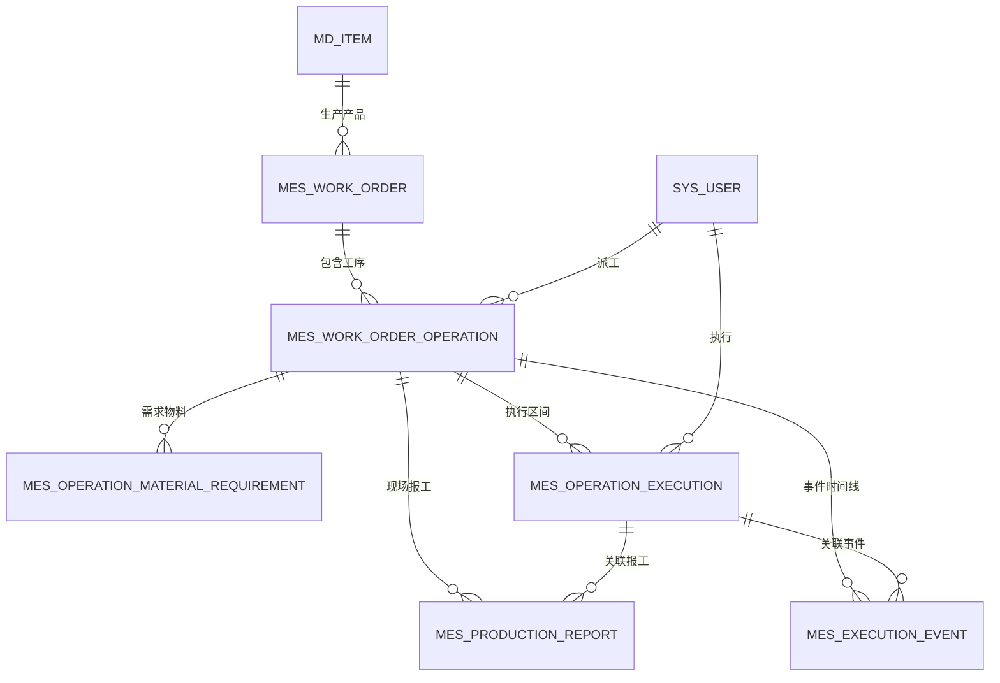
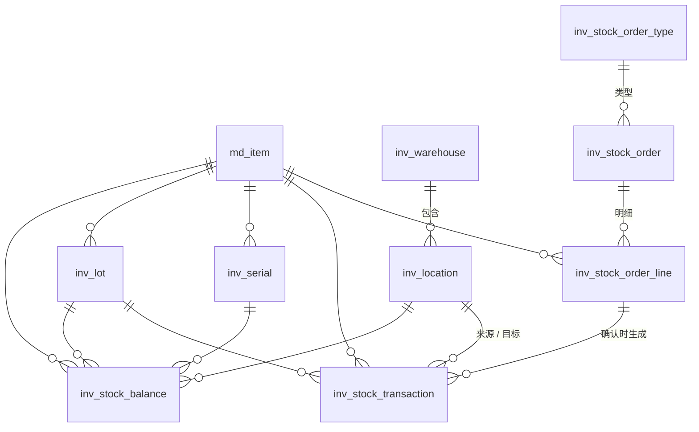

> 本文描述领域模型与架构演进。当前功能及操作入口见 [MES 说明](README.md)。
> 本文含历史部署组合、旧迁移路径及规划内容，不是当前开通步骤。当前使用 deployment.json 显式选择插件、core 独立分支和租户启用；当前字段/状态以 [实现映射](database-design.md) 和 [文档入口](README.md) 为准。原混合表目录、数据字典的引用现指向 MES 实现映射，不沿用旧章节编号。

# MES 领域数据模型

| 项目 | 内容 |
|---|---|
| 文档版本 | v0.4（补充 Work Order 与订单需求行的分配目标表） |
| 状态 | 草稿；MES P0 执行分支已落地，其他领域按分期实施 |
| 日期 | 2026-10-12 |
| 适用范围 | 制造执行（MES）产品；教育物资管理可参考统一库存模型 |
| 业务 schema | 当前租户的业务 schema `t_<tenant_no>`，例如 `t_mes1`；MES 不写死 schema 名称 |
| 遵循规范 | [数据库命名与建模规范](../../core/docs/foundation-platform/database-naming-convention.md) |

---

> 业务模型以[数据库与实现说明](database-design.md)及实际代码为准，下文包含早期设计和规划。

## 1. 通用约定

- 每个租户一个 schema，业务表不含 `tenant_id`；所有表都有标准字段：`id`（UUID）、`created_at`、`created_by`、`updated_at`、`updated_by`；除日志表外都有 `flex_form`（库存流水属于事务性流水，包含 `flex_form`）；业务数据表都有 `org_id`（工厂或仓储组织），引用 `sys_org`（管理底座表，与 MES 表在同一租户 schema）。下文的字段清单**不再重复列出标准字段**。
- `_code` 只给字典值用，实体自己的业务编码一律用 `_no`；所有 `_code` 字段的注释都写明字典编码。
- 启停统一使用 `is_active`；状态机使用 `status_code` 并引用字典。
- 每张表、每个字段都有中文注释；`_code` 字段在注释中写明字典编码。
- 业务唯一键在租户 schema 内定义，不含 `tenant_id`；需要在工厂或仓储组织内唯一的加 `org_id`。

### 1.1 当前已落地的 MES 自有表

截至 2026-10-11，`mes` 能力包已经有 **6 张 MES 自有表**。表定义位于
`backend/app/modules/mes/models.py`，租户迁移位于
`backend/alembic/versions/mes/0001_mes_core.py`；启用 `mes` 部署组合时创建，`edu`
部署组合不会创建这些表。

| 表名 | 中文名称 | 一行代表什么 | 当前状态 |
|---|---|---|---|
| `mes_work_order` | 生产工单 | 一张离散制造生产订单及释放时的产品快照 | 已实现：创建、查询、详情 |
| `mes_work_order_operation` | 工单工序任务 | 一张工单的一道可执行工序 | 已实现：查询、详情、派工、执行状态流转 |
| `mes_operation_material_requirement` | 工序物料需求 | 一道工序所需的一种物料及计划/累计消耗 | 已建表和详情读取；库存消耗联动待建设 |
| `mes_operation_execution` | 工序执行区间 | 一次 Track-in 到 Track-out 的执行区间 | 已实现：Track-in、Hold、Release、Track-out |
| `mes_production_report` | 现场生产报工 | 一次不可覆盖的数量、工时和异常报工事实 | 已实现：手机端/管理端 API、幂等和附件绑定 |
| `mes_execution_event` | 执行事件 | 一次任务状态变化或现场动作的追加事件 | 已实现：创建、派工、执行、暂停、报工、结束事件 |

这些表均位于当前租户 schema，不包含 `tenant_id`；业务组织通过 `org_id` 隔离。除
`mes_operation_execution`、`mes_production_report`、`mes_execution_event` 的追加事实特征
外，普通表使用标准审计字段、软删除字段和 `flex_form`，具体例外以迁移和 ORM 模型为准。

### 1.2 当前 MES 表的关键字段

下表只列出 MES 当前已实现模型的业务字段；`id`、创建/修改审计字段、软删除字段和
`flex_form` 等通用字段按[数据库命名与建模规范](../../core/docs/foundation-platform/database-naming-convention.md)执行。

| 表名 | 关键字段与职责 |
|---|---|
| `mes_work_order` | `org_id`；`work_order_no`；`product_item_id` 及 `product_item_no_snapshot` / `product_item_name_snapshot`；`unit_code`；计划、合格、报废、返工数量；`priority_code`、`status_code`、`due_at`；释放/关闭时间及动作人；`version_no` 乐观锁 |
| `mes_work_order_operation` | `work_order_id`；`operation_no`、名称/说明快照、`sequence_no`；工作中心/工作站名称快照；`assigned_production_person_id`（手动指定生产人员）、`assigned_user_id`（原派工账号）；计划和累计产出数量；`status_code`、`priority_code`；技能要求快照；`quality_required`、`predecessor_ready`；`due_at`、`version_no` |
| `mes_operation_material_requirement` | `operation_id`、`item_id`；物料编号/名称快照；`required_quantity`、`consumed_quantity`；`unit_code`；`lot_controlled`、`serial_controlled` |
| `mes_operation_execution` | `operation_id`；`worker_user_id` 及人员快照；工作站快照；`status_code`；`tracked_in_at`、`held_at`、`tracked_out_at`；累计人工/机器工时 |
| `mes_production_report` | `operation_id`、`execution_id`；本次合格/报废/返工数量；人工/机器工时；异常类型和说明；`idempotency_key`；来源和处理状态；`reported_at`；提交人 |
| `mes_execution_event` | `operation_id`、`execution_id`；`event_type_code`；变更前/后状态；说明；动作人及姓名快照；追加时间 |

当前模型中的 `_code` 字段及其字典包括 `mes_priority`、`mes_work_order_status`、
`mes_operation_task_status`、`mes_execution_status`、`mes_execution_event_type`、
`mes_exception_type`、`mes_report_source` 和 `mes_report_status`。

### 1.3 当前表关系



关系说明：

- `mes_work_order` 的产品引用 L2 物料主数据 `md_item`，并保存释放时产品编号、名称和单位快照；
- 工序任务是执行主对象，执行区间、报工和事件都通过 `operation_id` 回到任务；
- 报工和执行事件可以进一步关联具体执行区间，但事件允许系统动作而没有动作人；
- 当前工作中心、工作站、技能仍以任务快照或 JSONB 快照保存，尚未建立独立 MES 资源表；
- 当前表不直接拥有用户、组织、文件和库存的生命周期。

### 1.4 MES 复用但不拥有的表

MES 只保存制造事实和必要快照，以下对象由其他能力包维护：

| 所属层 | 复用表/能力 | MES 用途 | 写入边界 |
|---|---|---|---|
| L1 | `sys_org` | 生产组织和数据范围 | 通过组织/范围服务读取，不由 MES 建表 |
| L1 | `sys_user` | 派工人员、执行人员、动作人 | 通过认证与用户公开能力读取 |
| L1 | `file_attachment` | 报工照片、工艺文件和其他附件 | 通过文件 Service 上传/绑定 |
| L2 主数据 | `md_item`、`md_item_category` | 产品物料、工序需求物料 | 通过物料公开能力读取；MES 保存快照 |
| L2 `inv` | `inv_warehouse`、`inv_location`、`inv_lot` | 生产领料、退料和成品入库的库存侧对象 | MES 通过库存公开 Service，不直接写余额/流水 |
| L2 `inv` | `inv_stock_balance`、`inv_stock_transaction` | 可用量和库存记账结果 | 库存模块拥有生命周期 |
| L2 `inv` | `inv_stock_order_type`、`inv_stock_order`、`inv_stock_order_line` | 生产领料、退料、完工入库、报废单据 | 由库存模块创建和确认 |

当前代码的库存模型已包含 `inv_lot`，尚未包含独立的 `inv_serial` ORM 表；序列号追溯属于后续库存/MES 追溯阶段，不能在当前实现状态中写成已建表。

### 1.5 目标模型中尚未建表的 MES 对象

下列表仍是目标设计，当前没有对应的 MES ORM 模型或 `mes` 迁移，不应被前端或接口当作
已实现能力：

| 领域 | 规划表 |
|---|---|
| 产品与工艺版本 | `mes_manufacturing_item`、`mes_bom`、`mes_bom_version`、`mes_bom_line`、`mes_routing`、`mes_routing_version`、`mes_routing_operation`、`mes_operation_dependency` |
| 资源与技能 | `mes_work_center`、`mes_workstation`、`mes_skill`、`mes_workstation_skill`、`mes_worker_skill`、`mes_calendar`、`mes_calendar_shift`、`mes_calendar_exception` |
| 订单扩展与执行 | `mes_work_order_dependency`、`mes_dispatch`、`mes_exception` |
| 订单需求分配 | `mes_work_order_allocation` |
| 质量与返工 | `mes_quality_plan`、`mes_quality_plan_version`、`mes_quality_item`、`mes_quality_inspection`、`mes_quality_measurement`、`mes_quality_nonconformance`、`mes_quality_disposition`、`mes_quality_rework`、`mes_quality_spc_rule`、`mes_quality_spc_measurement` |
| 批次、序列号与谱系 | `mes_trace_unit`、`mes_material_consumption`、`mes_output_record`、`mes_genealogy_link` |
| 设备集成 | `mes_equipment`、`mes_equipment_endpoint`、`mes_equipment_tag`、`mes_equipment_binding`、`mes_equipment_event` |
| 排程 | `mes_schedule_plan`、`mes_schedule_operation`、`mes_capacity_reservation` |

这些规划表的字段和约束仍以 [MES 设计](mes-design.md) 的目标模型为基础，正式落地时需要
同步新增 ORM、租户迁移、目录权限、Repository/Service/API、管理端页面和数据字典；在此之前
页面只能展示“规划中”，不能用 mock 数据伪装真实查询。

### 1.6 Work Order 与订单需求分配 `mes_work_order_allocation`

该表用于表达生产工单与订单需求行之间的数量分配关系，解决多个销售订单购买同一产品时
合并生产的问题。一条 Work Order 可以分配给多条订单需求行，一条订单需求行也可以拆分到
多个 Work Order，因此它不是在 `mes_work_order` 上直接增加一个销售订单字段。

`order_id` 的粒度必须是销售订单明细行或统一生产需求行，而不是销售订单头。当前仓储尚未
落地销售订单能力包时，`order_id` 先作为由订单/需求来源适配器提供的稳定需求行 UUID，
并在语义模型中登记来源、类型和访问契约；不得伪造指向不存在销售订单表的外键。

| 字段 | 含义与约束 |
|---|---|
| `work_order_id` | Work Order 内部主键；外键引用 `mes_work_order.id`，必须与当前租户和组织数据范围一致 |
| `order_id` | 订单需求行内部标识；优先引用销售订单明细或统一生产需求明细，不能只引用销售订单头 |
| `allocated_quantity` | 分配给该订单需求行的计划数量；`numeric(18,3)`，非负，单位沿用 `mes_work_order.unit_code`，跨单位时先完成单位换算 |
| `fulfilled_quantity` | 已被该 Work Order 产出、库存分配或发运确认履约的数量；不是 Work Order 的总合格数量 |
| `scrapped_quantity` | 已分配给该订单需求行但最终报废的数量；不是 Work Order 的总报废数量 |
| `allocation_type_code` | 分配类型；字典 `mes_allocation_type`，至少支持 `soft`（计划/软分配）和 `hard`（硬分配） |
| `status_code` | 分配状态；字典 `mes_work_order_allocation_status`，至少支持 `planned`、`allocated`、`partially_fulfilled`、`fulfilled`、`cancelled` |

表还包含标准 `id`、`org_id`、创建/修改审计字段、软删除字段和 `flex_form`。非删除数据对
`(work_order_id, order_id)` 建唯一约束；如一个订单需求行需要多种分配策略，必须先明确业务
语义后再扩展唯一键，不能无条件允许重复关系。

关键约束如下：

- 同一 Work Order 的分配数量合计不得超过该工单允许分配的数量；超分配必须由明确的计划策略授权。
- 默认要求 `fulfilled_quantity + scrapped_quantity <= allocated_quantity`；修正不能直接覆盖原事实，需通过受控调整或更正记录保留审计轨迹。
- `soft` 分配表示计划、承诺或库存预留，允许后续重新分配；`hard` 分配表示已绑定到批次、序列号、Material Tracking Unit 或其他可追溯产出。
- `fulfilled_quantity` 只有在产出、库存分配或发运确认成功后才能增加；工单报工或工单完工本身不等于订单履约。
- `scrapped_quantity` 必须能够关联报废报工、质量处置或其他报废事实；不能由界面直接修改为任意值。

例如销售订单 `SO1001` 需求 10 件、`SO1002` 需求 15 件、`SO1003` 需求 5 件，
可以合并到产品相同、计划生产 30 件的 `WO20261001`，由三行
`mes_work_order_allocation` 分别记录 10、15、5 件。订单行的区分由 `order_id` 完成，
而不是依赖 Work Order 的产品或数量字段。

---

## 2. 统一库存模型

### 2.1 原则

生产中的原料、半成品、成品、包装材料、废品和待检品，**使用同一套库存余额表和库存流水表**。不要按库存类别分别建表（如 `inv_raw_material_stock`、`inv_finished_goods_stock`）。

库存类别通过以下维度区分：

| 维度 | 字段 | 说明 |
|---|---|---|
| 物料类型 | `md_item.item_type_code` | `raw_material`、`semi_finished`、`finished_good`、`packaging` 等 |
| 仓库 | `warehouse_id` → `inv_warehouse.id` | 通过仓库名称识别存放地点；不按仓库类型推断物料类别 |
| 实际库位 | `location_id` | 具体仓库、货架、库区或库位 |
| 库存状态 | `stock_status_code` | `available`、`quarantine`、`blocked`、`defective` 等 |
| 批次 | `lot_id` | 原料和成品的批次追溯 |
| 序列号 | `serial_id` | 需要单件追踪的成品或设备 |
| 库存所有者 | `owner_party_id` | 自有库存、寄售库存或客户库存 |

### 2.2 核心表

| 表 | 中文 | 分类 | 粒度 |
|---|---|---|---|
| `md_item` | 物料主数据 | 维度 | 一种物料 |
| `inv_warehouse` | 仓库 | 维度 | 一个仓库 |
| `inv_location` | 库位 | 维度 | 一个库位 |
| `inv_lot` | 批次 | 普通实体 | 一个批次 |
| `inv_serial` | 序列号 | 普通实体 | 一个单件 |
| `inv_stock_balance` | 统一库存余额 | 事实（快照性质） | 一个库存维度组合的当前余额 |
| `inv_stock_transaction` | 统一库存流水 | 事实 | 一次库存变化 |
| `inv_stock_order_type` | 库存单据类型（配置） | 维度 | 一种库存单据类型 |
| `inv_stock_order` | 库存单据 | 事实 | 一张库存单据（入库、出库、调拨、借出、归还、报损、盘点调整等） |
| `inv_stock_order_line` | 库存单据明细 | 事实 | 单据中的一个物料行 |

### 2.3 关系



---

## 3. 物料主数据

`md_item` 保存物料的基本属性，原料和成品属于同一张物料主数据表。

| 字段 | 含义 |
|---|---|
| `item_no` | 物料编号（租户内唯一） |
| `item_name` | 物料名称 |
| `item_type_code` | 物料类型；字典 `md_item_type`：`raw_material` / `semi_finished` / `finished_good` / `packaging` |
| `unit_code` | 基本计量单位；字典 `md_unit` |
| `is_lot_controlled` | 是否批次管理 |
| `is_serial_controlled` | 是否序列号管理 |
| `shelf_life_days` | 保质期（天） |
| `is_active` | 启停 |

`item_type_code` 表示物料属性，不表示当前库存所在位置。物料的库存位置和状态由库存表决定。

---

## 4. 仓库与库位

### 4.1 仓库 `inv_warehouse`

| 字段 | 含义 |
|---|---|
| `warehouse_no` | 仓库编号（租户内唯一） |
| `warehouse_name` | 仓库名称 |
| `location` | 仓库位置；可选文本，最长 255 字符，填写楼栋、楼层或房间等说明 |
| `org_id` | 所属工厂或组织（标准字段） |
| `is_active` | 启停 |

### 4.2 库位 `inv_location`

| 字段 | 含义 |
|---|---|
| `warehouse_id` | 所属仓库 |
| `location_no` | 库位编号（仓库内唯一） |
| `location_name` | 库位名称 |
| `location_type_code` | 库位类型；字典 `inv_location_type`：`storage` / `staging` / `inspection` / `production_line` |
| `is_active` | 启停 |

原料仓和成品仓是同一张 `inv_warehouse` 表中的不同记录，例如：

| 仓库编号 | 仓库名称 |
|---|---|
| RM01 | 原料仓库 |
| FG01 | 成品仓库 |
| QI01 | 待检仓库 |
| WIP01 | 在制品仓库 |

2026-11-04 更新：共享库存取消 `warehouse_type_code`，仓库名称与位置仅供识别，不作为业务分类判断条件。库存仍通过仓库 ID 关联，食材由物料分类及食材身份确定。本文其他库位、序列号等为 MES 规划，不表示当前共享库存已实现。当前仓库编辑及升级说明见仓库主设计目录中的 `docs/database-workflow.md`。

---

## 5. 统一库存余额

`inv_stock_balance` 表示某一物料在某一库位、批次、序列号和库存状态下的当前余额。

| 字段 | 含义 |
|---|---|
| `item_id` | 物料 |
| `location_id` | 库位 |
| `lot_id` | 批次（可空） |
| `serial_id` | 序列号（可空） |
| `stock_status_code` | 库存状态；字典 `inv_stock_status` |
| `owner_party_id` | 库存所有者（可空，空表示自有） |
| `quantity` | 账面数量 |
| `reserved_quantity` | 已预留数量 |
| `version_no` | 乐观锁版本号 |

规则：

- **逻辑唯一维度**：`item_id + location_id + lot_id + serial_id + stock_status_code + owner_party_id`。
- 批次、序列号、所有者可空，唯一约束使用 PostgreSQL 15 及以上支持的 `UNIQUE NULLS NOT DISTINCT`，使空值也参与唯一判断；PostgreSQL 18 可直接使用。
- `available_quantity` 由 `quantity - reserved_quantity` 计算得出；只有在明确的性能需求下才持久化，并定义更新规则。
- 余额只能由库存流水驱动更新，不允许直接修改；并发更新使用 `version_no` 乐观锁。

---

## 6. 统一库存流水

`inv_stock_transaction` 记录所有库存变化，包括采购入库、生产领料、完工入库、库存调拨、销售出库、盘点调整和报废。**流水只由库存单据确认时生成**（§7），不允许其他入口直接写入。

| 字段 | 含义 |
|---|---|
| `transaction_no` | 流水号（租户内唯一） |
| `transaction_type_code` | 流水方向；字典 `inv_transaction_type`：入库、出库、移位、状态转换、调整（与单据类型的方向一致；具体业务类型见单据） |
| `item_id` | 物料 |
| `from_location_id` | 来源库位（入库为空） |
| `to_location_id` | 目标库位（出库为空） |
| `lot_id` | 批次 |
| `serial_id` | 序列号 |
| `from_stock_status_code` | 来源库存状态（状态转换时使用） |
| `to_stock_status_code` | 目标库存状态 |
| `quantity` | 数量（正数） |
| `stock_order_id` | 生成本流水的库存单据（外键） |
| `stock_order_line_id` | 生成本流水的单据明细（外键） |
| `occurred_at` | 业务发生时间 |

流水表只追加，不需要 `updated_at`、`updated_by`、`deleted_at`，但保留 `flex_form`。

规则：

- 库存流水只追加，不修改历史流水；更正通过新的冲销流水完成。
- 调拨同时填写 `from_location_id` 和 `to_location_id`；入库只填目标，出库只填来源。
- 盘点、报废和状态转换必须使用明确的 `transaction_type_code`。
- 流水通过 `stock_order_line_id` 外键追溯到单据明细，不再使用多态的来源引用；单据的上游业务来源记录在单据上（§7.7）。
- 库存余额是当前状态，库存流水是可追溯的事实记录；余额必须能由流水重新计算得出。
- MES 的生产领料、退料、完工入库和不良品转移统一写入库存流水。

---

## 7. 库存单据

### 7.1 原则

**所有改变库存的动作，都使用同一张库存单据表，按“单据类型”区分。** 这是主流 ERP 的通行做法：

| 系统 | 做法 |
|---|---|
| SAP | 物料凭证（S/4HANA 为一张表）记录收货、发货、调拨、报废等全部移动，用“移动类型”区分 |
| Odoo | 调拨单 `stock.picking` + 移动明细 `stock.move`，用“作业类型”区分收货、发货、内部调拨 |
| Oracle EBS | 物料事务，用“事务类型”区分 |

规则：

1. 入库、出库、调拨、借出、归还、报损、盘点调整、生产领料、完工入库等**都是库存单据的类型**，不各自建表。
2. `inv_stock_order_type` 保留类型标识及历史单据关联；当前内置业务的方向、库存状态、审批和必填项由代码固定。新增业务需由所属模块实现，不再通过用户新增类型配置。
3. 有独立审批和生命周期的业务申请（采购订单、领用申请、借用申请、生产工单）是**上游业务单据**，单独建表；审批通过后生成库存单据（§7.7）。
4. 库存单据**确认**时调用统一记账服务，生成库存流水并更新余额（§7.6）；这是改变库存的唯一途径。

### 7.2 结构

```
上游业务单据（按需建，有各自的审批与生命周期）
  采购订单 pur_order · 领用申请 inv_requisition · 借用申请 inv_lend_request · 生产工单 mes_work_order
            │ 审批通过后生成
            ▼
库存单据  inv_stock_order + inv_stock_order_line
  类型配置 inv_stock_order_type：入库 · 出库 · 调拨 · 借出 · 归还 · 报损 · 盘点调整 · 生产领料 · 完工入库 …
            │ 确认
            ▼
统一记账服务 ──► inv_stock_transaction（流水）──► inv_stock_balance（余额）
```

### 7.3 库存单据类型 `inv_stock_order_type`

单据类型以 `id` 被单据引用，自身编号用 `_no`。开通时补齐内置类型，运行时按稳定类型编号使用代码规则；保留旧配置字段与历史记录，不再提供租户配置入口。

> 当前实现：`inventory/stock_order/rules.py` 固定内置业务的处理方式、必填项和审批要求。规则管理界面与写接口已移除；所有扣减及冲销禁止负库存。下表保留历史字段定义，有效规则及兼容步骤见[数据库维护](../../core/docs/database-workflow.md)。

| 字段 | 含义 |
|---|---|
| `type_no` | 类型编号（租户内唯一） |
| `type_name` | 类型名称，如“采购入库”“领用出库” |
| `direction_code` | 方向；字典 `inv_stock_direction`：`in` 入库、`out` 出库、`move` 移位、`status` 状态转换、`adjust` 调整 |
| `default_from_status_code` | 默认来源库存状态；字典 `inv_stock_status` |
| `default_to_status_code` | 默认目标库存状态；字典 `inv_stock_status` |
| `is_approval_required` | 是否需要审批 |
| `wf_definition_id` | 审批流程定义（需要审批时） |
| `required_field_config` | 必填字段配置（JSONB，如出库要求领用部门、领用人、用途） |
| `is_negative_allowed` | 是否允许确认后出现负库存（默认否） |
| `is_builtin` | 是否内置（内置类型不可删除，只能停用） |
| `is_active` | 启停 |
| `sort_no` | 排序 |

### 7.4 内置单据类型

| 类型 | 方向 | 库存状态变化 | 常用字段 | 审批 |
|---|---|---|---|---|
| 采购入库 | `in` | → 可用（需检验时 → 待检） | 往来方（供应商）、上游采购订单、批次、单价 | 验收确认 |
| 其他入库（捐赠、退还） | `in` | → 可用 | 往来方、原因 | 按需 |
| 领用出库 | `out` | 可用 → | 领用部门、领用人、用途、上游领用申请 | 按金额或数量 |
| 其他出库 | `out` | 可用 → | 原因 | 按需 |
| 调拨 | `move` | 不变 | 来源库位、目标库位（可跨校区） | 跨校区时需要 |
| 借出 | `status` | 可用 → 借出 | 借用人、预计归还日期、上游借用申请 | 按需 |
| 归还 | `status` | 借出 → 可用 | 对应的借出单（明细级引用） | 无 |
| 报损 | `out` | 可用 → | 原因、处理方式 | 需要 |
| 盘点调整 | `adjust` | 增或减 | 盘点批次、账面数、实盘数 | 需要 |
| 质检放行 | `status` | 待检 → 可用 / 不合格 | 检验单 | 无 |
| 生产领料、退料 | `out` / `in` | 可用 → / → 可用 | 生产工单 | 按需 |
| 完工入库 | `in` | → 待检或可用 | 生产工单、成品批次 | 无 |

### 7.5 库存单据 `inv_stock_order` 与明细 `inv_stock_order_line`

**单据主表**

| 字段 | 含义 |
|---|---|
| `order_no` | 单号（租户内唯一，按类型的编码规则生成） |
| `order_type_id` | 单据类型（外键 `inv_stock_order_type`） |
| `status_code` | 单据状态；字典 `inv_stock_order_status` |
| `business_date` | 业务日期 |
| `from_location_id` | 默认来源库位（出库、调拨） |
| `to_location_id` | 默认目标库位（入库、调拨） |
| `counterparty_party_id` | 往来方：供应商、领用人、借用人（引用主体） |
| `department_id` | 领用部门 |
| `purpose` | 用途 |
| `reason` | 原因（报损、其他出入库） |
| `handling_method_code` | 处理方式；字典 `inv_handling_method`（报损） |
| `expected_return_date` | 预计归还日期（借出） |
| `source_doc_type_code` | 上游业务单据类型；字典 `inv_source_doc_type`（采购订单、领用申请、借用申请、生产工单） |
| `source_doc_id` | 上游业务单据 ID（多态引用，注释列出可能的类型） |
| `reversal_of_order_id` | 冲销的原单据（冲销单使用） |
| `total_amount` / `currency_code` | 金额合计 / 币种 |
| `wf_instance_id` | 审批实例 |
| `confirmed_at` / `confirmed_by` | 确认（记账）时间 / 确认人 |
| `voided_at` / `voided_by` / `void_reason` | 作废信息 |
| `remark` | 备注 |

少数类型专用的字段（领用部门、用途、预计归还日期、报损原因等）作为主表的可空列，是否必填由类型的 `required_field_config` 决定；只作记录、不参与查询的信息放 `flex_form`。

**单据明细**

| 字段 | 含义 |
|---|---|
| `stock_order_id` | 所属单据 |
| `line_no` | 行号 |
| `item_id` | 物料 |
| `lot_id` / `serial_id` | 批次 / 序列号 |
| `from_location_id` / `to_location_id` | 来源 / 目标库位（为空时取主表默认值） |
| `from_stock_status_code` / `to_stock_status_code` | 来源 / 目标库存状态（为空时取类型默认值） |
| `quantity` | 数量（正数） |
| `unit_code` | 单位；字典 `md_unit` |
| `unit_price` / `amount` | 单价 / 金额 |
| `source_line_id` | 关联明细：归还行引用借出行、冲销行引用原行 |
| `counted_quantity` | 实盘数量（盘点调整） |
| `remark` | 备注 |

### 7.6 状态与记账

```
草稿 ──提交──► 待审批 ──通过──► 已审批 ──确认──► 已确认（已记账）
  │              │驳回                          │
  └──作废        └──► 草稿                       └──冲销：新建冲销单（反向记账）
```

| 规则 | 说明 |
|---|---|
| 不需要审批的类型 | 提交后直接进入“已审批” |
| 确认 = 记账 | 统一记账服务在一个事务中：按明细生成流水，更新余额（`version_no` 乐观锁），校验可用库存不足；所有扣减及冲销禁止负库存 |
| 已确认不可修改 | 已确认的单据和明细不可修改、不可删除；更正只能新建冲销单（`reversal_of_order_id`），反向记账 |
| 作废 | 只有未确认的单据可以作废 |
| 删除 | 只有草稿可以删除（软删除） |
| 借出与归还 | 借出单确认后，库存从“可用”转为“借出”；归还单逐行引用借出行（`source_line_id`），已归还数量不得超过借出数量；“借出在外”的数量就是“借出”状态的余额 |
| 盘点 | 盘点调整单按“实盘数 − 账面数”生成增或减的流水，不直接改余额 |

### 7.7 上游业务单据

| 上游单据 | 关系 |
|---|---|
| 采购订单 `pur_order` | 到货验收后生成“采购入库”单；一张采购订单可以分多次入库 |
| 领用申请 `inv_requisition` | 审批通过后生成“领用出库”单；不需要审批的领用可以直接建出库单 |
| 借用申请 `inv_lend_request` | 审批通过后生成“借出”单 |
| 生产工单 `mes_work_order` | 生成“生产领料”“完工入库”单 |

库存单据通过 `source_doc_type_code` + `source_doc_id` 记录上游来源。上游单据只表达业务申请和审批，不直接改库存。

### 7.8 编号、审批与权限

| 项目 | 规则 |
|---|---|
| 编号 | 每种类型配置自己的编码规则（管理底座 6.3），如入库 `RK-2026-0001`、出库 `CK-2026-0001` |
| 审批 | 当前调拨、报损固定要求库存单据审批；其余内置类型不做库存单据二次审批，上游业务审批由所属模块处理。此处未接入多级审批流 |
| 权限 | 按方向和类型授权，如 `inv:order:in:confirm`、`inv:order:out:confirm` |
| 打印 | 每种类型可配置自己的打印模板 |

---

## 8. 原料与成品的差异处理

原料和成品共用库存余额与库存流水，差异通过扩展表和业务规则处理：

| 表 | 中文 | 说明 |
|---|---|---|
| `inv_material_lot` | 原料批次属性 | 供应商批号、有效期、来料检验结果 |
| `inv_product_lot` | 成品批次属性 | 生产批次、生产工单、包装信息 |
| `qa_inspection` | 质量检验 | 检验结果与放行，放行后库存状态由待检转为可用 |
| `mes_work_order` | 生产工单 | |
| 生产领料、退料 | 库存单据类型（§7.4） | 引用生产工单；确认时生成流水 |
| 完工入库 | 库存单据类型（§7.4） | 引用生产工单；确认时生成流水，并建立成品批次 |

不要因为原料仓和成品仓物理位置不同，就拆分库存余额表。只有在数据量、系统边界或合规隔离有明确要求时，才考虑分区或物理拆表。

---

## 9. 语义模型要点

| 项目 | 说明 |
|---|---|
| 实体分类 | 物料、仓库、库位为维度；库存流水为事实；库存余额为快照性质的事实，不可与流水直接相加 |
| 口径 | “库存数量”默认指账面数量 `quantity`；“可用数量”指扣除预留后的数量，且只含 `available` 状态 |
| 时间 | 余额表示当前；历史时点库存需由流水回推，或使用按日快照表 `inv_stock_balance_snapshot` |
| 关系 | 流水的来源和目标库位是同一实体的两次引用，在语义模型中登记为两条命名关系 |

---

## 10. 对教育物资管理的参考

教育产品现有的物资模块按单据类型分为 14 张表（入库、出库、借用、调拨、报损的主表与明细，以及物品、分类、库存变动）。已确认本次合并为本模型：

- 入库、出库、调拨、借出归还、报损共 5 组单据（10 张表）合并为一张库存单据 `inv_stock_order` + `inv_stock_order_line`，用单据类型区分（§7）；
- 库存变化只由库存单据确认时写入 `inv_stock_transaction`，当前库存统一由 `inv_stock_balance` 表示；
- 借出为库存状态变化（可用 → 借出），归还单逐行引用借出单，恢复为可用。

制造仓库配置复用 `inv_warehouse.warehouse_type_code`（`mes_raw/mes_wip/mes_finished`），不新增制造仓库表。成品库存默认按工单隔离、禁止混发；同工单多次入库可按多个独立批次出货。旧总仓保留，历史未分批或共用批次须核对处理，不能按全局 FIFO 替代。

当前档案落地：`mes_customer`、`mes_project_stage`、`mes_process_requirement`、`mes_process`、`mes_process_dependency`、`mes_equipment`；采购价 `inv_supplier_price` 由 inv 拥有。阶段归类不改变工单状态；客户和工艺选用保存外键及快照，前置关系独立建表，不使用 JSON 关联。新范围的字段与验收以主目录 `mes-archives.md` 和实际模型为准。

## 工序检验放行

当前新增 `mes_quality_inspection` 追加事实表，整工序合格放行、退回原工序返工及复检已落地。详细范围与升级见 [主设计说明](database-design.md#工序检验放行)。完整质量体系仍按需开发。
